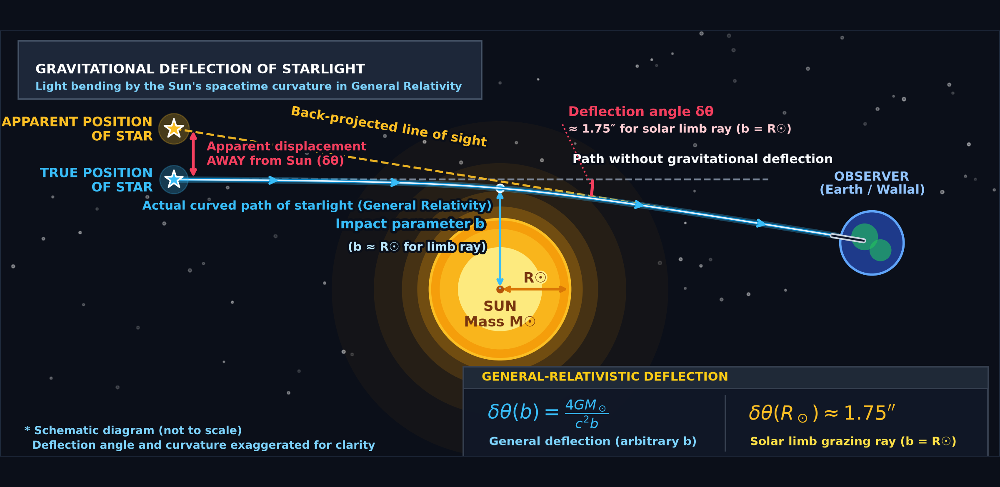
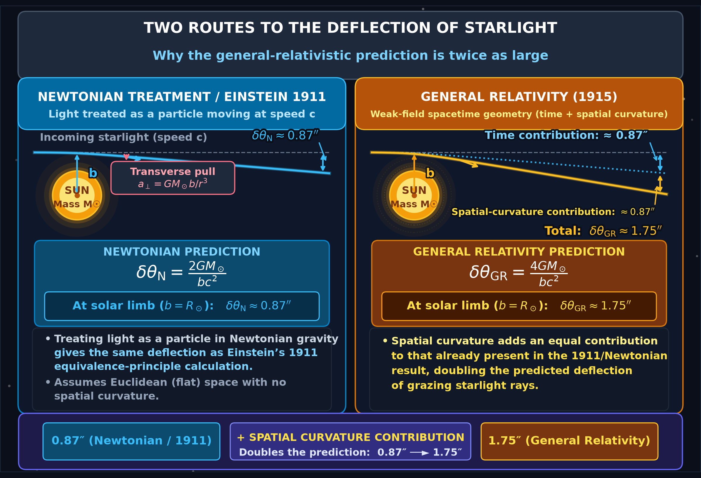
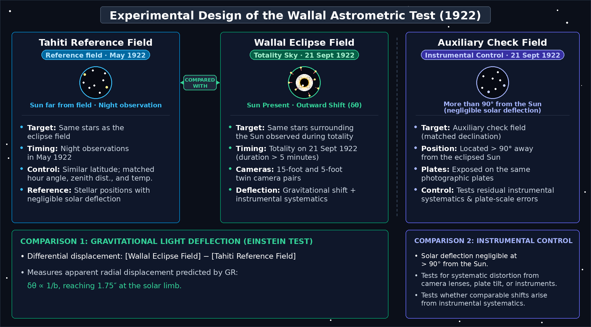
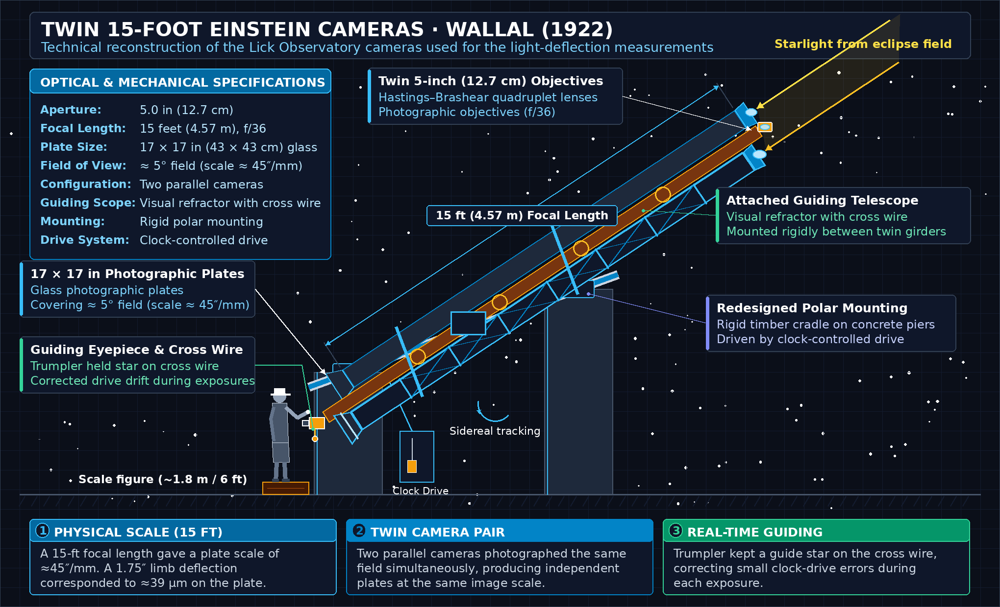
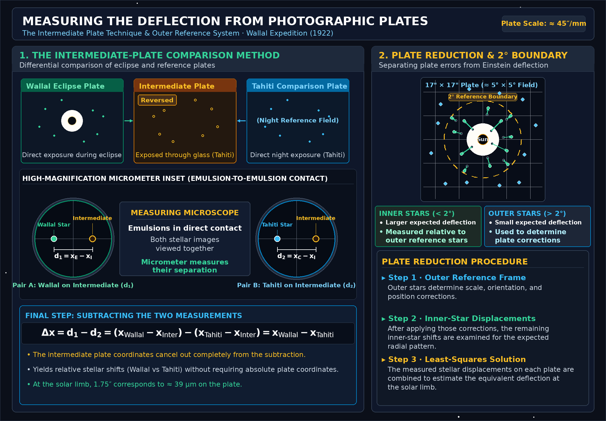
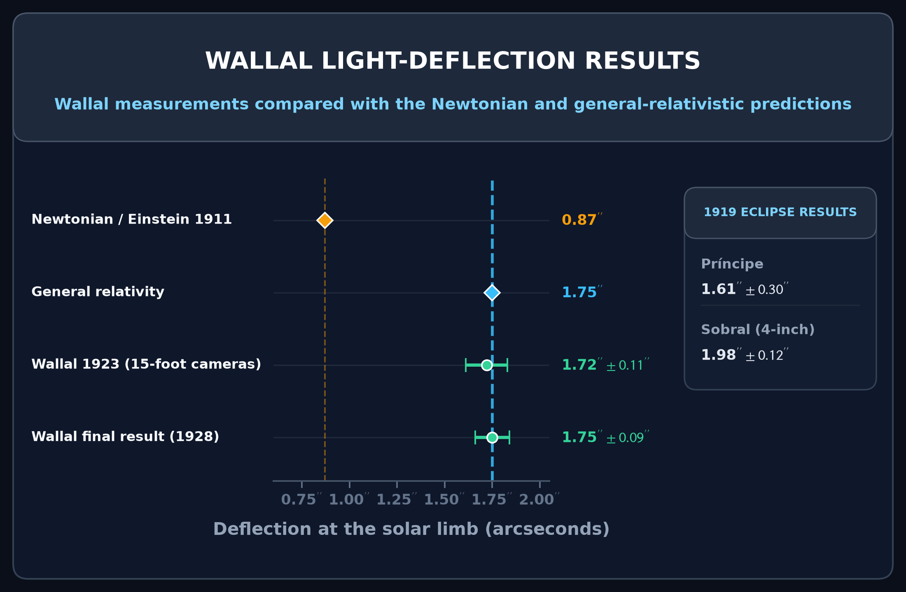

# The 1922 Solar Eclipse: A More Precise Test of General Relativity

This directory contains the standalone Python codebase and visualization suite supporting the technical article on **The 1922 Solar Eclipse: A More Precise Test of General Relativity**.

On 21 September 1922, the Lick Observatory expedition led by **William Wallace Campbell** and **Robert Julius Trumpler** observed a total solar eclipse at Wallal on Eighty Mile Beach in northwestern Western Australia. Using custom-built long-focus and short-focus cameras paired with a rigorous differential plate reduction method, the Wallal expedition provided the first decisively precise empirical confirmation of Einstein’s general-relativistic starlight deflection, resolving the uncertainties that had surrounded the famous 1919 British eclipse expeditions.

---

## 🗺️ Visual Architecture & Scientific Figures

The project provides self-contained, publication-grade scripts generating all 6 core scientific figures from first principles:

### 1. [Gravitational Light Deflection Geometry](code/generate_light_deflection_diagram.py)

* **Mechanics & Relativistic Formulation**: Illustrates a ray of light grazing the solar limb at impact parameter $b$, deflected by the gravitational field of the Sun:
  $$\delta\theta(b) = \frac{4GM_\odot}{c^2 b}, \qquad \delta\theta(R_\odot) \approx 1.751''$$
* **Apparent Displacement**: Because light bends toward the gravitating mass, an observer at Earth extrapolates along the incoming asymptotic trajectory, causing the apparent stellar position to shift radially outward away from the center of the Sun.
* **Script**: `code/generate_light_deflection_diagram.py`

---

### 2. [Two Routes to Light Deflection: Newton vs. Einstein](code/generate_predictions_comparison.py)

* **Theoretical Breakdown**: Contrasts the two distinct routes to gravitational light deflection:
  * **Newtonian / Einstein 1911**: Treating light as a particle moving at speed $c$ in Newtonian gravity (or equivalently applying the equivalence principle with flat space) yields a transverse deflection of $\delta\theta \approx 0.875''$.
  * **General Relativity (1915)**: In the curved spacetime metric $ds^2 = -(1 - 2GM/c^2 r)c^2 dt^2 + (1 + 2GM/c^2 r)dr^2 + r^2 d\Omega^2$, the time component ($g_{00}$) contributes $0.875''$ through gravitational time dilation, while spatial curvature ($g_{rr}$) contributes an equal $0.875''$, doubling the total deflection to $\delta\theta \approx 1.751''$.
* **Physical Significance**: The factor-of-two difference is a direct signature of Einstein's curved spatial geometry.
* **Script**: `code/generate_predictions_comparison.py`

---

### 3. [Wallal Astrometric Experimental Design](code/generate_wallal_experimental_design.py)

* **Experimental Architecture**: The Wallal experiment was designed around a differential comparison between two epochs:
  1. **Nighttime Reference Field (Tahiti, May 1922)**: Trumpler photographed the identical stellar field surrounding the Sun months prior from Tahiti at similar latitude and altitude, strictly matching hour angle, zenith distance, and temperature to minimize differential refraction and thermal plate distortion.
  2. **Eclipse Totality Field (Wallal, September 1922)**: The same stellar field was photographed during the 5-minute total eclipse at Wallal.
  3. **Auxiliary Check Field**: An auxiliary star field $>90^\circ$ away was photographed on the night of the eclipse to test for residual instrumental and emulsion distortions.
* **Script**: `code/generate_wallal_experimental_design.py`

---

### 4. [Twin 15-Foot Einstein Cameras Schematic](code/generate_wallal_cameras_schematic.py)

* **Optical & Mechanical Design**: Elevation schematic of Lick Observatory's twin 15-foot cameras:
  * **Twin 15-Foot Cameras**: Focal length $F = 15\,\text{ft}$ ($4.57\,\text{m}$), 5-inch quadruplet Hastings–Brashear lenses, yielding an astrometric plate scale of $\approx 45''/\text{mm}$ on large $17 \times 17\,\text{inch}$ glass plates.
  * **Twin 5-Foot Cameras**: Shorter focal length ($F = 1.52\,\text{m}$, scale $\approx 135''/\text{mm}$) providing a wider field of view around the eclipsed Sun.
  * **Polar Mounting**: Mounted on a rigid polar axis framework between heavy piers, guided by a central visual refractor with micrometer control to track diurnal motion throughout totality.
* **Script**: `code/generate_wallal_cameras_schematic.py`

---

### 5. [Photographic Plate Differential Reduction Method](code/generate_plate_measurement_schematic.py)

* **The Intermediate-Plate Technique**:
  * An extra reference plate was exposed through the glass side in Tahiti, producing a reversed image.
  * Placed emulsion-to-emulsion in contact with a Wallal eclipse plate or Tahiti comparison plate, corresponding star images were brought within fractions of a millimeter, enabling direct differential micrometer measurement and canceling optical distortion.
* **The $2^\circ$ Reference Boundary**:
  * Stars located beyond $r > 2^\circ$ from the solar center (where expected deflection is negligible, $\delta\theta < 0.22''$) were used to determine plate scale, orientation, and zero-point shifts independently.
  * Displacements of inner stars ($r < 2^\circ$) were then evaluated against the $1/\rho$ hyperbolic deflection law without assuming the relativistic formula in advance.
* **Script**: `code/generate_plate_measurement_schematic.py`

---

### 6. [Wallal Deflection Results & Theoretical Predictions](code/generate_deflection_results.py)

* **Astrometric Results & Significance**:
  * **Campbell & Trumpler (1923)**: 15-foot camera plates yielded a solar-limb deflection of:
    $$\delta\theta = 1.72'' \pm 0.11'' \quad (0.27\sigma \text{ from GR}, >7.7\sigma \text{ from Newtonian})$$
  * **Trumpler Final Combined (1928)**: Combining the 15-foot and 5-foot independent camera series yielded:
    $$\delta\theta = 1.75'' \pm 0.09'' \quad (0.0\sigma \text{ from GR}, >9.7\sigma \text{ from Newtonian})$$
  * **1919 Inset Context**: Outlines the earlier results from Sobral (4-inch: $1.98'' \pm 0.12''$) and Príncipe ($1.61'' \pm 0.30''$), demonstrating how Wallal's rigorous plate control decisively confirmed General Relativity.
* **Script**: `code/generate_deflection_results.py`

---

## 🚀 Setup & Execution

### 1. Prerequisites & Environment

Ensure Python 3.9+ is installed, then install required dependencies:

```bash
pip install -r requirements.txt
```

Dependencies:
* `numpy >= 1.22.0`
* `scipy >= 1.8.0`
* `matplotlib >= 3.5.0`
* `pillow >= 9.0.0`
* `pytest >= 7.0.0`

### 2. Generate All Scientific Figures

To re-render all 6 publication figures (both standard and high-resolution Retina `_2x` versions) in a single pass:

```bash
python3 code/generate_all_figures.py
```

Or run any generator script individually:

```bash
python3 code/generate_light_deflection_diagram.py
python3 code/generate_predictions_comparison.py
python3 code/generate_wallal_experimental_design.py
python3 code/generate_wallal_cameras_schematic.py
python3 code/generate_plate_measurement_schematic.py
python3 code/generate_deflection_results.py
```

All figures are saved to the `images/` directory.

---

## 🧪 Running the Test Suite

A comprehensive test suite validates both the astronomical light deflection physics and figure rendering:

```bash
# Run using Python standard library unittest
python3 -m unittest discover tests -v

# Or run using pytest
pytest tests/ -v
```

The test suite validates:
1. **Gravitational Deflection Formula**: Exact Einstein limb deflection $\delta\theta = 4GM_\odot / (c^2 R_\odot) \approx 1.751''$.
2. **Newtonian Deflection**: Exact corpuscular / 1911 equivalence principle formula $\delta\theta = 2GM_\odot / (c^2 R_\odot) \approx 0.876''$.
3. **GR-to-Newtonian Factor-of-Two Ratio**: Strict invariance of $\delta\theta_{\rm GR} / \delta\theta_{\rm Newton} = 2.0$.
4. **Monotonic Hyperbolic Fall-off**: $\delta\theta(\rho) = \delta\theta_{\rm limb} (R_\odot / \rho)$ decreasing inversely with distance.
5. **Observational Statistical Significance**: Wallal 1923 and 1928 empirical determinations match GR within $<0.5\sigma$ and $0.0\sigma$ while rejecting the Newtonian prediction by $>7.7\sigma$ and $>9.7\sigma$.
6. **Rendering Pipeline**: Isolated generation of all 6 figures in temporary workspaces, confirming PNG magic headers, non-zero file sizes, and exact pixel dimensions (including 680px Medium layout and 2x Retina versions).

---

## 📚 Historical Context & Archival Sources

1. **Einstein, A. (1911)**: *Einfluss der Schwerkraft auf die Ausbreitung des Lichtes*, Annalen der Physik, 35, 898–908.
2. **Einstein, A. (1915)**: *Erklärung der Perihelbewegung des Merkur aus der allgemeinen Relativitätstheorie*, Sitzungsberichte der Preussischen Akademie der Wissenschaften, 831–839.
3. **Einstein, A. (1916)**: *Die Grundlage der allgemeinen Relativitätstheorie*, Annalen der Physik, 49, 769–822.
4. **Dyson, F. W., Eddington, A. S., & Davidson, C. (1920)**: *A Determination of the Deflection of Light by the Sun's Gravitational Field, from Observations Made at the Total Eclipse of May 29, 1919*, Philosophical Transactions of the Royal Society of London A, 220, 291–333.
5. **Campbell, W. W., & Trumpler, R. J. (1923)**: *Observations on the Deflection of Light in the Sun's Gravitational Field Made with the Plates Taken at the Total Solar Eclipse of September 21, 1922*, Lick Observatory Bulletin, 11(346), 41–54.
6. **Campbell, W. W., & Trumpler, R. J. (1928)**: *Observations Made with the Five-Foot Cameras for Testing the Einstein Deflection of Light*, Lick Observatory Bulletin, 13(397), 130–160.
7. **Trumpler, R. J. (1928)**: *Comparison and Discussion of the Results on the Deflection of Light in the Sun's Gravitational Field Obtained with the Fifteen-Foot and Five-Foot Cameras at the Total Solar Eclipse of September 21, 1922*, Publications of the Astronomical Society of the Pacific, 40(235), 130–137.

---

## 📄 License

This project is licensed under the MIT License - see the [LICENSE](../LICENSE) file for details.
