# From a Nearly Uniform Universe to Galaxies and the Cosmic Web

This directory contains the standalone Python codebase, physical models, and scientific visualization suite supporting the technical article on **From a Nearly Uniform Universe to Galaxies and the Cosmic Web: How gravitational instability shaped the universe through radiation, matter, and dark-energy domination**, published in [**The Quantastic Journal**](https://thequantasticjournal.com/).

---

## 🌌 Overview & Physical Architecture

The cosmic microwave background (CMB), released approximately 380,000 years after the Big Bang, reveals a young universe whose temperature varied across the sky by only about one part in $10^5$. Today, matter is organized into a rich hierarchical network of galaxies, galaxy clusters, sheets, filaments, and vast cosmic voids known as the **cosmic web**.

This project reconstructs the mathematical physics, cosmological perturbation theory, and numerical milestones that explain how tiny primordial perturbations evolved into present-day large-scale structure:

1. **From Jeans Instability to Relativistic Cosmological Perturbations**:
   In a static self-gravitating fluid, James Jeans (1902) showed that the competition between thermal pressure and gravitational attraction defines a critical **Jeans wavelength** $\lambda_J = c_s\sqrt{\pi / (G\rho_0)}$. Extending gravitational instability to an expanding Friedmann–Lemaître background $a(t)$ (Friedmann 1922; Lemaître 1927; Lifshitz 1946; Bonnor 1957) replaces exponential growth with power-law growth ($\delta_+ \propto t^{2/3} \propto a$ in an Einstein–de Sitter universe), while superhorizon scales require a gauge-invariant general-relativistic formulation (Bardeen 1980).
2. **Primordial Fluctuations & Inflationary Quantum Seeds**:
   Harrison (1970) and Zel'dovich (1972) independently proposed a scale-invariant primordial curvature power spectrum $\mathcal{P}_{\mathcal{R}}(k) = A_s (k/k_*)^{n_s - 1}$ with $n_s \approx 1$. Cosmic inflation (Starobinsky 1980; Guth 1981) and the quantization of inflationary perturbations (Mukhanov & Chibisov 1981; Hawking 1982; Guth & Pi 1982) explained how subhorizon quantum vacuum fluctuations were stretched beyond the Hubble radius and froze out with a slightly red-tilted spectrum ($n_s \approx 0.965$).
3. **Radiation vs. Matter Domination, Acoustic Oscillations & the Matter Power Spectrum**:
   Modes entering the comoving Hubble radius $(aH)^{-1}$ before matter–radiation equality ($a_{\mathrm{eq}}$) experience opposing fates depending on particle couplings: tightly coupled photons and baryons undergo **acoustic oscillations** driven by radiation pressure ($c_s \approx c/\sqrt{3}$) and photon diffusion (**Silk damping**, Silk 1968; Sakharov 1965/1966; Peebles & Yu 1970; Sunyaev & Zel'dovich 1970), whereas collisionless **cold dark matter (CDM)** grows logarithmically during radiation domination (**Mészáros effect**, Mészáros 1974). After recombination, baryons decouple and fall into the pre-existing CDM gravitational potential wells, imprinting the **matter transfer function** $T(k)$ and **baryon acoustic oscillation (BAO)** wiggles onto the linear matter power spectrum $P_m(k, a) \propto k^{n_s} T^2(k) D^2(a)$ (Eisenstein & Hu 1998; WMAP 2003; SDSS 2005; Planck 2018).
4. **Nonlinear Gravitational Collapse & the Emergence of the Cosmic Web**:
   Once density contrasts reach $\delta \sim 1$, linear perturbation theory breaks down. While idealized spherical overdensities collapse and virialize through violent relaxation (Lynden-Bell 1967; Gunn & Gott 1972; Press & Schechter 1974), realistic initial tidal fields are anisotropic. The **Zel'dovich approximation** (1970) $\mathbf{x}(\mathbf{q}, t) = \mathbf{q} - D(t)\nabla_{\mathbf{q}}\Phi_0(\mathbf{q})$ shows that generic gravitational collapse proceeds sequentially along principal strain axes ($\lambda_1 \ge \lambda_2 \ge \lambda_3$) to form two-dimensional **sheets** ("pancakes"), one-dimensional **filaments**, and compact **halos/nodes** surrounding underdense **voids** (Jõeveer, Einasto & Tago 1978; Davis, Efstathiou, Frenk & White 1985; Bond, Kofman & Pogosyan 1996).
5. **Dark Energy & the Late-Time Suppression of Structure Growth**:
   In a spatially flat $\Lambda\mathrm{CDM}$ cosmology ($\Omega_m + \Omega_\Lambda = 1$), the cosmological constant $\Lambda$ becomes dynamically important at late times ($a \gtrsim 0.6$), driving accelerated cosmic expansion (Riess et al. 1998; Perlmutter et al. 1999) and suppressing the linear growth factor $D(a)$ below the Einstein–de Sitter scaling $D(a) \propto a$ (Heath 1977; Efstathiou, Sutherland & Maddox 1990; Lahav et al. 1991).

---

## 📊 Scientific Figure Gallery

### 1. [From the Cosmic Microwave Background to the Cosmic Web](code/generate_cmb_to_cosmic_web.py)
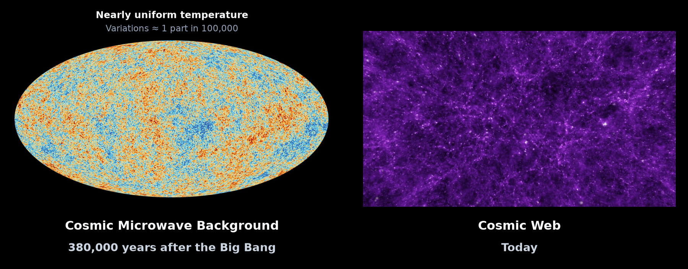
* **Side-by-Side Cosmological Comparison**:
  * **Left (Early Universe, $t \approx 380{,}000\text{ yr}$)**: Planck 2018 temperature anisotropy map showing $\Delta T / T \sim 10^{-5}$ fluctuations.
  * **Right (Present-Day Large-Scale Structure)**: Simulated cosmic web of dark-matter filaments, galaxy clusters, and voids.
* **Script**: `code/generate_cmb_to_cosmic_web.py`

---

### 2. [The Jeans Instability Dispersion Relation](code/generate_jeans_dispersion_relation.py)
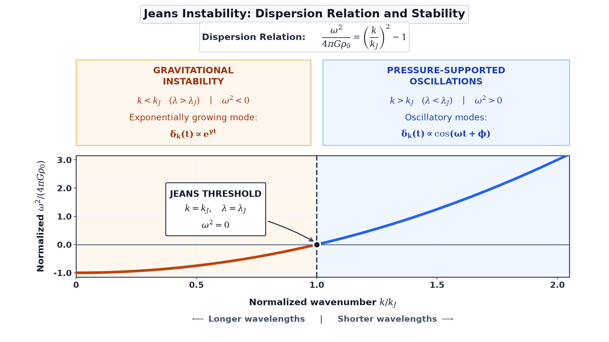
* **Dispersion Relation**: $\omega^2 = c_s^2 k^2 - 4\pi G\rho_0$.
* **Physical Regimes**: Separates gravitationally unstable modes with exponential growth rate $\gamma = \sqrt{-\omega^2}$ at long wavelengths ($k < k_J$) from pressure-supported acoustic oscillations at short wavelengths ($k > k_J$).
* **Script**: `code/generate_jeans_dispersion_relation.py`

---

### 3. [Cosmic Expansion in Physical and Comoving Coordinates](code/generate_cosmic_expansion_coordinates.py)
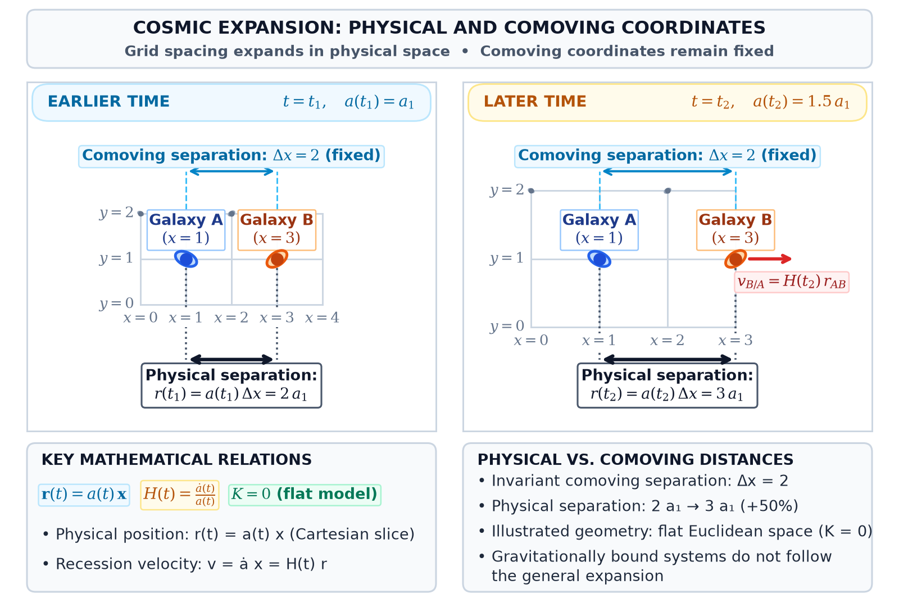
* **Coordinate Kinematics**: Illustrates how two galaxies retain a fixed comoving separation $\Delta x = 2$ on the comoving grid while their physical distance $\mathbf{r}(t) = a(t)\mathbf{x}$ scales in direct proportion to $a(t)$.
* **Script**: `code/generate_cosmic_expansion_coordinates.py`

---

### 4. [Spatial Curvature in Friedmann–Lemaître Cosmological Models](code/generate_spatial_curvature_friedmann.py)
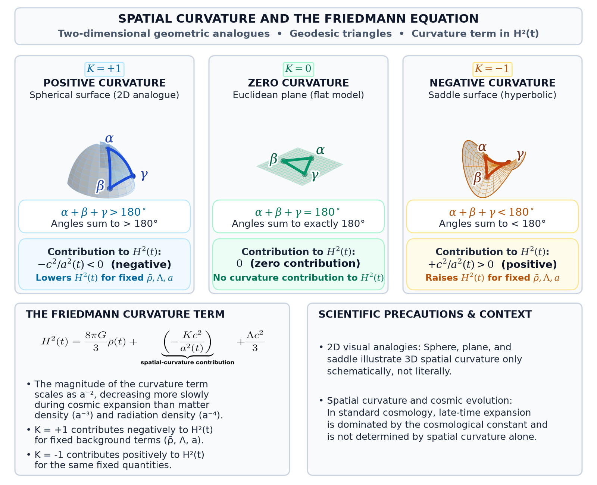
* **Three Constant-Curvature Geometries**:
  * **Positive Curvature ($K = +1$)**: Spherical geometry with triangle angle sum $> 180^\circ$ and curvature contribution $-Kc^2/a^2 < 0$.
  * **Zero Curvature ($K = 0$)**: Spatially flat Euclidean geometry with angle sum $= 180^\circ$.
  * **Negative Curvature ($K = -1$)**: Hyperbolic saddle geometry with angle sum $< 180^\circ$ and $-Kc^2/a^2 > 0$.
* **Script**: `code/generate_spatial_curvature_friedmann.py`

---

### 5. [Particle Horizon, Hubble Radius, and Perturbation Scales](code/generate_horizons_and_perturbation_scales.py)
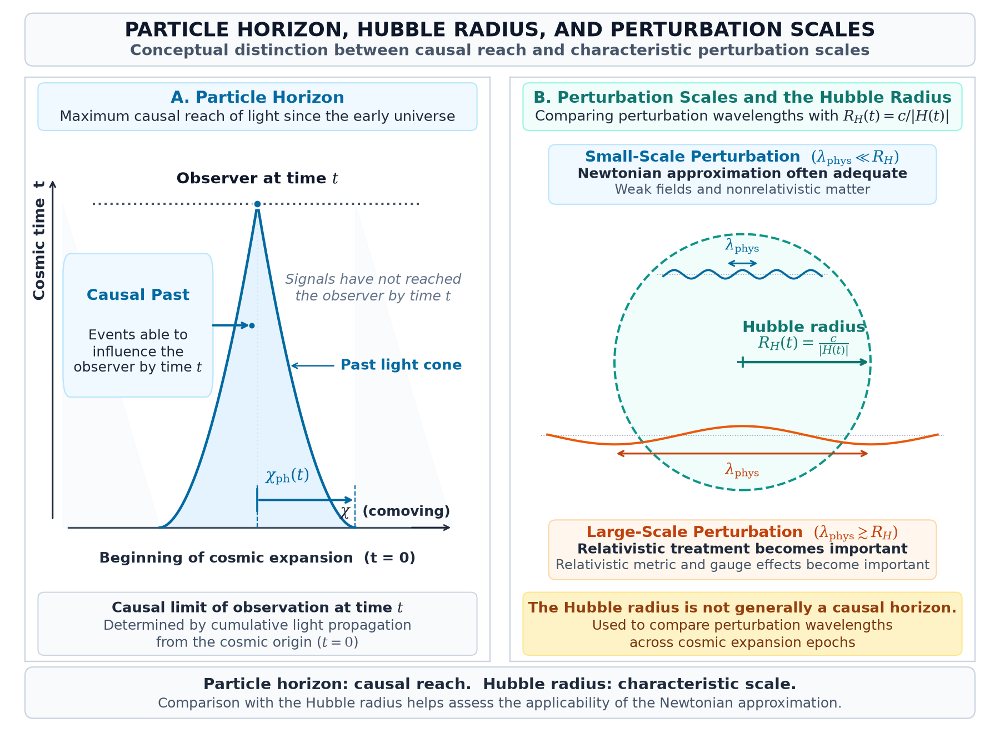
* **Causal Structure vs. Dynamical Scale**: Contrasts the **particle horizon** (bounded by the past light cone since $t = 0$) with the local **Hubble radius** $R_H = c/|H|$, separating subhorizon Newtonian regimes ($\lambda \ll R_H$) from superhorizon relativistic regimes ($\lambda \gtrsim R_H$).
* **Script**: `code/generate_horizons_and_perturbation_scales.py`

---

### 6. [Timeline: From Jeans to Bardeen (1902–1980)](code/generate_cosmological_perturbations_timeline.py)
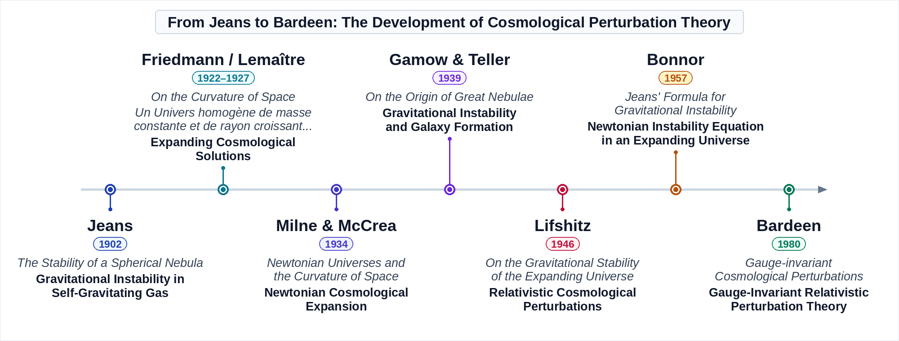
* **Historical Milestones**: Jeans (1902), Friedmann (1922) & Lemaître (1927), Milne & McCrea (1934), Gamow & Teller (1939), Lifshitz (1946), Bonnor (1957), and Bardeen (1980).
* **Script**: `code/generate_cosmological_perturbations_timeline.py`

---

### 7. [From Quantum Fluctuations to Primordial Perturbations](code/generate_quantum_fluctuations_inflation.py)
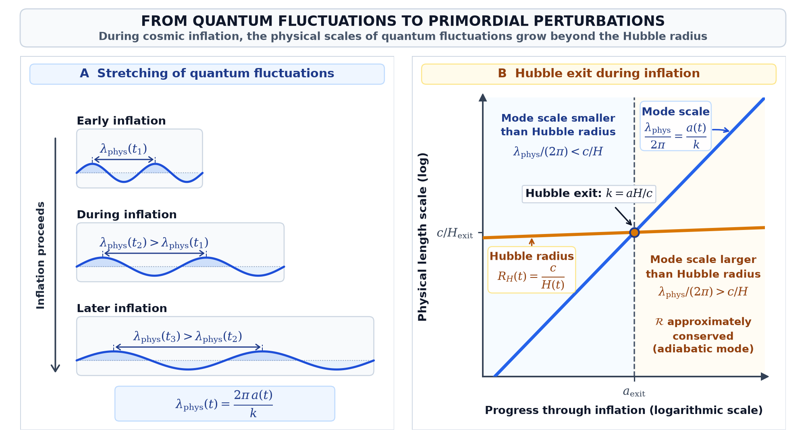
* **Two-Panel Inflationary Mechanism**:
  * **Panel A (Stretching of Quantum Fluctuations)**: Successive snapshots of a scalar-field fluctuation mode whose physical wavelength $\lambda_{\mathrm{phys}}(t) = 2\pi a(t)/k$ is stretched to increasingly large physical scales as cosmic inflation proceeds.
  * **Panel B (Hubble Exit During Inflation)**: Evolution of the characteristic mode scale $\lambda_{\mathrm{phys}}/(2\pi) = a(t)/k$ against the nearly constant Hubble radius $R_H(t) = c/H(t)$, illustrating **Hubble exit** ($k = aH/c$) and the approximate conservation of the comoving curvature perturbation $\mathcal{R}$ for adiabatic modes on scales larger than the Hubble radius.
* **Script**: `code/generate_quantum_fluctuations_inflation.py`

---

### 8. [The Primordial Curvature Power Spectrum](code/generate_primordial_power_spectrum.py)
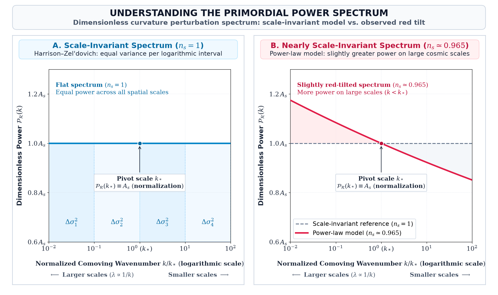
* **Two-Panel Comparison**:
  * **Left**: Exact Harrison–Zel'dovich scale-invariant spectrum ($n_s = 1$), with equal variance per logarithmic interval in wavenumber $k$.
  * **Right**: Red-tilted power-law spectrum inferred from Planck 2018 observations ($n_s \approx 0.965$), normalized at the pivot scale $k_*$.
* **Script**: `code/generate_primordial_power_spectrum.py`

---

### 9. [Timeline: From Harrison & Zel'dovich to Inflationary Perturbations (1970–1982)](code/generate_primordial_fluctuations_timeline.py)
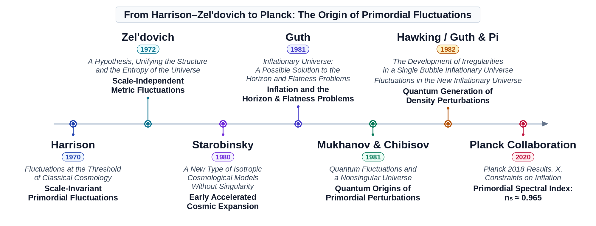
* **Historical Milestones**: Harrison (1970), Zel'dovich (1972), Starobinsky (1980), Guth (1981), Mukhanov & Chibisov (1981), and Hawking / Guth & Pi / Starobinsky (1982).
* **Script**: `code/generate_primordial_fluctuations_timeline.py`

---

### 10. [Comoving Hubble Radius and Horizon Entry of Perturbation Modes](code/generate_horizon_entry.py)
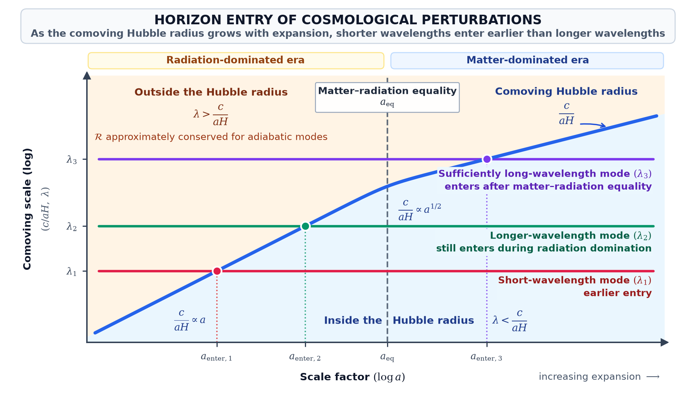
* **Scale-Dependent Horizon Entry**: Shows the evolution of the comoving Hubble radius $(aH)^{-1}$ across radiation domination ($\propto a$) and matter domination ($\propto a^{1/2}$), illustrating how short-wavelength modes ($k_{\mathrm{small}}$) enter during the radiation era while long-wavelength modes ($k_{\mathrm{large}}$) enter during the matter era.
* **Script**: `code/generate_horizon_entry.py`

---

### 11. [Photon–Baryon Acoustic Oscillations, Silk Damping, and the Planck 2018 CMB Spectrum](code/generate_photon_baryon_acoustic_oscillations.py)
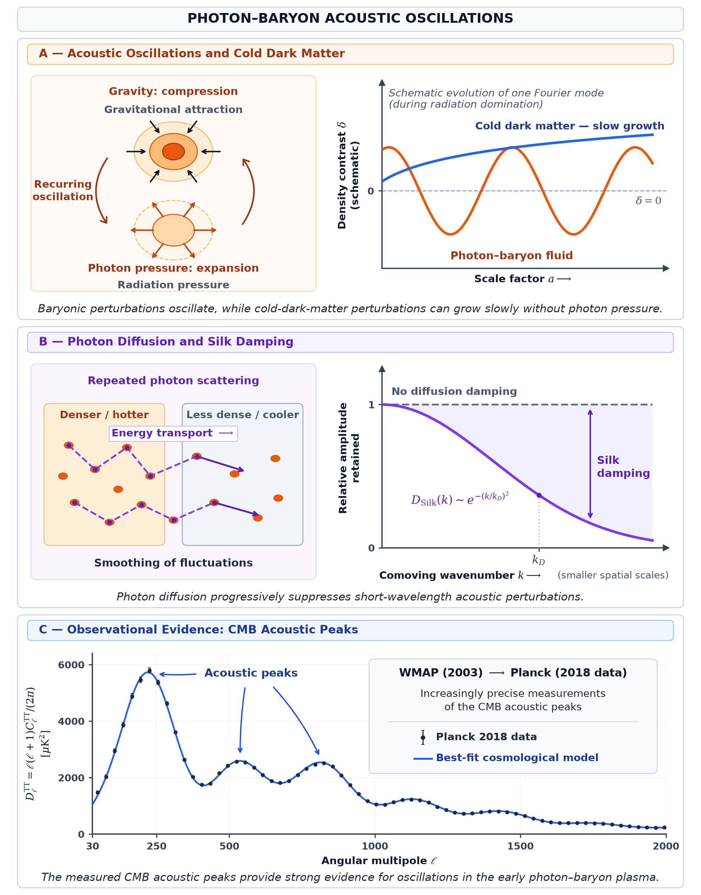
* **Three-Panel Synthesis**:
  * **Panel A**: Driven acoustic oscillations of a single subhorizon mode in the tightly coupled photon–baryon fluid.
  * **Panel B**: High-$k$ exponential envelope suppression due to photon diffusion (**Silk damping**) prior to recombination.
  * **Panel C**: Published **Planck 2018 CMB TT** observational binned data and best-fit $\Lambda\mathrm{CDM}$ theoretical curve displaying the acoustic peaks and damping tail.
* **Script**: `code/generate_photon_baryon_acoustic_oscillations.py`

---

### 12. [Evolution of Cold Dark Matter and Baryon Density Perturbations](code/generate_cdm_baryon_evolution.py)
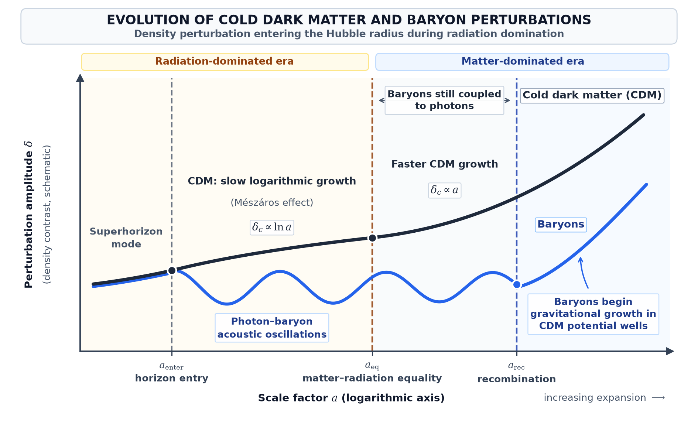
* **Decoupled vs. Coupled Evolution**: Follows a single subhorizon Fourier mode across horizon entry, matter–radiation equality ($a_{\mathrm{eq}}$), and recombination ($a_{\mathrm{rec}}$), contrasting logarithmic Mészáros-regime CDM growth and post-equality power-law amplification with baryon acoustic oscillations and post-recombination baryon infall into CDM potential wells.
* **Script**: `code/generate_cdm_baryon_evolution.py`

---

### 13. [Matter Transfer Function & Linear Matter Power Spectrum](code/generate_matter_transfer_power_spectrum.py)
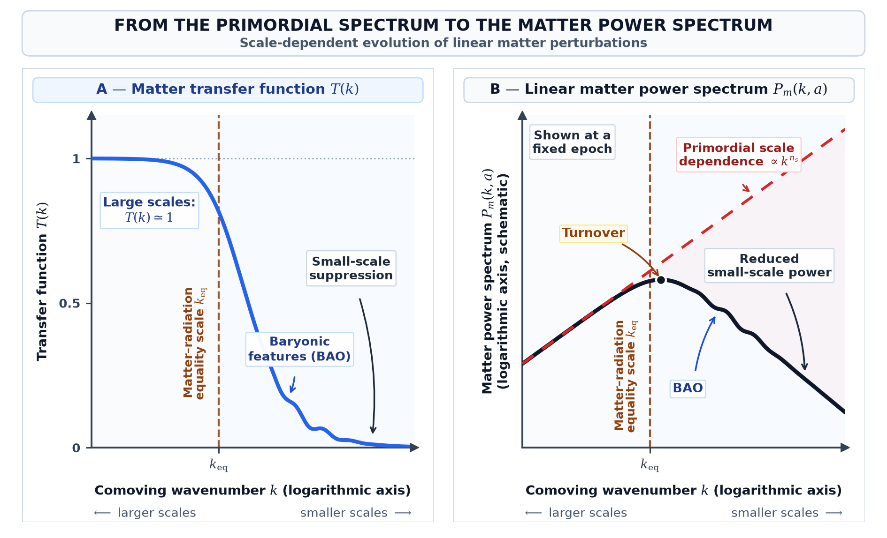
* **Two-Panel Structure Formation Imprint**:
  * **Panel A**: The matter transfer function $T(k)$, transitioning from $T(k) \to 1$ on large super-equality scales ($k \ll k_{\mathrm{eq}}$) to suppressed small-scale power with superimposed BAO wiggles.
  * **Panel B**: The resulting linear matter power spectrum $P_m(k) \propto k^{n_s} T^2(k) D^2(a)$, showing the characteristic turnover at $k_{\mathrm{eq}}$.
* **Script**: `code/generate_matter_transfer_power_spectrum.py`

---

### 14. [Timeline: From Acoustic Oscillations to the Matter Power Spectrum (1965–2005)](code/generate_perturbation_evolution_timeline.py)
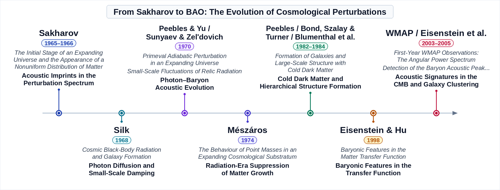
* **Historical Milestones**: Sakharov (1965/1966), Silk (1968), Peebles & Yu / Sunyaev & Zel'dovich (1970), Mészáros (1974), Peebles / Bond, Szalay & Turner / Blumenthal et al. (1982–1984), Eisenstein & Hu (1998), and WMAP / SDSS BAO (2003–2005).
* **Script**: `code/generate_perturbation_evolution_timeline.py`

---

### 15. [Anisotropic Gravitational Collapse and the Emergence of the Cosmic Web](code/generate_anisotropic_collapse_cosmic_web.py)
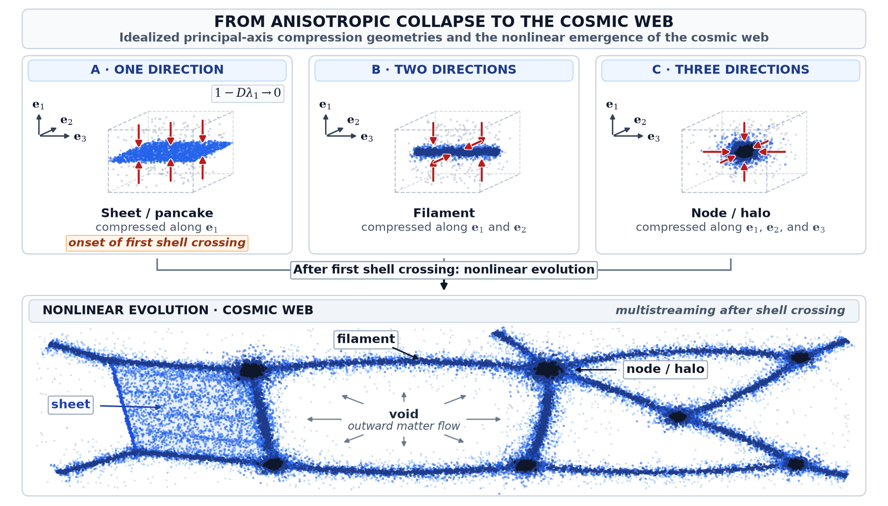
* **Zel'dovich Eigenvalue Classification & Multistreaming**:
  * **Top Row**: Sequential deformation of an initially uniform comoving volume under principal strain eigenvalues $(\lambda_1, \lambda_2, \lambda_3)$ into a **sheet** ($\lambda_1 > 0$), **filament** ($\lambda_1, \lambda_2 > 0$), and **node/halo** ($\lambda_1, \lambda_2, \lambda_3 > 0$).
  * **Bottom Row**: Post-shell-crossing multistreaming and hierarchical assembly of sheets, filaments, halos, and voids in the cosmic web.
* **Script**: `code/generate_anisotropic_collapse_cosmic_web.py`

---

### 16. [Timeline: From Nonlinear Collapse to the Cosmic Web (1967–1996)](code/generate_cosmic_web_timeline.py)
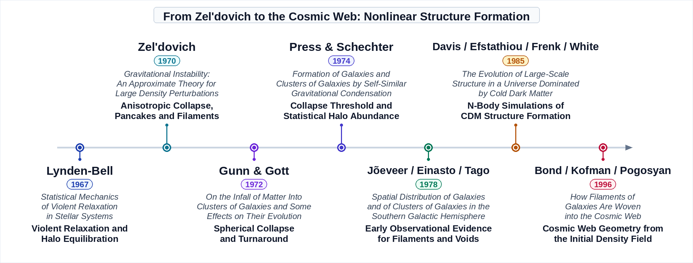
* **Historical Milestones**: Lynden-Bell (1967), Zel'dovich (1970), Gunn & Gott (1972), Press & Schechter (1974), Jõeveer, Einasto & Tago (1978), Davis, Efstathiou, Frenk & White (1985), and Bond, Kofman & Pogosyan (1996).
* **Script**: `code/generate_cosmic_web_timeline.py`

---

### 17. [Dark Energy and the Late-Time Suppression of Structure Growth](code/generate_dark_energy_structure_growth.py)
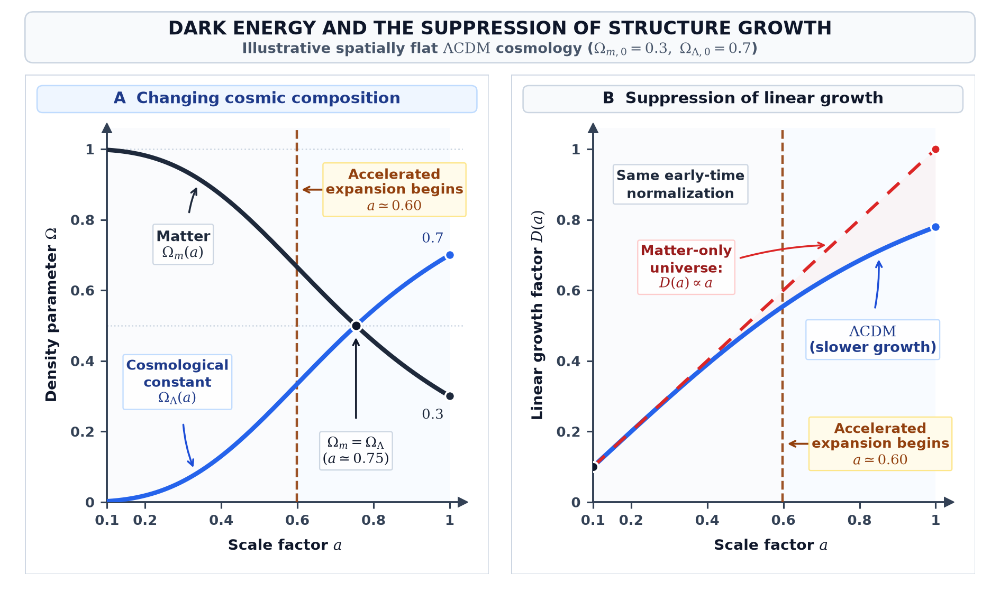
* **Two-Panel $\Lambda\mathrm{CDM}$ Dynamics**:
  * **Panel A**: Evolution of the dimensionless density parameters $\Omega_m(a)$ and $\Omega_\Lambda(a)$ in a spatially flat cosmology ($\Omega_{m,0} = 0.3$, $\Omega_{\Lambda,0} = 0.7$), highlighting the onset of cosmic acceleration ($a \approx 0.6$) prior to $\Omega_\Lambda = \Omega_m$.
  * **Panel B**: Exact numerical integration of the Heath (1977) linear growth factor $D(a)$, showing late-time growth suppression in $\Lambda\mathrm{CDM}$ relative to an Einstein–de Sitter ($D(a) \propto a$) universe.
* **Script**: `code/generate_dark_energy_structure_growth.py`

---

### 18. [Timeline: Cosmological Constant and Accelerating Expansion (1977–1999)](code/generate_dark_energy_timeline.py)
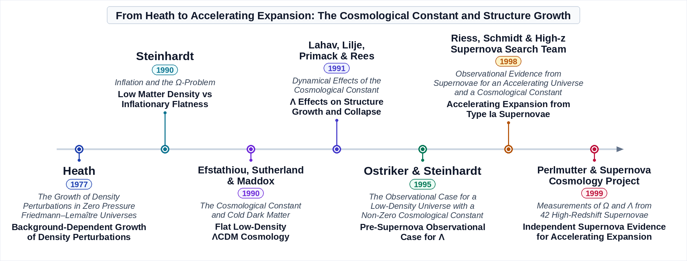
* **Historical Milestones**: Heath (1977), Steinhardt (1990), Efstathiou, Sutherland & Maddox (1990), Lahav, Lilje, Primack & Rees (1991), Ostriker & Steinhardt (1995), Riess et al. (1998), and Perlmutter et al. (1999).
* **Script**: `code/generate_dark_energy_timeline.py`

---

## 📁 Directory Structure

```
from_primordial_fluctuations_to_cosmic_web/
├── README.md                                            # Comprehensive documentation, figure gallery & bibliography
├── requirements.txt                                     # Python dependencies
├── images/                                              # Pre-rendered high-resolution scientific figures & timelines
│   ├── cmb_to_cosmic_web.png
│   ├── jeans_instability_dispersion_relation.png
│   ├── cosmic_expansion_coordinates.png
│   ├── spatial_curvature_friedmann.png
│   ├── particle_horizon_hubble_radius.png
│   ├── cosmological_perturbations_timeline.png
│   ├── quantum_fluctuations_primordial_perturbations.png
│   ├── primordial_power_spectrum.png
│   ├── primordial_fluctuations_timeline.png
│   ├── horizon_entry_perturbations.png
│   ├── photon_baryon_acoustic_oscillations.png
│   ├── cdm_baryon_perturbation_evolution.png
│   ├── matter_transfer_function_power_spectrum.png
│   ├── perturbation_evolution_timeline.png
│   ├── anisotropic_collapse_cosmic_web.png
│   ├── cosmic_web_timeline.png
│   ├── dark_energy_structure_growth.png
│   ├── dark_energy_timeline.png
│   ├── planck_cmb_2018_clean.jpg                        # Source ESA/Planck 2018 CMB map for figure 1
│   ├── nasa_svs_10118_cosmic_web.jpg                    # Source NASA/NCSA cosmic web visualization for figure 1
│   └── math/                                            # Compiled display-math equation PNGs
├── code/                                                # Standalone, runnable generation scripts & cosmological models
│   ├── generate_all_figures.py                          # Master batch runner for all 18 scientific & timeline figures
│   ├── generate_cmb_to_cosmic_web.py
│   ├── generate_jeans_dispersion_relation.py
│   ├── generate_cosmic_expansion_coordinates.py
│   ├── generate_spatial_curvature_friedmann.py
│   ├── generate_horizons_and_perturbation_scales.py
│   ├── generate_cosmological_perturbations_timeline.py
│   ├── generate_quantum_fluctuations_inflation.py
│   ├── generate_primordial_power_spectrum.py
│   ├── generate_primordial_fluctuations_timeline.py
│   ├── generate_horizon_entry.py
│   ├── generate_photon_baryon_acoustic_oscillations.py
│   ├── generate_cdm_baryon_evolution.py
│   ├── generate_matter_transfer_power_spectrum.py
│   ├── generate_perturbation_evolution_timeline.py
│   ├── generate_anisotropic_collapse_cosmic_web.py
│   ├── generate_cosmic_web_timeline.py
│   ├── generate_dark_energy_structure_growth.py
│   ├── generate_dark_energy_timeline.py
│   ├── COM_PowerSpect_CMB-TT-binned_R3.01.txt           # Published Planck 2018 binned CMB TT power spectrum
│   └── COM_PowerSpect_CMB-base-plikHM-TTTEEE-lowl-lowE-lensing-minimum-theory_R3.01.txt
└── tests/                                               # Automated physics & figure verification suite
    ├── __init__.py
    └── test_figure_generation.py                        # Cosmological perturbation, growth factor & rendering tests
```

---

## 🚀 Running the Code

### Dependencies
Install the required scientific Python packages:

```bash
pip install -r requirements.txt
```

### Generate All Figures
Execute the master runner to produce all 18 scientific figures and historical timelines into `images/`:

```bash
python3 code/generate_all_figures.py
```

### Generate Figures Individually
Each script is completely self-contained and can be run directly:

```bash
python3 code/generate_cmb_to_cosmic_web.py
python3 code/generate_jeans_dispersion_relation.py
python3 code/generate_cosmic_expansion_coordinates.py
python3 code/generate_spatial_curvature_friedmann.py
python3 code/generate_horizons_and_perturbation_scales.py
python3 code/generate_cosmological_perturbations_timeline.py
python3 code/generate_quantum_fluctuations_inflation.py
python3 code/generate_primordial_power_spectrum.py
python3 code/generate_primordial_fluctuations_timeline.py
python3 code/generate_horizon_entry.py
python3 code/generate_photon_baryon_acoustic_oscillations.py
python3 code/generate_cdm_baryon_evolution.py
python3 code/generate_matter_transfer_power_spectrum.py
python3 code/generate_perturbation_evolution_timeline.py
python3 code/generate_anisotropic_collapse_cosmic_web.py
python3 code/generate_cosmic_web_timeline.py
python3 code/generate_dark_energy_structure_growth.py
python3 code/generate_dark_energy_timeline.py
```

---

## 🧪 Running the Test Suite

A comprehensive test suite validates both the physical/mathematical derivations and the rendering integrity of all figures:

```bash
# Run using standard library unittest
python3 -m unittest discover -s tests -t . -v

# Or run using pytest
pytest tests/ -v
```

The test suite validates:
1. **Jeans Dispersion & Wavelength Threshold**: Verifies $\omega^2 = c_s^2 k^2 - 4\pi G\rho_0 = 0$ at $\lambda_J = c_s\sqrt{\pi/(G\rho_0)}$, unstable growth ($\omega^2 < 0$) for $k < k_J$, and acoustic oscillations ($\omega^2 > 0$) for $k > k_J$.
2. **Einstein–de Sitter Growing & Decaying Modes**: Confirms that $\delta_+(t) = t^{2/3}$ and $\delta_-(t) = t^{-1}$ identically satisfy the linear pressureless perturbation ODE $\ddot{\delta} + 2H\dot{\delta} - 4\pi G\bar{\rho}_m\delta = 0$ when $a(t) \propto t^{2/3}$.
3. **Mészáros Radiation-Era Logarithmic Solution**: Confirms that $\delta_c(t) = C_1 + C_2 \ln a(t)$ solves the subhorizon radiation-dominated limit $\ddot{\delta}_c + 2H\dot{\delta}_c = 0$ when $a(t) \propto t^{1/2}$.
4. **Comoving Hubble Radius & Perturbation Curves**: Verifies asymptotic slopes across matter–radiation equality, continuity of CDM/baryon evolution curves, and post-recombination monotonic baryon growth.
5. **Matter Transfer Function & Power Spectrum**: Validates large-scale normalization $T(k \to 0) = 1$, small-scale radiation-era suppression, and the $k_{\mathrm{eq}}$ turnover of $P_m(k)$.
6. **Flat-$\Lambda\mathrm{CDM}$ Closure & Heath Growth Integral**: Verifies $\Omega_m(a) + \Omega_\Lambda(a) = 1$ and late-time suppression of $D(a)$ relative to Einstein–de Sitter growth.
7. **Zel'dovich Anisotropic Collapse**: Confirms that the exact inverse-Jacobian density $\rho/\bar{\rho} = \prod_{i=1}^3 [1 - D(t)\lambda_i]^{-1}$ recovers the linear limit $\delta \simeq D(\lambda_1 + \lambda_2 + \lambda_3)$ at small $D$ and reaches first shell crossing ("pancake" formation) at $D_{\mathrm{cross}} = 1/\lambda_1$.
8. **Asset & Rendering Pipeline Integrity**: Verifies the presence of Planck 2018 power spectrum tables, source images, all 30 rendered math equations, and isolated execution of all 18 scientific diagram and timeline generators in temporary workspaces.

---

## 📚 References & Further Reading

1. **Laplace, P.-S. (1796).** *Exposition du système du monde.* Paris: Imprimerie du Cercle-Social, 2 vols. [Digital edition: ETH Zürich, e-rara](https://www.e-rara.ch/zut/doi/10.3931/e-rara-497)
2. **Darwin, G. H. (1889).** *On the Mechanical Conditions of a Swarm of Meteorites, and on Theories of Cosmogony.* Philosophical Transactions of the Royal Society of London (A), 180, 1–69. [Original paper: Royal Society Publishing](https://doi.org/10.1098/rsta.1889.0001)
3. **Jeans, J. H. (1902).** *The Stability of a Spherical Nebula.* Philosophical Transactions of the Royal Society of London (A), 199, 1–53. [Original paper: Royal Society Publishing](https://doi.org/10.1098/rsta.1902.0012)
4. **Slipher, V. M. (1915).** *Spectrographic Observations of Nebulae.* Popular Astronomy, 23, 21–24. [Digital copy: University of Sheffield PDF](https://www.hep.shef.ac.uk/roszkowski/phy306/papers/slipher_1915.pdf)
5. **Einstein, A. (1917).** *Kosmologische Betrachtungen zur allgemeinen Relativitätstheorie.* Sitzungsberichte der Königlich Preußischen Akademie der Wissenschaften (Berlin), 142–152. English translation: *Cosmological Considerations on the General Theory of Relativity*, in *The Principle of Relativity* (1923; Dover reprint, 1952), pp. 175–188 (PDF viewer pages 183–196). [English translation](https://pages.jh.edu/rrynasi1/spacetime/eprints/Lorentz%2BEtAl1952%281923%29ThePrincipleOfRelativity.pdf)
6. **Shapley, H., & Curtis, H. D. (1921).** *The Scale of the Universe.* Bulletin of the National Research Council, 2(3), No. 11, 171–217. [Original published papers: NASA transcription](https://science.nasa.gov/apod/nrc-transcripts-of-the-great-debate/)
7. **Friedmann, A. (1922).** *Über die Krümmung des Raumes.* Zeitschrift für Physik, 10, 377–386. English translation: *On the Curvature of Space*. [English translation: Internet Archive PDF](https://ia803104.us.archive.org/30/items/aleksandr-friedmann.-on-the-curvature-of-space/Aleksandr%20Friedmann.%20On%20the%20Curvature%20of%20Space.pdf)
8. **Strömberg, G. (1925).** *Analysis of Radial Velocities of Globular Clusters and Non-Galactic Nebulae.* The Astrophysical Journal, 61, 353–362. [Astrophysics Data System (ADS)](https://ui.adsabs.harvard.edu/abs/1925ApJ....61..353S/abstract)
9. **Hubble, E. (1926).** *Extragalactic Nebulae.* The Astrophysical Journal, 64, 321–369. [Astrophysics Data System (ADS) PDF](https://articles.adsabs.harvard.edu/pdf/1926ApJ....64..321H)
10. **Lemaître, G. (1927).** *Un Univers homogène de masse constante et de rayon croissant rendant compte de la vitesse radiale des nébuleuses extra-galactiques.* Annales de la Société Scientifique de Bruxelles, A47, 49–59. [Digital reprint: UCLA Astronomy PDF](https://astro.ucla.edu/~wright/LeMaitre_1927_Annales_Societe_Scientifique_Bruxelles_47A_49-59.pdf)
11. **Milne, E. A. (1934).** *A Newtonian Expanding Universe.* Quarterly Journal of Mathematics, os-5(1), 64–72. [Original paper: Oxford Academic](https://doi.org/10.1093/qmath/os-5.1.64)
12. **McCrea, W. H., & Milne, E. A. (1934).** *Newtonian Universes and the Curvature of Space.* Quarterly Journal of Mathematics, os-5(1), 73–80. [Original paper: Oxford Academic](https://doi.org/10.1093/qmath/os-5.1.73) | [PDF](https://ayuba.fr/pdf/mccrea1934.pdf)
13. **Gamow, G., & Teller, E. (1939).** *On the Origin of Great Nebulae.* Physical Review, 55(7), 654–657. [Original paper: American Physical Society](https://doi.org/10.1103/PhysRev.55.654)
14. **Lifshitz, E. (1946).** *On the Gravitational Stability of the Expanding Universe.* Journal of Physics (USSR), 10(2), 116–129. [Reprint: General Relativity and Gravitation (2017), 49, Article 18](https://doi.org/10.1007/s10714-016-2165-8)
15. **Bonnor, W. B. (1957).** *Jeans' Formula for Gravitational Instability.* Monthly Notices of the Royal Astronomical Society, 117(1), 104–117. [Original paper: Oxford Academic / MNRAS](https://doi.org/10.1093/mnras/117.1.104)
16. **Sakharov, A. D. (1965/1966).** *The Initial Stage of an Expanding Universe and the Appearance of a Nonuniform Distribution of Matter.* Soviet Physics JETP, 22(1), 241–249. Original Russian version: ZhETF, 49, 345–358 (1965); English translation published in 1966. [JETP PDF / article page](https://jetp.ras.ru/cgi-bin/e/index/e/22/1/p241?a=list)
17. **Lynden-Bell, D. (1967).** *Statistical Mechanics of Violent Relaxation in Stellar Systems.* Monthly Notices of the Royal Astronomical Society, 136(1), 101–121. [Original paper: Oxford Academic](https://doi.org/10.1093/mnras/136.1.101)
18. **Silk, J. (1968).** *Cosmic Black-Body Radiation and Galaxy Formation.* The Astrophysical Journal, 151, 459–471. [Original paper](https://doi.org/10.1086/149449) | [ADS PDF](https://articles.adsabs.harvard.edu/pdf/1968ApJ...151..459S)
19. **Harrison, E. R. (1970).** *Fluctuations at the Threshold of Classical Cosmology.* Physical Review D, 1(10), 2726–2730. [Original paper: American Physical Society](https://doi.org/10.1103/PhysRevD.1.2726)
20. **Peebles, P. J. E., & Yu, J. T. (1970).** *Primeval Adiabatic Perturbation in an Expanding Universe.* The Astrophysical Journal, 162, 815–836. [Original paper](https://doi.org/10.1086/150713) | [NASA GISS](https://www.giss.nasa.gov/pubs/abs/pe00300h.html)
21. **Sunyaev, R. A., & Zel'dovich, Ya. B. (1970).** *Small-Scale Fluctuations of Relic Radiation.* Astrophysics and Space Science, 7(1), 3–19. [Original paper](https://doi.org/10.1007/BF00653471)
22. **Zel'dovich, Ya. B. (1970).** *Gravitational Instability: An Approximate Theory for Large Density Perturbations.* Astronomy & Astrophysics, 5, 84–89. [Full paper: NASA ADS PDF](https://articles.adsabs.harvard.edu/pdf/1970A%26A.....5...84Z)
23. **Zel'dovich, Ya. B. (1972).** *A Hypothesis, Unifying the Structure and the Entropy of the Universe.* Monthly Notices of the Royal Astronomical Society, 160(1), 1P–3P. [Original paper: PDF via NASA ADS](https://articles.adsabs.harvard.edu/pdf/1972MNRAS.160P...1Z) | [Publisher: Oxford Academic](https://doi.org/10.1093/mnras/160.1.1P)
24. **Gunn, J. E., & Gott, J. R., III (1972).** *On the Infall of Matter Into Clusters of Galaxies and Some Effects on Their Evolution.* The Astrophysical Journal, 176, 1–19. [Original paper](https://doi.org/10.1086/151605) | [ADS PDF](https://articles.adsabs.harvard.edu/pdf/1972ApJ...176....1G)
25. **Mészáros, P. (1974).** *The Behaviour of Point Masses in an Expanding Cosmological Substratum.* Astronomy & Astrophysics, 37, 225–228. [Astrophysics Data System (ADS)](https://ui.adsabs.harvard.edu/abs/1974A%26A....37..225M/abstract) | [ADS PDF](https://articles.adsabs.harvard.edu/pdf/1974A%26A....37..225M)
26. **Press, W. H., & Schechter, P. (1974).** *Formation of Galaxies and Clusters of Galaxies by Self-Similar Gravitational Condensation.* The Astrophysical Journal, 187, 425–438. [Original paper](https://doi.org/10.1086/152650) | [Astrophysics Data System (ADS)](https://ui.adsabs.harvard.edu/abs/1974ApJ...187..425P/abstract)
27. **Heath, D. J. (1977).** *The Growth of Density Perturbations in Zero Pressure Friedmann–Lemaître Universes.* Monthly Notices of the Royal Astronomical Society, 179(3), 351–358. [Original paper: Oxford Academic](https://doi.org/10.1093/mnras/179.3.351)
28. **Jõeveer, M., Einasto, J., & Tago, E. (1978).** *Spatial Distribution of Galaxies and of Clusters of Galaxies in the Southern Galactic Hemisphere.* Monthly Notices of the Royal Astronomical Society, 185(2), 357–370. [Original paper: Oxford Academic](https://doi.org/10.1093/mnras/185.2.357)
29. **Starobinsky, A. A. (1980).** *A New Type of Isotropic Cosmological Models Without Singularity.* Physics Letters B, 91(1), 99–102. [Original paper: Elsevier](https://doi.org/10.1016/0370-2693(80)90670-X)
30. **Bardeen, J. M. (1980).** *Gauge-Invariant Cosmological Perturbations.* Physical Review D, 22(8), 1882–1905. [Original paper: American Physical Society](https://doi.org/10.1103/PhysRevD.22.1882)
31. **Guth, A. H. (1981).** *Inflationary Universe: A Possible Solution to the Horizon and Flatness Problems.* Physical Review D, 23(2), 347–356. [Original paper: American Physical Society](https://doi.org/10.1103/PhysRevD.23.347) | [PDF](https://www.hep.shef.ac.uk/cartwright/phy306/papers/guth1981.pdf)
32. **Mukhanov, V. F., & Chibisov, G. V. (1981).** *Quantum Fluctuations and a Nonsingular Universe.* JETP Letters, 33(10), 532–535. [Original paper: PDF via CERN INSPIRE](https://s3.cern.ch/inspire-prod-files-4/46746cd8351e349e64c5d91b6f7db6df)
33. **Hawking, S. W. (1982).** *The Development of Irregularities in a Single Bubble Inflationary Universe.* Physics Letters B, 115(4), 295–297. [Original paper: Elsevier](https://doi.org/10.1016/0370-2693(82)90373-2)
34. **Guth, A. H., & Pi, S.-Y. (1982).** *Fluctuations in the New Inflationary Universe.* Physical Review Letters, 49(15), 1110–1113. [Original paper: American Physical Society](https://doi.org/10.1103/PhysRevLett.49.1110)
35. **Peebles, P. J. E. (1982).** *Large-Scale Background Temperature and Mass Fluctuations Due to Scale-Invariant Primeval Perturbations.* The Astrophysical Journal Letters, 263, L1–L5. [Original paper](https://doi.org/10.1086/183911) | [ADS PDF](https://articles.adsabs.harvard.edu/pdf/1982ApJ...263L...1P)
36. **Bond, J. R., Szalay, A. S., & Turner, M. S. (1982).** *Formation of Galaxies in a Gravitino-Dominated Universe.* Physical Review Letters, 48(23), 1636–1639. [Original paper: American Physical Society](https://doi.org/10.1103/PhysRevLett.48.1636)
37. **White, S. D. M., Frenk, C. S., & Davis, M. (1983).** *Clustering in a Neutrino-Dominated Universe.* The Astrophysical Journal Letters, 274, L1–L5. [Original paper: NASA ADS PDF](https://adsabs.harvard.edu/pdf/1983ApJ...274L...1W) | [Publisher](https://doi.org/10.1086/184139)
38. **Blumenthal, G. R., Faber, S. M., Primack, J. R., & Rees, M. J. (1984).** *Formation of Galaxies and Large-Scale Structure with Cold Dark Matter.* Nature, 311, 517–525. [Original paper: Nature](https://doi.org/10.1038/311517a0) | [SLAC preprint PDF](https://slac.stanford.edu/pubs/slacpubs/3250/slac-pub-3307.pdf)
39. **Davis, M., Efstathiou, G., Frenk, C. S., & White, S. D. M. (1985).** *The Evolution of Large-Scale Structure in a Universe Dominated by Cold Dark Matter.* The Astrophysical Journal, 292, 371–394. [Original paper](https://doi.org/10.1086/163168) | [ADS PDF](https://articles.adsabs.harvard.edu/pdf/1985ApJ...292..371D)
40. **Steinhardt, P. J. (1990).** *Inflation and the Ω-Problem.* Nature, 345, 47–49. [Original paper: Nature](https://doi.org/10.1038/345047a0)
41. **Efstathiou, G., Sutherland, W. J., & Maddox, S. J. (1990).** *The Cosmological Constant and Cold Dark Matter.* Nature, 348, 705–707. [Original paper: Nature](https://doi.org/10.1038/348705a0)
42. **Lahav, O., Lilje, P. B., Primack, J. R., & Rees, M. J. (1991).** *Dynamical Effects of the Cosmological Constant.* Monthly Notices of the Royal Astronomical Society, 251(1), 128–136. [Original paper: Oxford Academic](https://doi.org/10.1093/mnras/251.1.128)
43. **Ostriker, J. P., & Steinhardt, P. J. (1995).** *The Observational Case for a Low-Density Universe with a Non-Zero Cosmological Constant.* Nature, 377(6550), 600–602. [Original paper: Nature](https://doi.org/10.1038/377600a0)
44. **Bond, J. R., Kofman, L., & Pogosyan, D. (1996).** *How Filaments of Galaxies Are Woven into the Cosmic Web.* Nature, 380, 603–606. [Original paper: Nature](https://doi.org/10.1038/380603a0)
45. **Eisenstein, D. J., & Hu, W. (1998).** *Baryonic Features in the Matter Transfer Function.* The Astrophysical Journal, 496, 605–614. [Original paper](https://doi.org/10.1086/305424) | [Full-text PDF](https://www-astro.lbl.gov/~fwh/papers/cosmology/eisenstein-hu-1998.pdf)
46. **Riess, A. G., et al. (1998).** *Observational Evidence from Supernovae for an Accelerating Universe and a Cosmological Constant.* The Astronomical Journal, 116(3), 1009–1038. [Original paper](https://doi.org/10.1086/300499) | [arXiv: astro-ph/9805201](https://arxiv.org/abs/astro-ph/9805201)
47. **Perlmutter, S., et al. (1999).** *Measurements of Ω and Λ from 42 High-Redshift Supernovae.* The Astrophysical Journal, 517(2), 565–586. [Original paper](https://doi.org/10.1086/307221) | [arXiv: astro-ph/9812133](https://arxiv.org/abs/astro-ph/9812133)
48. **Krasiński, A. (2000).** *Editor's Note: A Newtonian Expanding Universe; Newtonian Universes and the Curvature of Space.* General Relativity and Gravitation, 32(9), 1933–1936. [Original paper: Springer](https://doi.org/10.1023/A:1001945016909) | [PDF](https://users.camk.edu.pl/akr/milmacedibio.grg.pdf)
49. **Hinshaw, G., et al. (2003).** *First-Year Wilkinson Microwave Anisotropy Probe (WMAP) Observations: The Angular Power Spectrum.* The Astrophysical Journal Supplement Series, 148(1), 135–159. [Original paper](https://doi.org/10.1086/377225) | [NASA PDF](https://lambda.gsfc.nasa.gov/product/wmap/dr1/pub_papers/firstyear/powspec/57706.web.pdf)
50. **Eisenstein, D. J., et al. (2005).** *Detection of the Baryon Acoustic Peak in the Large-Scale Correlation Function of SDSS Luminous Red Galaxies.* The Astrophysical Journal, 633, 560–574. [Original paper](https://doi.org/10.1086/466512)
51. **Ellis, G. F. R. (2017).** *Editorial Note to: E. Lifshitz, On the Gravitational Stability of the Expanding Universe.* General Relativity and Gravitation, 49, Article 17. [Original paper: Springer](https://doi.org/10.1007/s10714-016-2164-9) | [PDF](https://users.camk.edu.pl/akr/Lifshitzbio.grg.pdf)
52. **Planck Collaboration (2020).** *Planck 2018 Results. V. CMB Power Spectra and Likelihoods.* Astronomy & Astrophysics, 641, Article A5. [Original paper: open access](https://doi.org/10.1051/0004-6361/201936386)
53. **Planck Collaboration (2020).** *Planck 2018 Results. X. Constraints on Inflation.* Astronomy & Astrophysics, 641, Article A10. [Original paper: open access](https://doi.org/10.1051/0004-6361/201833887) | [Full-text PDF](https://orca.cardiff.ac.uk/id/eprint/127119/8/aa33887-18.pdf)

---

## 📄 License

This project is licensed under the MIT License - see the [LICENSE](../LICENSE) file for details.