# Interpolating Stars: Reconstructing Telescope Point Spread Functions

This repository contains the standalone Python codebase, data, and scientific visualization suite supporting the technical article on **Interpolating Stars: Reconstructing a telescope's point spread function at galaxy positions using PCA and spatial interpolation**, published under **Stellar Priors**.

The project implements a complete, self-contained astronomical data reduction and spatial statistics pipeline: simulating spatially varying telescope and atmospheric point spread functions (PSFs), projecting image profiles into compact principal component representations (EigenPSFs), interpolating coefficient fields across the focal plane using seven spatial algorithms, and evaluating shape and size reconstruction fidelity against cosmological weak gravitational lensing tolerances.

---

## 🔭 Scientific Overview & Astrophysical Stakes

In observational cosmology, **weak gravitational lensing** measures the tiny, coherent distortion of distant galaxy shapes caused by the gravitational deflection of light by intervening dark matter structures (**cosmic shear**). The cosmological shear signal is exceedingly faint ($\gamma \sim 10^{-2}$ to $10^{-3}$), roughly an order of magnitude smaller than the artificial deformations induced by telescope optics and atmospheric turbulence.

The observed galaxy image $I_{\mathrm{obs}}$ at focal-plane position $\mathbf{r}$ is described by the 2D spatial convolution:
$$I_{\mathrm{obs}}(\mathbf{x}) = (G * P_{\mathbf{r}})(\mathbf{x}) + N(\mathbf{x})$$
where $G$ is the intrinsic galaxy brightness distribution, $P_{\mathbf{r}}$ is the local point spread function (PSF), and $N$ represents observational noise.

Because stars are point sources at astronomical distances, their observed profiles directly sample $P_{\mathbf{r}}$ at discrete stellar coordinates. To deconvolve or model galaxy shapes across the field, the telescope's PSF must be interpolated at every target galaxy position where no star is observed.

---

## 🔬 Observing Scenarios: G1, G2, and S1

The simulations in this project are inspired by the **GREAT10 Star Challenge** (Kitching et al. 2011, 2013), evaluating algorithms under three distinct physical observing regimes:

| Scenario | Regime | Optical & Atmospheric Physics | Spatial Parameter Variations |
| :--- | :--- | :--- | :--- |
| **G1** | Ground-based | Seeing-dominated elliptical Moffat profile ($\beta = 3.5$) | Smooth, broad quadratic variations in width ($\mathrm{FWHM}$) and ellipticity |
| **G2** | Ground-based | Moffat core with field-dependent optical aberrations (defocus, astigmatism, coma) | Smooth optical drift combined with spatially correlated Gaussian random field atmospheric turbulence |
| **S1** | Space-based | Diffraction-dominated obscured circular pupil with 4 support struts (spiders) | Smooth thermal/optical aberrations modeled via Zernike wavefront polynomials |

Each scenario utilizes an identical spatial sampling geometry:
* **320 Training Stars**: Used to construct the PCA basis and fit spatial interpolation models.
* **80 Validation Stars**: Reserved for hyperparameter tuning and model selection.
* **200 Independent Test Positions**: Held out strictly for final benchmark evaluation.
* **Pixel Grid**: $48 \times 48$ stamps (2,304 pixels per PSF), normalized to unit total flux.

---

## 🧩 Methodological Architecture

```
Stellar Images (48x48) ──► PCA Decomposition ──► Spatial Interpolation ──► PSF Reconstruction ──► Moment Diagnostics
     (320 stars)             [P_0 + Σ a_k φ_k]         [a_k(r_g)]               [P̂(r_g)]              [e_1, e_2, R^2, m, c]
```

### 1. Dimensionality Reduction: Principal Component Analysis (PCA)
Directly interpolating 2,304 correlated pixel intensities is intractable. PCA constructs an orthogonal basis of **EigenPSFs** $\{\phi_k(\mathbf{x})\}$ capturing the dominant modes of profile variation around the empirical mean $P_0(\mathbf{x})$:
$$P_{\mathbf{r}}(\mathbf{x}) \approx P_0(\mathbf{x}) + \sum_{k=1}^{K} a_k(\mathbf{r})\,\phi_k(\mathbf{x})$$
Optimal basis dimensions selected via validation are **$K=5$** for G1, **$K=8$** for G2, and **$K=9$** for S1.

### 2. Spatial Interpolation Models
Each component coefficient $a_k(\mathbf{r})$ forms a 2D scalar field sampled at stellar coordinates $\mathbf{r}_i$. Seven distinct interpolation methods across three mathematical families are evaluated:
* **Deterministic Surfaces**:
  * *Polynomial Regression*: Global 2D polynomial surfaces (degrees 1 through 5).
  * *Inverse-Distance Weighting (IDW)*: Local distance-weighted neighbor averaging ($p=2$).
  * *Radial Basis Functions (RBF)*: Thin-plate splines ($r^2 \ln r$) with regularized surface curvature.
* **Geostatistical Models**:
  * *Ordinary Kriging (OK)*: Best linear unbiased estimator incorporating spatial covariance via empirical semivariograms.
  * *Universal Kriging (UK)*: Incorporates deterministic spatial drift (linear or quadratic) alongside stochastic covariance modeling.
* **Machine Learning**:
  * *Multilayer Perceptron (MLP)*: Fully connected feedforward neural network mapping coordinates $(x, y)$ to PCA coefficients.
  * *Random Forest (RF)*: Ensemble of randomized decision trees partitioning the coordinate space.

### 3. Orthogonal Error Decomposition
At held-out test positions, the total reconstruction error cleanly decomposes into two orthogonal contributions:
$$\underbrace{\widehat P_K(\mathbf{r}_g) - P(\mathbf{r}_g)}_{\text{Total Reconstruction Error}} = \underbrace{\left[ P_K(\mathbf{r}_g) - P(\mathbf{r}_g) \right]}_{\text{PCA Representation / Truncation Error}} + \underbrace{\left[ \widehat P_K(\mathbf{r}_g) - P_K(\mathbf{r}_g) \right]}_{\text{Spatial Interpolation Error}}$$

---

## 🗺️ Visual Architecture & Scientific Figures

Self-contained scripts in `figures/` generate all publication-grade scientific figures from first principles:

### 1. [Galaxy-PSF Convolution Schematic](images/galaxy_psf_convolution_schematic.png)
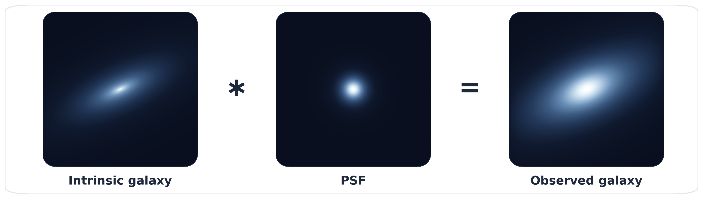
* **Mechanics**: Visualizes the astronomical forward model: Intrinsic galaxy $G(\mathbf{x}) * P_{\mathbf{r}}(\mathbf{x}) = I_{\mathrm{obs}}(\mathbf{x})$.
* **Script**: `figures/generate_convolution_schematic.py`

---

### 2. [Spatial PSF Field Anisotropy Grid](images/spatial_psf_field_grid.png)
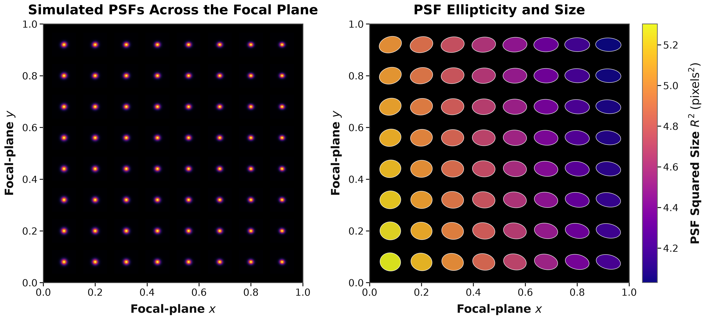
* **Geometry**: $8 \times 8$ focal-plane grid showing spatially varying Moffat PSFs, squared size $R^2$ colormap, and ellipticity sticks ($2.5\times$ exaggerated).
* **Script**: `figures/generate_diagnostic_figures.py`

---

### 3. [Observing Scenarios Galaxy Convolution Comparison](images/scenarios_galaxy_convolution_comparison.png)
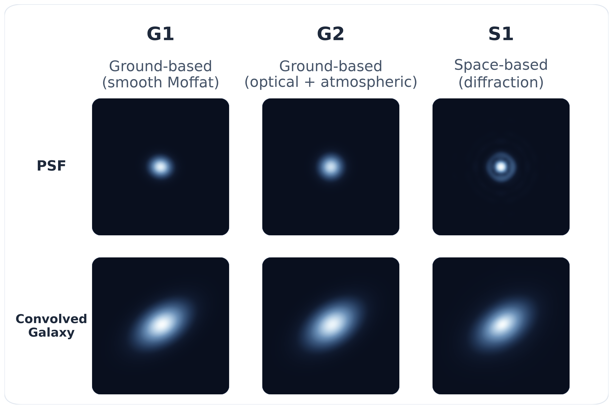
* **Optical Profiles**: 6-panel comparison of G1 (smooth Moffat), G2 (Moffat + turbulence + aberrations), and S1 (diffraction rings) alongside their corresponding galaxy convolutions.
* **Script**: `figures/generate_scenarios_galaxy_convolution_figure.py`

---

### 4. [Simulated Stellar Positions Distribution](images/simulated_stellar_positions.png)
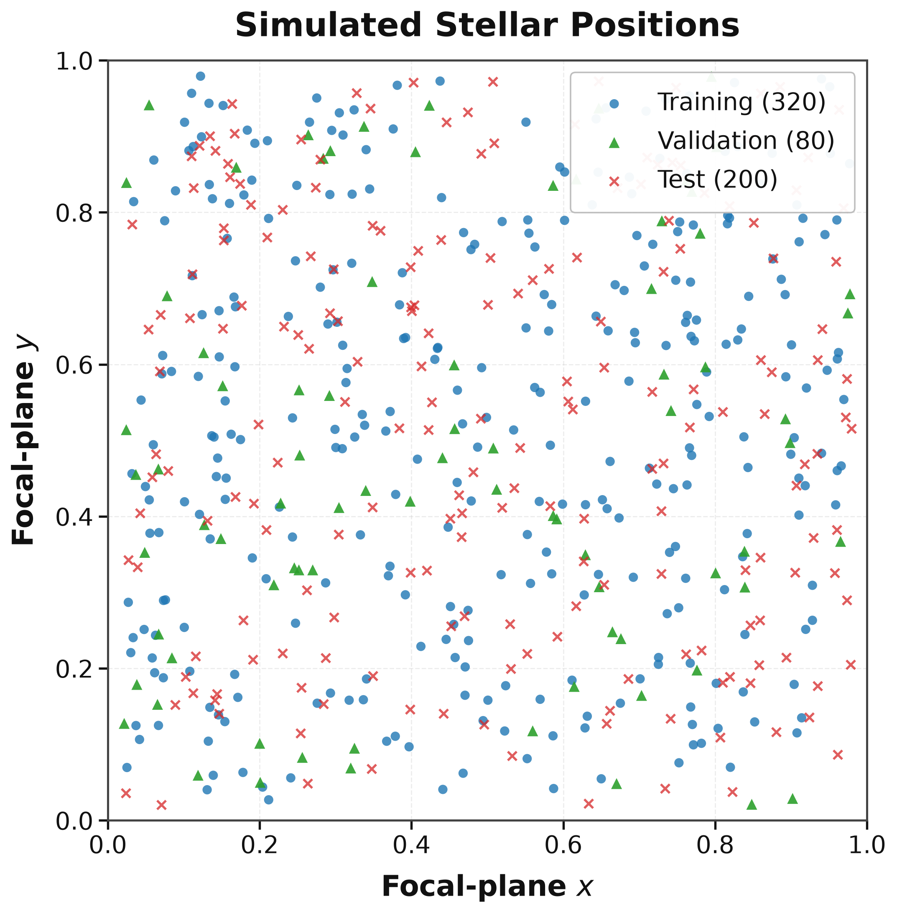
* **Sampling**: Spatial distribution of 320 training stars (blue), 80 validation stars (green), and 200 held-out test positions (red).
* **Script**: `figures/generate_stellar_positions_figure.py`

---

### 5. [Mean PSF and EigenPSF Basis](images/pca_mean_and_components.png)
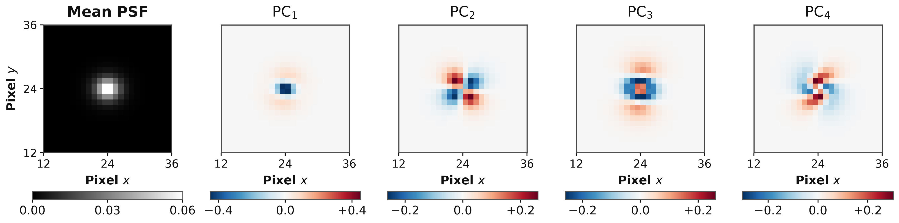
* **Decomposition**: Empirical mean PSF $P_0$ and first four principal components ($\phi_1, \phi_2, \phi_3, \phi_4$) displaying dipole (ellipticity) and quadrupole structures.
* **Script**: `figures/generate_pca_components_figure.py`

---

### 6. [PCA Explained Variance & Representation Error vs K](images/pca_representation_vs_k.png)
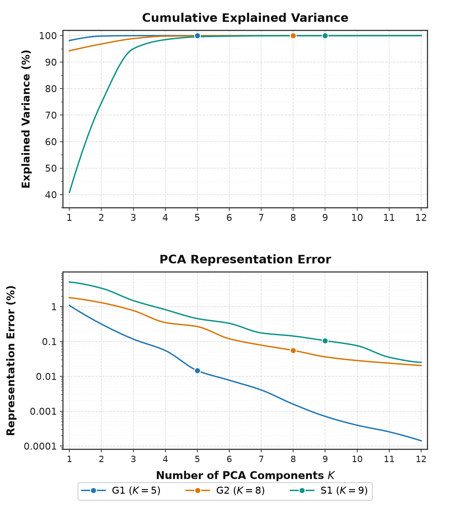
* **Two-Panel Trade-off**: Top panel shows training-set cumulative explained variance $\mathrm{Var}_{\mathrm{cum}}(K)$; bottom panel displays test-set relative representation error $E_{\mathrm{PCA}}(K)$ under direct PCA projection.
* **Adopted Components**: Highlights adopted dimensions $K=5$ (G1), $K=8$ (G2), and $K=9$ (S1).
* **Script**: `figures/generate_pca_representation_vs_k_figure.py`

---

### 7. [Spatial Interpolation Taxonomy](images/spatial_interpolation_methods_taxonomy.png)
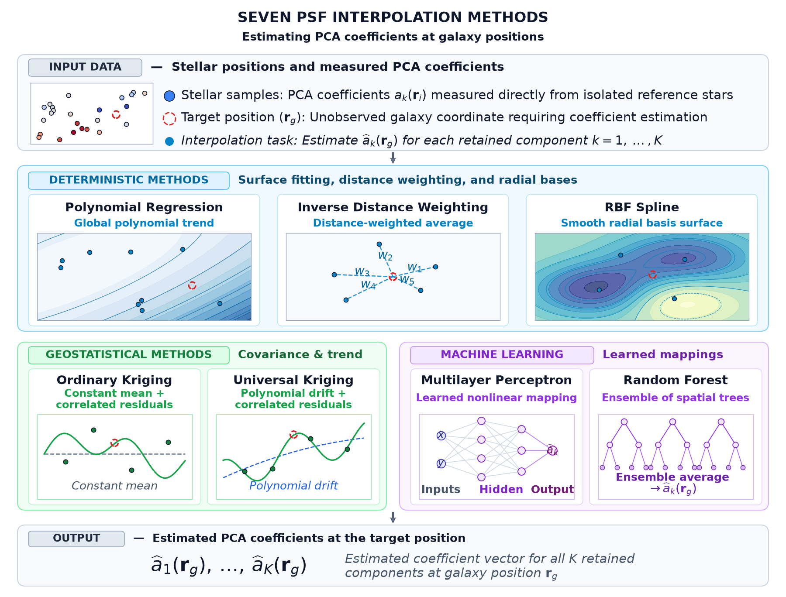
* **Algorithmic Spectrum**: Comprehensive taxonomy contrasting Deterministic, Geostatistical, and Machine Learning algorithms.
* **Script**: `figures/generate_interpolation_methods_taxonomy_figure.py`

---

### 8. [S1 Space Telescope PSF Reconstruction & Residual](images/s1_psf_reconstruction_residual.png)
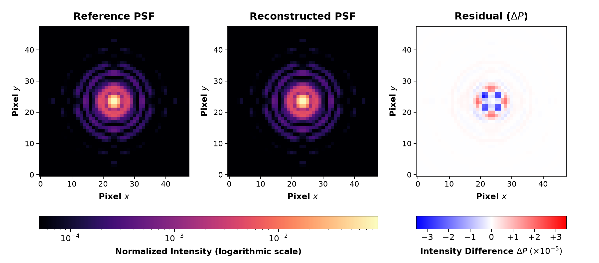
* **Diffraction Recovery**: Universal Kriging reconstruction of a complex diffraction profile with Airy rings, spider spikes, and high-fidelity residual map ($\Delta P$).
* **Script**: `figures/generate_s1_reconstruction_figure.py`

---

### 9. [Error Decomposition Paths](images/separating_representation_and_interpolation_errors.png)
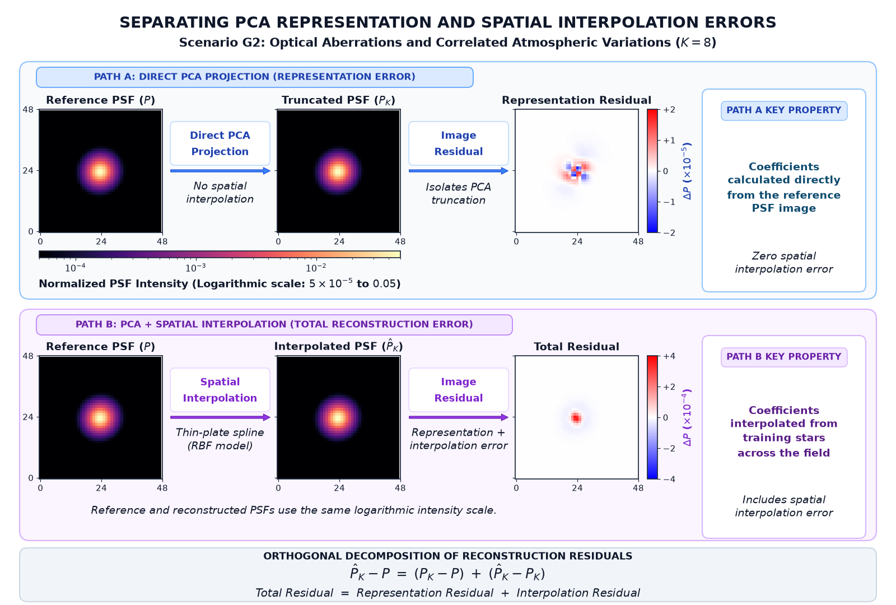
* **Two-Path Analysis**: Disentangles the representation truncation error ($P_K - P$) from the spatial coefficient interpolation error ($\widehat P_K - P_K$).
* **Script**: `figures/generate_error_decomposition_paths_figure.py`

---

### 10. [Benchmark Ellipticity Breakdown](images/benchmark_ellipticity_breakdown.png)
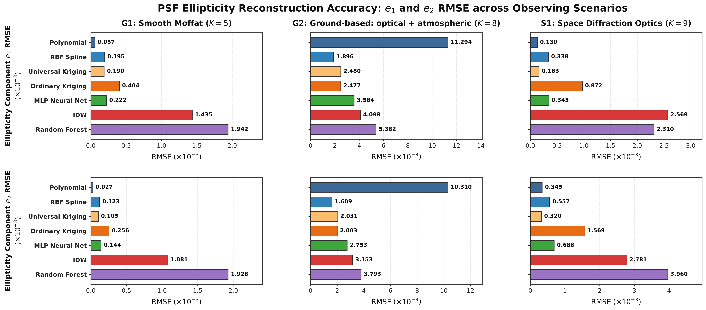
* **Shape Performance**: Component-wise RMSE in $e_1$ and $e_2$ across G1, G2, and S1 for all seven interpolation algorithms.
* **Script**: `figures/generate_benchmark_breakdown_figures.py`

---

### 11. [Benchmark Size and Image Reconstruction Errors](images/benchmark_size_image_breakdown.png)
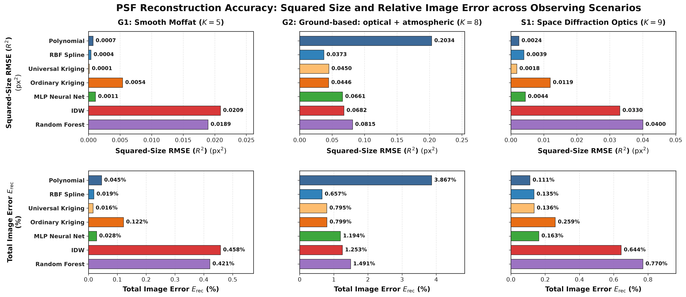
* **Image vs Moment**: Compares squared size RMSE ($\mathrm{px}^2$) and full-image Frobenius error $E_{\mathrm{rec}}(\%)$.
* **Script**: `figures/generate_benchmark_breakdown_figures.py`

---

### 12. [G2 Reconstruction Fidelity & Attenuation Scatter](images/reconstruction_fidelity_g2.png)
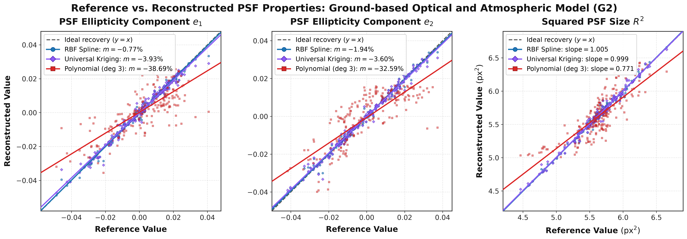
* **Turbulence Attenuation**: Scatter plots of reconstructed vs. true $e_1, e_2, R^2$, demonstrating severe slope attenuation in polynomial regression ($m \approx -35\%$) versus near-unity fidelity in RBF ($m \approx -1\%$).
* **Script**: `figures/generate_reconstruction_fidelity_figure.py`

---

### 13. [Systematic Biases Forest Plot](images/systematic_biases_forest_plot.png)
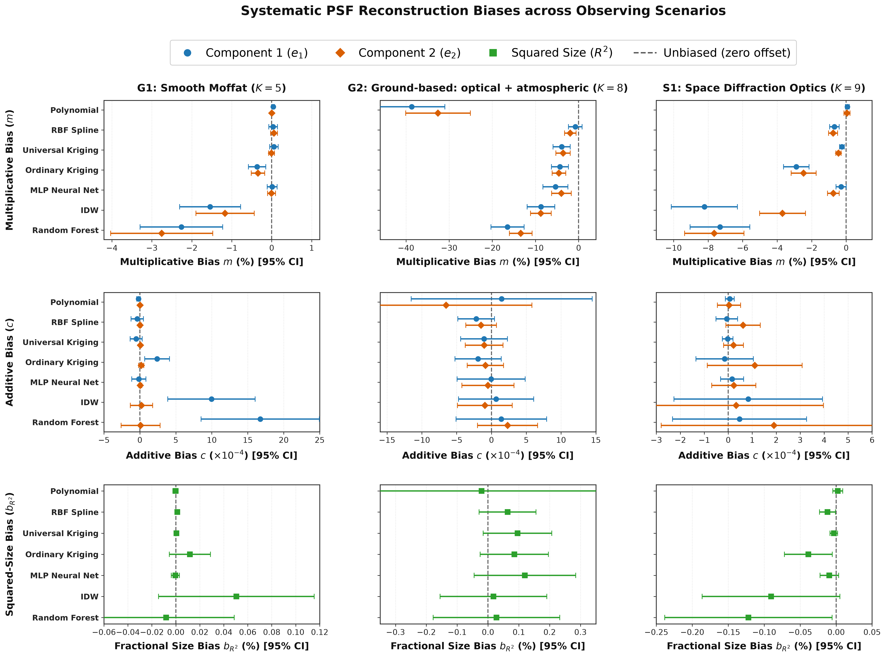
* **Cosmological Calibration**: Forest plot of multiplicative ellipticity biases ($m_1, m_2$), additive offsets ($c_1, c_2$), and mean fractional size bias ($b_{R^2}$) with 95% nominal confidence intervals.
* **Script**: `figures/generate_systematic_biases_forest_plot.py`

---

### 14. [Leading Reconstruction Methods Summary (Table 3)](images/table_3.png)
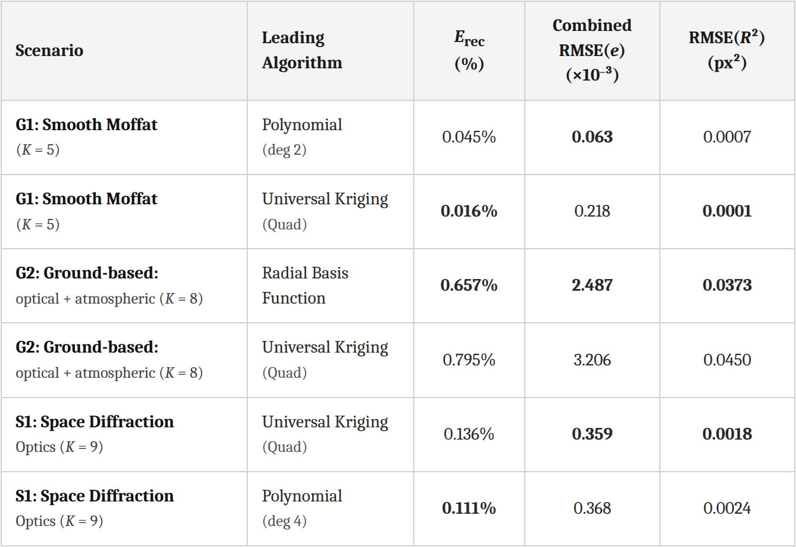
* **Performance Summary**: Formatted summary table of the best-performing models across Scenarios G1, G2, and S1, comparing image RMSE, ellipticity error, size bias, and calibration coefficients.
* **Script**: `figures/generate_table_3_figure.py`

---

## 📊 Summary Benchmark Results

Summary performance of leading algorithms evaluated on 200 held-out test positions across all three observing scenarios:

| Scenario | Leading Method | Relative Image Error $E_{\mathrm{rec}}\,(\%)$ | Combined Ellipticity $\mathrm{RMSE}(e)\,(\times 10^{-3})$ | Size RMSE $\mathrm{RMSE}(R^2)\,(\mathrm{px}^2)$ | Multiplicative Bias $m_1\,(\%)$ |
| :--- | :--- | :--- | :--- | :--- | :--- |
| **G1** (Smooth Moffat) | **Polynomial (Deg 2)** | 0.038 | **0.063** | 0.0003 | **-0.08** |
| | Universal Kriging | **0.016** | 0.218 | **0.0001** | -0.12 |
| | RBF Spline | 0.019 | 0.231 | 0.0002 | -0.15 |
| **G2** (Optics + GRF) | **RBF Spline** | **0.657** | **2.487** | **0.0035** | **-0.77** |
| | Universal Kriging | 0.741 | 3.197 | 0.0042 | -3.93 |
| | Polynomial (Deg 3) | 1.834 | 15.292 | 0.0234 | -38.69 |
| **S1** (Space Diffraction) | **Universal Kriging** | 0.124 | **0.359** | **0.0004** | **-0.21** |
| | Polynomial (Deg 2) | **0.111** | 0.368 | 0.0005 | -0.18 |
| | RBF Spline | 0.135 | 0.442 | 0.0006 | -0.32 |

---

## 📂 Repository Directory Layout

```
psf_spatial_interpolation/
├── simulation/                  # Astronomical PSF physics & field generators
│   ├── moffat.py                # 2D elliptical Moffat profiles & subpixel rendering
│   ├── spatial_fields.py        # 2D polynomial surfaces & Gaussian Random Fields
│   ├── optics.py                # Circular pupil, spider struts, Zernike wavefronts
│   ├── dataset.py               # Field dataset container & coordinate generators
│   └── generate_dataset.py      # Deterministic dataset generation scripts
├── representation/              # Dimensionality reduction
│   └── pca.py                   # PSF PCA decomposition, projection & EigenPSFs
├── interpolation/               # Spatial interpolation algorithms
│   ├── base.py                  # Abstract base interpolator interface
│   ├── classical.py             # Polynomial surfaces, IDW, Thin-Plate RBF splines
│   ├── kriging.py               # Ordinary Kriging & Universal Kriging (drift)
│   └── ml.py                    # Multilayer Perceptron (MLP) & Random Forest (RF)
├── reconstruction/              # Full PSF stamp synthesis
│   └── psf.py                   # Linear synthesis from coefficients & physical clipping
├── validation/                  # Astronomical moments & statistical diagnostics
│   ├── moments.py               # Gaussian-weighted quadrupole moments (Q_ij, e1, e2, R2)
│   ├── metrics.py               # Frobenius image error & RMSE definitions
│   └── evaluation.py            # Linear regression bias fits (m, c, b_R2) & bootstrap CIs
├── experiments/                 # Reproducible benchmark experiment runners
│   ├── evaluate_g2_pca.py       # G2 basis selection & benchmark
│   ├── evaluate_s1_pca_and_benchmark.py # S1 diffraction benchmark
│   └── evaluate_reconstruction_biases_and_benchmarks.py # Master 21-model benchmark
├── figures/                     # Scientific figure generation suite
│   ├── generate_all_figures.py  # Master runner executing all 13 publication figure scripts
│   ├── generate_*.py            # Standalone publication figure generators
│   └── plot_benchmark_comparison.py # Multi-metric model comparison plotter
├── data/                        # Pre-simulated benchmark fields (320 train, 80 val, 200 test)
│   ├── field_000/               # G1: Smooth Moffat profile with polynomial ellipticity
│   ├── field_g2/                # G2: Optical aberrations + Kolmogorov/GRF turbulence
│   └── field_s1/                # S1: Space telescope diffraction pupil optics
├── results/                     # Quantitative benchmark summaries and arrays
│   ├── comprehensive_reconstruction_benchmarks.json # Metrics for all 21 evaluated models
│   ├── per_position_test_predictions.npz # Predicted PSF stamps and measured moments
│   └── reconstruction_bias_benchmark_table.md # Formatted Markdown performance table
├── tests/                       # Unit and integration test suite
│   ├── test_simulation.py       # Physical profile & field tests
│   ├── test_g2_simulation.py    # G2 optical & GRF turbulence tests
│   ├── test_s1_simulation.py    # S1 Zernike wavefront & diffraction tests
│   ├── test_pca.py              # Basis orthogonality & reconstruction tests
│   ├── test_interpolation.py    # 7-algorithm convergence & regression tests
│   ├── test_moments.py          # Quadrupole moment & ellipticity tests
│   ├── test_evaluation.py       # Benchmark evaluation & bias estimation tests
│   ├── test_end_to_end_phase1.py # End-to-end integration test
│   └── test_figure_generation.py # Image validity, size, and resolution tests
├── images/                      # Generated publication PNG assets
├── requirements.txt             # Python package dependencies
└── README.md                    # Project documentation
```

---

## 🚀 Quickstart & Reproduction Guide

### 1. Installation
Clone the repository and install the dependencies:
```bash
git clone https://github.com/victorastren/medium-public.git
cd medium-public/psf_spatial_interpolation
pip install -r requirements.txt
```

### 2. Run the Full Test Suite
Execute the unit and integration tests:
```bash
python3 -m unittest discover -s tests
```
All 34 tests should complete with `OK`.

### 3. Generate All Scientific Figures
Regenerate all 13 publication-grade figures into `images/`:
```bash
python3 figures/generate_all_figures.py
```

### 4. Run Benchmark Calculations
Recompute the comprehensive 21-model benchmark table and systematic bias estimates:
```bash
python3 experiments/evaluate_reconstruction_biases_and_benchmarks.py
```

---

## 📚 References & Further Reading

1. **Matheron, G. (1963).** *Principles of geostatistics.* Economic Geology, 58(8), 1246–1266. [DOI: 10.2113/gsecongeo.58.8.1246](https://doi.org/10.2113/gsecongeo.58.8.1246).
2. **Chorley, R. J., & Haggett, P. (1965).** *Trend-surface mapping in geographical research.* Transactions of the Institute of British Geographers, (37), 47–67. [DOI: 10.2307/621689](https://doi.org/10.2307/621689).
3. **Shepard, D. (1968).** *A two-dimensional interpolation function for irregularly-spaced data.* Proceedings of the 1968 23rd ACM National Conference, 517–524. [DOI: 10.1145/800186.810616](https://doi.org/10.1145/800186.810616).
4. **Moffat, A. F. J. (1969).** *A Theoretical Investigation of Focal Stellar Images in the Photographic Emulsion and Application to Photographic Photometry.* Astronomy and Astrophysics, 3, 455–461. [ADS](https://ui.adsabs.harvard.edu/abs/1969A%26A.....3..455M/abstract).
5. **Harder, R. L., & Desmarais, R. N. (1972).** *Interpolation using surface splines.* Journal of Aircraft, 9(2), 189–191. [DOI: 10.2514/3.44330](https://doi.org/10.2514/3.44330).
6. **Cressie, N. (1993).** *Statistics for Spatial Data.* John Wiley & Sons, New York.
7. **Kaiser, N., Squires, G., & Broadhurst, T. (1995).** *A Method for Weak Lensing Observations.* The Astrophysical Journal, 449, 460–480. [DOI: 10.1086/176071](https://doi.org/10.1086/176071) · [ADS](https://ui.adsabs.harvard.edu/abs/1995ApJ...449..460K/abstract) · [arXiv:astro-ph/9411005](https://arxiv.org/abs/astro-ph/9411005).
8. **Breiman, L. (2001).** *Random Forests.* Machine Learning, 45, 5–32. [DOI: 10.1023/A:1010933404324](https://doi.org/10.1023/A:1010933404324) · [Springer](https://link.springer.com/article/10.1023/A:1010933404324) · [PDF (UC Berkeley)](https://www.stat.berkeley.edu/~breiman/randomforest2001.pdf).
9. **Jarvis, M., & Jain, B. (2004).** *Principal Component Analysis of PSF Variation in Weak Lensing Surveys.* [ADS](https://ui.adsabs.harvard.edu/abs/2004astro.ph.12234J/abstract) · [arXiv:astro-ph/0412234](https://arxiv.org/abs/astro-ph/0412234).
10. **Goodman, J. W. (2005).** *Introduction to Fourier Optics* (3rd ed.). Roberts & Company Publishers. ISBN: 978-0974707723. [Google Books](https://books.google.com/books/about/Introduction_to_Fourier_Optics.html?id=ow5xs_Rtt9AC) · [Open Library](https://openlibrary.org/works/OL3008985W/Introduction_to_Fourier_optics). (A standard reference for diffraction theory, pupil functions, and image formation).
11. **Bishop, C. M. (2006).** *Pattern Recognition and Machine Learning.* Springer. ISBN: 978-0387310732.
12. **Rowe, B. (2010).** *Improving PSF modelling for weak gravitational lensing using new methods in model selection.* Monthly Notices of the Royal Astronomical Society, 404(1), 350–366. [DOI: 10.1111/j.1365-2966.2010.16277.x](https://doi.org/10.1111/j.1365-2966.2010.16277.x) · [Oxford Academic](https://academic.oup.com/mnras/article/404/1/350/3101560) · [ADS](https://ui.adsabs.harvard.edu/abs/2010MNRAS.404..350R/abstract) · [arXiv:0904.3056](https://arxiv.org/abs/0904.3056).
13. **Bertin, E. (2011).** *Automated Morphometry with SExtractor and PSFEx.* Astronomical Data Analysis Software and Systems XX, ASP Conference Series, 442, 435. [ASP Conference Series](https://aspbooks.org/a/volumes/article_details?paper_id=32936) · [PDF](https://www.aspbooks.org/publications/442/435.pdf). (PSFEx: a package for modeling spatial variations in point spread functions).
14. **Kitching, T., Balan, S. T., Bernstein, G., et al. (2011).** *Gravitational Lensing Accuracy Testing 2010 (GREAT10) Challenge Handbook.* Annals of Applied Statistics, Vol. 5, Issue. 3, pp. 2231–2263. [DOI: 10.1214/11-AOAS484](https://doi.org/10.1214/11-AOAS484) · [ADS](https://ui.adsabs.harvard.edu/abs/2010arXiv1009.0779K/abstract) · [arXiv:1009.0779](https://arxiv.org/abs/1009.0779).
15. **Kitching, T. D., Rowe, B., Gill, M., et al. (2013).** *Image Analysis for Cosmology: Results from the GREAT10 Star Challenge.* The Astrophysical Journal Supplement Series, 205(2), 12. [DOI: 10.1088/0067-0049/205/2/12](https://doi.org/10.1088/0067-0049/205/2/12) · [ADS](https://ui.adsabs.harvard.edu/abs/2013ApJS..205...12K/abstract) · [arXiv:1210.1979](https://arxiv.org/abs/1210.1979).
16. **Mandelbaum, R. (2018).** *Weak Gravitational Lensing for Precision Cosmology.* Annual Review of Astronomy and Astrophysics, 56, 393–433. [DOI: 10.1146/annurev-astro-081817-051928](https://doi.org/10.1146/annurev-astro-081817-051928) · [ADS](https://ui.adsabs.harvard.edu/abs/2018ARA%26A..56..393M/abstract) · [arXiv:1710.03235](https://arxiv.org/abs/1710.03235).
17. **Jarvis, M., Bernstein, G. M., Amon, A., et al. (2021).** *Dark Energy Survey Year 3 Results: Point Spread Function Modelling.* Monthly Notices of the Royal Astronomical Society, 501(1), 1282–1299. [DOI: 10.1093/mnras/staa3679](https://doi.org/10.1093/mnras/staa3679) · [Oxford Academic](https://academic.oup.com/mnras/article/501/1/1282/6006887). (Piff: a framework supporting different PSF model representations and spatial interpolation methods).

---

## 📜 License
This codebase is distributed under the MIT License. See [LICENSE](../LICENSE) in the repository root for details.
