# The Golden Age of Black Hole Physics (1963–1974)

This directory contains the standalone Python codebase, relativistic numerical models, and scientific visualization suite supporting the technical article **The Golden Age of Black Hole Physics (1963–1974): From Kerr’s rotating black holes to Hawking radiation**.

---

## 🌌 Overview & Physical Architecture

In September 1963, Roy Kerr published a two-page paper presenting the exact solution to Einstein's field equations for a rotating mass. Over the following decade—often called *the golden age of black-hole physics*—general relativity underwent a transformation from a largely abstract geometric theory into a quantitative framework for relativistic astrophysics and black-hole thermodynamics.

This project reconstructs the mathematical physics, relativistic geodesic calculations, perturbation models, and thermodynamic laws across that era:

1. **Gravitational Collapse & Frame Dragging**:
   Contrasts the Oppenheimer–Snyder (1939) collapse of a homogeneous, pressureless spherical dust star—where the surface crosses the Schwarzschild radius $r_s = 2GM/c^2$ in finite proper time $\tau$ while freezing asymptotically in Schwarzschild coordinate time $t$—with the Lense–Thirring (1918) gravitomagnetic precession $\Omega_{\mathrm{LT}} \propto J/r^3$ around a spinning mass.
2. **Petrov Classification, Goldberg–Sachs Theorem & Kerr Geometry**:
   Illustrates how Petrov Type D algebraically special vacuum spacetimes and shear-free twisting null congruences led Kerr (1963) to his rotating metric, parameterized in Boyer–Lindquist coordinates $(t, r, \theta, \phi)$ with mass scale $m = GM/c^2$ and spin parameter $a = J/(Mc)$, revealing the outer event horizon $r_+$, inner Cauchy horizon $r_-$, ergosphere $r_e(\theta)$, and equatorial ring singularity ($\Sigma = 0$).
3. **Kerr Geodesics & Black-Hole Perturbations**:
   Computes inclined, eccentric bound timelike orbits ($p/m = 9$, $e = 0.25$, $45^\circ$ inclination) via [KerrGeoPy](https://github.com/blackholeperturbationtoolkit/kerrgeopy) from the [Black Hole Perturbation Toolkit](https://bhptoolkit.org/), contrasting planar Schwarzschild rosette precession with three-dimensional Kerr nodal precession ($a/m = 0.8$), alongside the Teukolsky $(\ell = 2, m = 2, n = 0)$ quasinormal mode ringdown waveform.
4. **Rotational Energy Extraction & No-Hair Uniqueness**:
   Simulates the Penrose process via relativistic 4-momentum splitting inside the ergosphere ($E_0 = E_1 + E_2$, $L_{z,0} = L_{z,1} + L_{z,2}$), where a negative-energy fragment ($E_1 < 0$) plunges across $r_+$ while the escaping fragment exits with $E_2 > E_0$, connecting energy extraction to Christodoulou's irreducible mass $M_{\mathrm{irr}}$.
5. **Black-Hole Thermodynamics & Hawking Radiation**:
   Models Hawking's classical area theorem ($dA \ge 0$, merger bound $A_{\mathrm{final}} \ge A_1 + A_2$), Bekenstein's Generalized Second Law ($\Delta S_{\mathrm{gen}} = \Delta S_{\mathrm{ext}} + \Delta S_{\mathrm{BH}} \ge 0$), the four laws of black-hole mechanics, and Hawking's 1974 thermal emission spectrum at temperature $T_H = \hbar c^3 / (8\pi G M k_B)$ attenuated by greybody factors $\Gamma_\ell(\omega)$.

---

## 📊 Scientific Figure Gallery

### 1. [Oppenheimer–Snyder Gravitational Collapse](code/generate_oppenheimer_snyder_collapse.py)
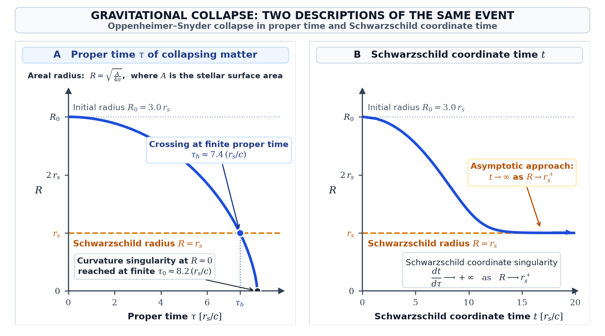
* **Proper Time vs. Coordinate Time**: Tracks a pressureless homogeneous dust star collapsing from $R_0 = 3r_s$, crossing the horizon in finite proper time $\tau$ (left) while approaching $r_s$ asymptotically in Schwarzschild coordinate time $t$ (right).
* **Script**: `code/generate_oppenheimer_snyder_collapse.py`

---

### 2. [Lense–Thirring Frame Dragging](code/generate_lense_thirring_animation.py)
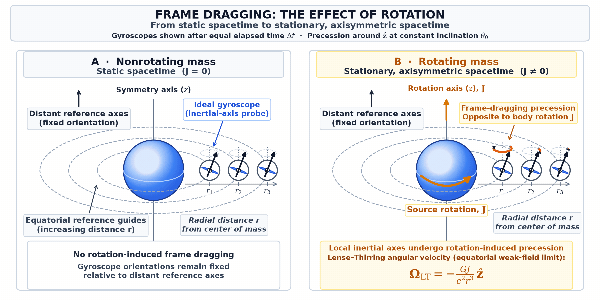
* **Static & Animated Comparison**: Contrasts a nonrotating mass (stationary gyroscope axes) with a rotating mass whose gravitomagnetic field drags inertial frames and induces gyroscope precession falling off as $1/r^3$ (static figure in `images/lense_thirring_frame_dragging.png`, animated MP4/GIF in `images/lense_thirring_frame_dragging_animation.*`).
* **Scripts**: `code/generate_lense_thirring_frame_dragging.py`, `code/generate_lense_thirring_animation.py`

---

### 3. [From Curvature to the Kerr Solution: Petrov Types & Optical Congruences](code/generate_from_curvature_to_kerr_solution.py)
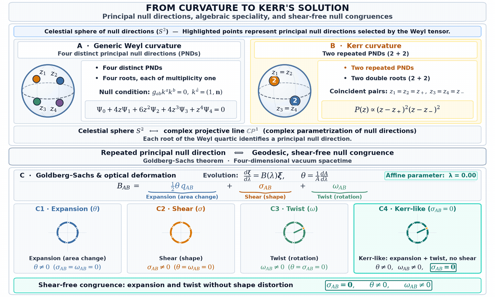
* **Algebraic Specialness & Null Congruences**: Contrasts four distinct principal null directions in generic Petrov Type I spacetimes with two repeated directions in Type D Kerr spacetime alongside expansion, shear, twist, and shear-free twisting null congruences.
* **Script**: `code/generate_from_curvature_to_kerr_solution.py`

---

### 4. [Boyer–Lindquist Coordinates in Kerr Spacetime](code/generate_boyer_lindquist_coordinates.py)
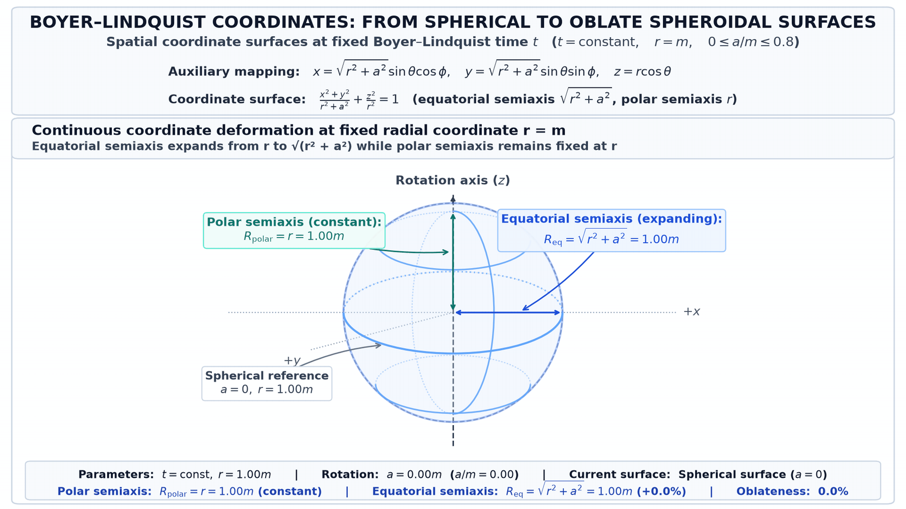
* **Spherical-to-Oblate Transition**: Visualizes coordinate surfaces of constant radial coordinate $r = m$ transforming from spherical ($a = 0$) into oblate spheroids as the Kerr spin parameter $a$ increases toward extremality.
* **Script**: `code/generate_boyer_lindquist_coordinates.py`

---

### 5. [Anatomy of a Rotating Kerr Black Hole](code/generate_kerr_black_hole_anatomy.py)
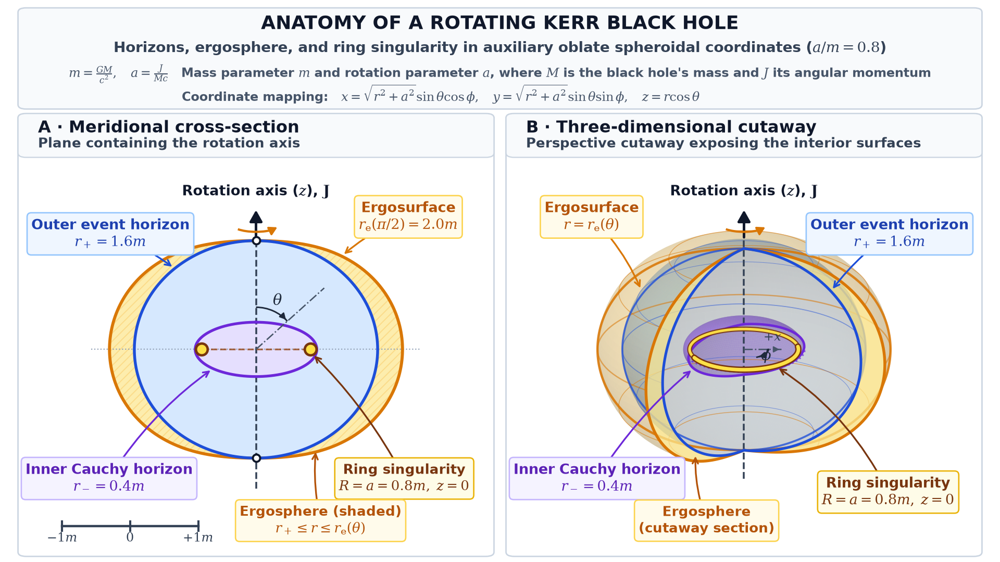
* **Cross-Sectional & 3D Architecture**: Shows the outer event horizon $r_+$, inner Cauchy horizon $r_-$, static-limit ergosphere $r_e(\theta)$, rotation axis, and equatorial ring singularity of radius $|a|$.
* **Script**: `code/generate_kerr_black_hole_anatomy.py`

---

### 6. [Bound Geodesic Orbits in Schwarzschild & Kerr Spacetimes](code/generate_geodesic_orbits_schwarzschild_kerr.py)
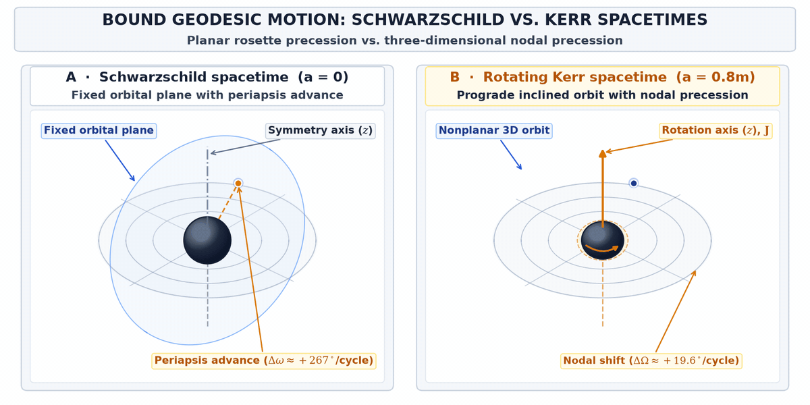
* **Planar Rosette vs. 3D Nodal Precession**: Compares inclined eccentric orbits ($p/m = 9$, $e = 0.25$, $\iota = 45^\circ$) computed via `KerrGeoPy` around a Schwarzschild black hole (planar rosette motion) and a prograde Kerr black hole ($a/m = 0.8$, $\Delta\Omega \approx +19.6^\circ$/cycle nodal precession).
* **Script**: `code/generate_geodesic_orbits_schwarzschild_kerr.py`

---

### 7. [Kerr Black-Hole Perturbations & Quasinormal Ringdown](code/generate_black_hole_perturbations_ringdown.py)
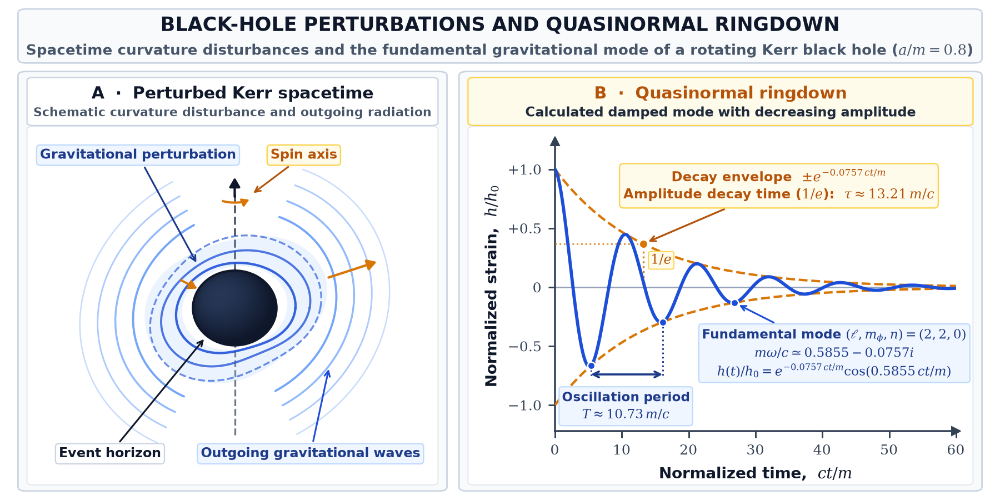
* **Perturbation Geometry & $(\ell=2, m=2, n=0)$ Waveform**: Illustrates outgoing gravitational radiation from a perturbed Kerr black hole ($a/m = 0.8$) alongside its exponentially damped quasinormal ringdown waveform ($\omega_R m \approx 0.5855$, $\gamma m \approx 0.0757$).
* **Script**: `code/generate_black_hole_perturbations_ringdown.py`

---

### 8. [The Penrose Process & Rotational Energy Extraction](code/generate_penrose_process.py)
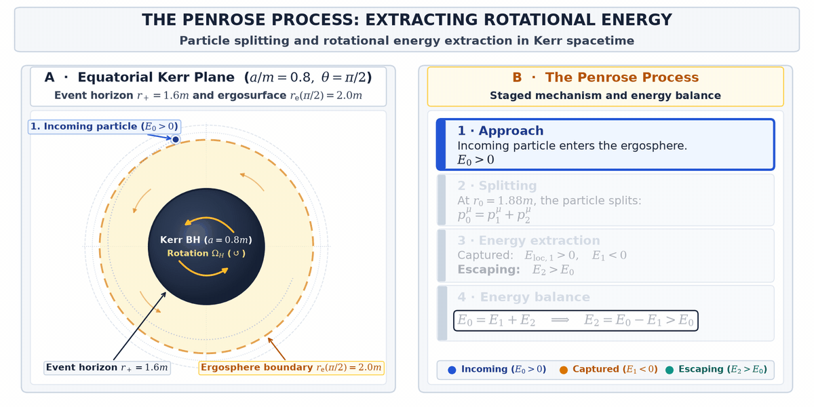
* **Exact Relativistic Geodesic Simulation**: Tracks an incoming test particle splitting at $r_0 = 1.72\,m$ inside the Kerr ergosphere ($a = 0.8\,m$): one fragment falls through $r_+ = 1.6\,m$ with negative conserved energy ($E_1 < 0$), while the other escapes to infinity with boosted energy ($E_2 > E_0$).
* **Script**: `code/generate_penrose_process.py`

---

### 9. [Hawking’s Classical Area Theorem](code/generate_hawking_area_theorem.py)
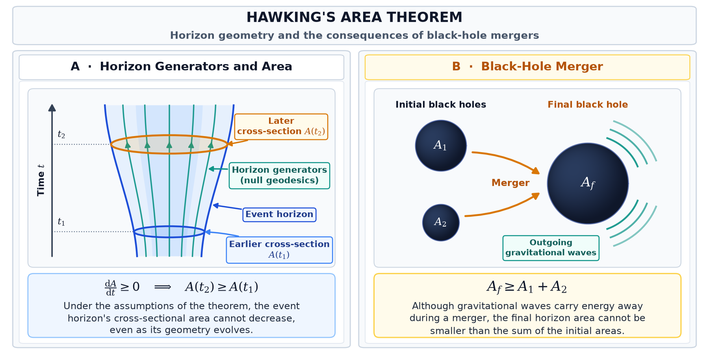
* **Irreversibility of Horizon Area**: Depicts nondecreasing horizon area ($\Delta A \ge 0$) during perturbation absorption and the binary black-hole merger bound ($A_{\mathrm{final}} \ge A_1 + A_2$) even while gravitational waves radiate mass-energy.
* **Script**: `code/generate_hawking_area_theorem.py`

---

### 10. [Bekenstein’s Generalized Second Law](code/generate_bekenstein_gsl.py)
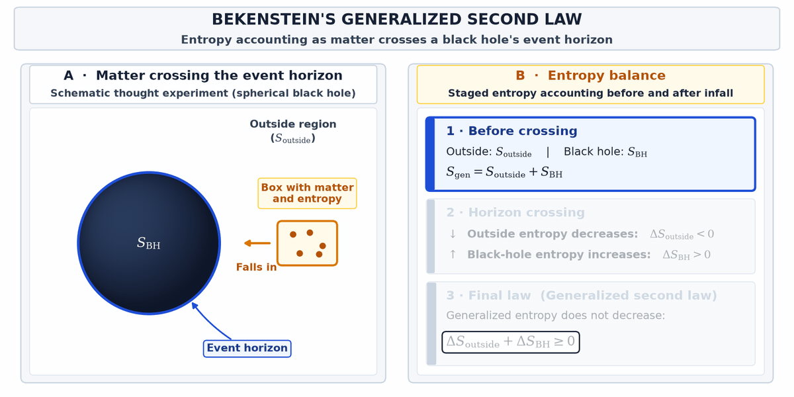
* **Exterior Entropy vs. Horizon Entropy**: Animates a thermodynamic box carrying entropy $S_{\mathrm{ext}}$ across the event horizon: exterior entropy vanishes while black-hole mass, horizon radius $r_s$, and entropy $S_{\mathrm{BH}} \propto A$ grow to preserve $\Delta S_{\mathrm{gen}} \ge 0$.
* **Script**: `code/generate_bekenstein_gsl.py`

---

### 11. [Hawking Radiation & Thermal Collapse Spectrum](code/generate_hawking_radiation_collapse_spectrum.py)
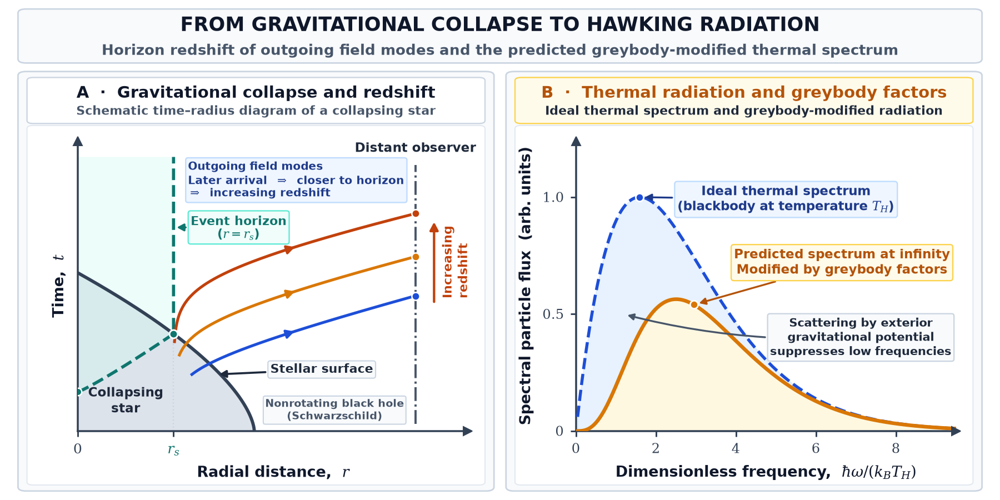
* **Collapse Redshift & Greybody-Modulated Planck Spectrum**: Links extreme gravitational redshift along outgoing null rays near horizon formation (left) to the emergent blackbody emission at $T_H$ attenuated by frequency-dependent greybody transmission factors $\Gamma_\ell(\omega)$ (right).
* **Script**: `code/generate_hawking_radiation_collapse_spectrum.py`

---

## 📁 Directory Structure

```
the_golden_age_of_black_hole_physics/
├── README.md                                                 # Project documentation, figure gallery & bibliography
├── requirements.txt                                          # Python dependencies
├── images/                                                   # Pre-rendered high-resolution scientific figures & animations
│   ├── oppenheimer_snyder_collapse.png
│   ├── lense_thirring_frame_dragging.png
│   ├── lense_thirring_frame_dragging_animation.gif
│   ├── lense_thirring_frame_dragging_animation.mp4
│   ├── from_curvature_to_kerr_solution.png
│   ├── from_curvature_to_kerr_solution_animation.gif
│   ├── from_curvature_to_kerr_solution_animation.mp4
│   ├── boyer_lindquist_coordinates.png
│   ├── boyer_lindquist_coordinates_animation.gif
│   ├── boyer_lindquist_coordinates_animation.mp4
│   ├── kerr_black_hole_anatomy.png
│   ├── geodesic_orbits_schwarzschild_kerr.png
│   ├── geodesic_orbits_schwarzschild_kerr_animation.gif
│   ├── geodesic_orbits_schwarzschild_kerr_animation.mp4
│   ├── black_hole_perturbations_ringdown.png
│   ├── penrose_process.png
│   ├── penrose_process_animation.gif
│   ├── penrose_process_animation.mp4
│   ├── hawking_area_theorem.png
│   ├── bekenstein_gsl.png
│   ├── bekenstein_gsl_animation.gif
│   ├── bekenstein_gsl_animation.mp4
│   ├── hawking_radiation_collapse_spectrum.png
│   └── math/                                                 # Compiled display-math equation PNGs
├── code/                                                     # Standalone, runnable generation scripts & relativistic models
│   ├── generate_all_figures.py                               # Master batch runner for all 12 scientific figure/animation scripts
│   ├── generate_oppenheimer_snyder_collapse.py
│   ├── generate_lense_thirring_frame_dragging.py
│   ├── generate_lense_thirring_animation.py
│   ├── generate_from_curvature_to_kerr_solution.py
│   ├── generate_boyer_lindquist_coordinates.py
│   ├── generate_kerr_black_hole_anatomy.py
│   ├── generate_geodesic_orbits_schwarzschild_kerr.py
│   ├── generate_black_hole_perturbations_ringdown.py
│   ├── generate_penrose_process.py
│   ├── generate_hawking_area_theorem.py
│   ├── generate_bekenstein_gsl.py
│   └── generate_hawking_radiation_collapse_spectrum.py
└── tests/                                                    # Automated physics & figure verification suite
    ├── __init__.py
    └── test_physics_and_figures.py                           # Kerr geometry, geodesics, thermodynamics & rendering tests
```

---

## 🚀 Running the Code

### Dependencies
Install the required scientific Python packages (`ffmpeg` on `PATH` is also required when regenerating `.mp4` and `.gif` animations):

```bash
pip install -r requirements.txt
```

### Generate All Figures
Execute the master runner to produce all static scientific figures into `images/` (or omit `--static-only` to also regenerate all `.mp4` and `.gif` animations):

```bash
python3 code/generate_all_figures.py --static-only
python3 code/generate_all_figures.py
```

### Generate Figures & Animations Individually
Each script is self-contained and can be run directly:

```bash
python3 code/generate_oppenheimer_snyder_collapse.py
python3 code/generate_lense_thirring_frame_dragging.py
python3 code/generate_lense_thirring_animation.py
python3 code/generate_from_curvature_to_kerr_solution.py
python3 code/generate_boyer_lindquist_coordinates.py
python3 code/generate_kerr_black_hole_anatomy.py
python3 code/generate_geodesic_orbits_schwarzschild_kerr.py
python3 code/generate_black_hole_perturbations_ringdown.py
python3 code/generate_penrose_process.py
python3 code/generate_hawking_area_theorem.py
python3 code/generate_bekenstein_gsl.py
python3 code/generate_hawking_radiation_collapse_spectrum.py
```

---

## 🧪 Running the Test Suite

A comprehensive test suite validates both the relativistic/thermodynamic derivations and the rendering integrity of all figures:

```bash
# Run using standard library unittest
python3 -m unittest discover -s tests -t . -v

# Or run using pytest
pytest tests/ -v
```

The test suite validates:
1. **Kerr Spacetime Geometry & First Law**: Verifies outer/inner horizons $r_\pm = m \pm \sqrt{m^2 - a^2}$, the extremal limit ($a = m$), ergosphere enclosure $r_e(\theta) \ge r_+$, and the differential First Law $\delta M = (\kappa / 8\pi)\,\delta A$ at constant angular momentum $J$.
2. **Collapse Trajectories, Optical Congruences & Ringdown**: Confirms finite proper-time horizon crossing and coordinate-time asymptotic freeze in Oppenheimer–Snyder collapse, orthogonal invariance of shear-free Petrov congruences, and Kerr $(2,2,0)$ quasinormal mode parameters.
3. **3D Kerr Geodesic Integrability & Penrose Splitting**: Verifies planar Schwarzschild rosette orbits vs. $19.6^\circ$/cycle Kerr nodal precession via `KerrGeoPy`, plus exact 4-momentum conservation ($E_0 = E_1 + E_2$, $L_{z,0} = L_{z,1} + L_{z,2}$), future-directedness, capture ($E_1 < 0$), and boosted escape ($E_2 > E_0$) in the Penrose process.
4. **Black-Hole Thermodynamics**: Validates Bekenstein GSL animation state transitions and SI Hawking temperature inverse-mass scaling ($T_H \approx 6.17 \times 10^{-8}\text{ K}$ for $1\,M_\odot$).
5. **Asset & Rendering Pipeline Integrity**: Verifies all 23 scientific PNG/GIF/MP4 files in `images/`, the compiled display-math PNGs in `images/math/`, and isolated rendering of the static figure and poster generators into temporary workspaces.

---

## 📚 References & Further Reading

1. **Schwarzschild, K. (1916).** *Über das Gravitationsfeld eines Massenpunktes nach der Einsteinschen Theorie.* Sitzungsberichte der Königlich Preußischen Akademie der Wissenschaften, 189–196. [Original German text: Wikisource](https://de.wikisource.org/wiki/%C3%9Cber_das_Gravitationsfeld_eines_Massenpunktes_nach_der_Einsteinschen_Theorie)
2. **Lense, J., & Thirring, H. (1918).** *Über den Einfluß der Eigenrotation der Zentralkörper auf die Bewegung der Planeten und Monde nach der Einsteinschen Gravitationstheorie.* Physikalische Zeitschrift, 19, 156–163. English translation: General Relativity and Gravitation, 16(8), 727–741 (1984). [Publisher: Springer](https://doi.org/10.1007/BF00762913)
3. **Jebsen, J. T. (1921).** *Über die allgemeinen kugelsymmetrischen Lösungen der Einsteinschen Gravitationsgleichungen im Vakuum.* Arkiv för Matematik, Astronomi och Fysik, 15(18), 1–9. English translation: General Relativity and Gravitation, 37(12), 2253–2259 (2005). [Publisher: Springer](https://doi.org/10.1007/s10714-005-0168-y)
4. **Birkhoff, G. D. (1923).** *Relativity and Modern Physics.* Harvard University Press, particularly p. 253. [Book record: Google Books](https://books.google.com/books?id=SmAmAAAAMAAJ)
5. **Chandrasekhar, S. (1931).** *The Highly Collapsed Configurations of a Stellar Mass.* Monthly Notices of the Royal Astronomical Society, 91(5), 456–466. [Original paper: Oxford Academic](https://doi.org/10.1093/mnras/91.5.456) · [Original scan: NASA ADS](https://articles.adsabs.harvard.edu/pdf/1931MNRAS..91..456C)
6. **Chandrasekhar, S. (1931).** *The Maximum Mass of Ideal White Dwarfs.* The Astrophysical Journal, 74, 81–82. [Original paper: IOPscience](https://doi.org/10.1086/143324) · [Original scan: NASA ADS](https://articles.adsabs.harvard.edu/pdf/1931ApJ....74...81C)
7. **Lewis, T. (1932).** *Some Special Solutions of the Equations of Axially Symmetric Gravitational Fields.* Proceedings of the Royal Society of London A, 136(829), 176–192. [Original paper: Royal Society](https://doi.org/10.1098/rspa.1932.0073)
8. **Lemaître, G. (1933).** *L'univers en expansion.* Annales de la Société Scientifique de Bruxelles, Série A, 53, 51–85. [Université catholique de Louvain archives](https://archives.uclouvain.be/ark:/33176/dli000000eXt8)
9. **Eddington, A. S. (1935).** *On “Relativistic Degeneracy”.* Monthly Notices of the Royal Astronomical Society, 95(3), 194–206. [Original paper: Oxford Academic](https://doi.org/10.1093/mnras/95.3.194)
10. **Einstein, A. (1939).** *On a Stationary System with Spherical Symmetry Consisting of Many Gravitating Masses.* Annals of Mathematics, 40(4), 922–936. [Original paper: JSTOR](https://doi.org/10.2307/1968902)
11. **Oppenheimer, J. R., & Snyder, H. (1939).** *On Continued Gravitational Contraction.* Physical Review, 56(5), 455–459. [Original paper: American Physical Society](https://doi.org/10.1103/PhysRev.56.455)
12. **Papapetrou, A. (1953).** *Eine rotationssymmetrische Lösung in der allgemeinen Relativitätstheorie.* Annalen der Physik, 12(4–6), 309–315. [Original paper: Wiley](https://doi.org/10.1002/andp.19534470412)
13. **Petrov, A. Z. (1954).** *Classification of Spaces Defining Gravitational Fields.* Uchenye Zapiski Kazanskogo Universiteta, 114(8), 55–69. [Original publication record: Math-Net.Ru](https://www.mathnet.ru/eng/uzku344)
14. **Pirani, F. A. E. (1957).** *Invariant Formulation of Gravitational Radiation Theory.* Physical Review, 105(3), 1089–1099. [Original paper: American Physical Society](https://doi.org/10.1103/PhysRev.105.1089)
15. **Regge, T., & Wheeler, J. A. (1957).** *Stability of a Schwarzschild Singularity.* Physical Review, 108(4), 1063–1069. [Original paper: American Physical Society](https://doi.org/10.1103/PhysRev.108.1063)
16. **Finkelstein, D. (1958).** *Past-Future Asymmetry of the Gravitational Field of a Point Particle.* Physical Review, 110(4), 965–967. [Original paper: American Physical Society](https://doi.org/10.1103/PhysRev.110.965)
17. **Adams, J. B., Harrison, B. K., Klauder, L. T., Jr., Mjolsness, R., Wakano, M., Wheeler, J. A., & Willey, R. (1958/1959).** *Some Implications of General Relativity for the Structure and Evolution of the Universe.* Presented at the Eleventh Solvay Conference, Brussels, June 1958. [Primary report: Solvay Institutes](https://solvayinstitutes.be/wp-content/uploads/2025/10/Proceedings-Physics-1958.pdf)
18. **Dautcourt, G. (1959).** *Sur la solution de l'équation d'Einstein g_μ+ν-;ρ = 0.* Comptes Rendus de l'Académie des Sciences, Paris, 249, 2159–2161. [Original scan: Bibliothèque nationale de France (Gallica)](https://gallica.bnf.fr/ark:/12148/bpt6k731d/f1033) · [Bibliographic record: INSPIRE-HEP](https://inspirehep.net/literature/45499)
19. **Fronsdal, C. (1959).** *Completion and Embedding of the Schwarzschild Solution.* Physical Review, 116(3), 778–781. [Original paper: American Physical Society](https://doi.org/10.1103/PhysRev.116.778)
20. **Robinson, I., & Trautman, A. (1960).** *Spherical Gravitational Waves.* Physical Review Letters, 4(8), 431–432. [Original paper: American Physical Society](https://doi.org/10.1103/PhysRevLett.4.431)
21. **Kruskal, M. D. (1960).** *Maximal Extension of Schwarzschild Metric.* Physical Review, 119(5), 1743–1745. [Original paper: American Physical Society](https://doi.org/10.1103/PhysRev.119.1743)
22. **Szekeres, G. (1960).** *On the Singularities of a Riemannian Manifold.* Publicationes Mathematicae Debrecen, 7, 285–301. [Original paper: Publicationes Mathematicae Debrecen](https://doi.org/10.5486/PMD.1960.7.1-4.26)
23. **Goldberg, J. N., & Sachs, R. K. (1962).** *A Theorem on Petrov Types.* Acta Physica Polonica, Supplementum, 22, 13–23. Republication: General Relativity and Gravitation, 41(2), 433–444 (2009). [Publisher: Springer](https://doi.org/10.1007/s10714-008-0722-5)
24. **Newman, E. T., & Penrose, R. (1962).** *An Approach to Gravitational Radiation by a Method of Spin Coefficients.* Journal of Mathematical Physics, 3(3), 566–578. [Original paper: AIP](https://doi.org/10.1063/1.1724257)
25. **Ehlers, J., & Kundt, W. (1962).** *Exact Solutions of the Gravitational Field Equations.* In L. Witten (Ed.), *Gravitation: An Introduction to Current Research*, pp. 49–101. John Wiley & Sons. [Bibliographic record: NASA ADS](https://ui.adsabs.harvard.edu/abs/1962gait.book.....W/abstract)
26. **Schmidt, M. (1963).** *3C 273: A Star-Like Object with Large Red-Shift.* Nature, 197(4872), 1040. [Original paper: Nature](https://doi.org/10.1038/1971040a0)
27. **Newman, E. T., Tamburino, L. A., & Unti, T. (1963).** *Empty-Space Generalization of the Schwarzschild Metric.* Journal of Mathematical Physics, 4(7), 915–923. [Original paper: AIP](https://doi.org/10.1063/1.1704018)
28. **Kerr, R. P. (1963).** *Gravitational Field of a Spinning Mass as an Example of Algebraically Special Metrics.* Physical Review Letters, 11(5), 237–238. [Original paper: American Physical Society](https://doi.org/10.1103/PhysRevLett.11.237)
29. **Penrose, R. (1965).** *Gravitational Collapse and Space-Time Singularities.* Physical Review Letters, 14(3), 57–59. [Original paper: American Physical Society](https://doi.org/10.1103/PhysRevLett.14.57)
30. **Newman, E. T., Couch, E., Chinnapared, K., Exton, A., Prakash, A., & Torrence, R. (1965).** *Metric of a Rotating, Charged Mass.* Journal of Mathematical Physics, 6(6), 918–919. [Original paper: AIP](https://doi.org/10.1063/1.1704351)
31. **Boyer, R. H., & Lindquist, R. W. (1967).** *Maximal Analytic Extension of the Kerr Metric.* Journal of Mathematical Physics, 8(2), 265–281. [Original paper: AIP](https://doi.org/10.1063/1.1705193)
32. **Israel, W. (1967).** *Event Horizons in Static Vacuum Space-Times.* Physical Review, 164(5), 1776–1779. [Original paper: American Physical Society](https://doi.org/10.1103/PhysRev.164.1776)
33. **Carter, B. (1968).** *Global Structure of the Kerr Family of Gravitational Fields.* Physical Review, 174(5), 1559–1571. [Original paper: American Physical Society](https://doi.org/10.1103/PhysRev.174.1559)
34. **Carter, B. (1968).** *Hamilton–Jacobi and Schrödinger Separable Solutions of Einstein's Equations.* Communications in Mathematical Physics, 10(4), 280–310. [Original paper: Springer](https://doi.org/10.1007/BF03399503)
35. **Penrose, R. (1969).** *Gravitational Collapse: The Role of General Relativity.* Rivista del Nuovo Cimento, Numero Speciale 1, 252–276. Republication: General Relativity and Gravitation, 34(7), 1141–1165 (2002). [Reprint: General Relativity and Gravitation (2002)](https://doi.org/10.1023/A:1016578408204) · [Reprint PDF](https://www.physics.umd.edu/grt/taj/675e/Penrose-collapse.pdf)
36. **Parker, L. (1969).** *Quantized Fields and Particle Creation in Expanding Universes. I.* Physical Review, 183(5), 1057–1068. [Original paper: American Physical Society](https://doi.org/10.1103/PhysRev.183.1057)
37. **Vishveshwara, C. V. (1970).** *Stability of the Schwarzschild Metric.* Physical Review D, 1(10), 2870–2879. [Original paper: American Physical Society](https://doi.org/10.1103/PhysRevD.1.2870)
38. **Vishveshwara, C. V. (1970).** *Scattering of Gravitational Radiation by a Schwarzschild Black-hole.* Nature, 227, 936–938. [Original paper: Nature](https://doi.org/10.1038/227936a0)
39. **Walker, M., & Penrose, R. (1970).** *On Quadratic First Integrals of the Geodesic Equations for Type {22} Spacetimes.* Communications in Mathematical Physics, 18(4), 265–274. [Original paper: Springer](https://doi.org/10.1007/BF01649445)
40. **Christodoulou, D. (1970).** *Reversible and Irreversible Transformations in Black-Hole Physics.* Physical Review Letters, 25(22), 1596–1597. [Original paper: American Physical Society](https://doi.org/10.1103/PhysRevLett.25.1596)
41. **Carter, B. (1971).** *Axisymmetric Black Hole Has Only Two Degrees of Freedom.* Physical Review Letters, 26(6), 331–333. [Original paper: American Physical Society](https://doi.org/10.1103/PhysRevLett.26.331)
42. **Penrose, R., & Floyd, R. M. (1971).** *Extraction of Rotational Energy from a Black Hole.* Nature Physical Science, 229, 177–179. [Original paper: Nature](https://doi.org/10.1038/physci229177a0)
43. **Christodoulou, D., & Ruffini, R. (1971).** *Reversible Transformations of a Charged Black Hole.* Physical Review D, 4(12), 3552–3555. [Original paper: American Physical Society](https://doi.org/10.1103/PhysRevD.4.3552)
44. **Hawking, S. W. (1971).** *Gravitational Radiation from Colliding Black Holes.* Physical Review Letters, 26(21), 1344–1346. [Original paper: American Physical Society](https://doi.org/10.1103/PhysRevLett.26.1344)
45. **Zel'dovich, Ya. B. (1971).** *The Generation of Waves by a Rotating Body.* JETP Letters, 14(4), 180–181. Russian original: Pis'ma Zh. Eksp. Teor. Fiz., 14, 270–272. [Original paper: JETP Letters archive](http://jetpletters.ru/ps/1604/article_24607.shtml) · [PDF](http://jetpletters.ru/ps/1604/article_24607.pdf) · [Bibliographic record: Sonoma State University](https://phys-astro.sonoma.edu/brucemedalists/yakov-zeldovich)
46. **Wilkins, D. C. (1972).** *Bound Geodesics in the Kerr Metric.* Physical Review D, 5(4), 814–822. [Original paper: American Physical Society](https://doi.org/10.1103/PhysRevD.5.814)
47. **Price, R. H. (1972).** *Nonspherical Perturbations of Relativistic Gravitational Collapse. I. Scalar and Gravitational Perturbations.* Physical Review D, 5(10), 2419–2438. [Original paper: American Physical Society](https://doi.org/10.1103/PhysRevD.5.2419)
48. **Hawking, S. W. (1972).** *Black Holes in General Relativity.* Communications in Mathematical Physics, 25(2), 152–166. [Original paper: Springer](https://doi.org/10.1007/BF01877517)
49. **Press, W. H., & Teukolsky, S. A. (1972).** *Floating Orbits, Superradiant Scattering and the Black-hole Bomb.* Nature, 238, 211–212. [Original paper: Nature](https://doi.org/10.1038/238211a0)
50. **Bekenstein, J. D. (1972).** *Black Holes and the Second Law.* Lettere al Nuovo Cimento, 4(15), 737–740. [Original paper: Springer](https://doi.org/10.1007/BF02757029)
51. **Teukolsky, S. A. (1972).** *Rotating Black Holes: Separable Wave Equations for Gravitational and Electromagnetic Perturbations.* Physical Review Letters, 29(16), 1114–1118. [Original paper: American Physical Society](https://doi.org/10.1103/PhysRevLett.29.1114)
52. **Bardeen, J. M., Press, W. H., & Teukolsky, S. A. (1972).** *Rotating Black Holes: Locally Nonrotating Frames, Energy Extraction, and Scalar Synchrotron Radiation.* The Astrophysical Journal, 178, 347–369. [Original paper: IOPscience](https://doi.org/10.1086/151796)
53. **Smarr, L. (1973).** *Mass Formula for Kerr Black Holes.* Physical Review Letters, 30(2), 71–73. [Original paper: American Physical Society](https://doi.org/10.1103/PhysRevLett.30.71) · Erratum: Physical Review Letters, 30, 521 (1973). [APS correction](https://doi.org/10.1103/PhysRevLett.30.521)
54. **Bekenstein, J. D. (1973).** *Black Holes and Entropy.* Physical Review D, 7(8), 2333–2346. [Original paper: American Physical Society](https://doi.org/10.1103/PhysRevD.7.2333)
55. **Fulling, S. A. (1973).** *Nonuniqueness of Canonical Field Quantization in Riemannian Space-Time.* Physical Review D, 7(10), 2850–2862. [Original paper: American Physical Society](https://doi.org/10.1103/PhysRevD.7.2850)
56. **Bardeen, J. M., Carter, B., & Hawking, S. W. (1973).** *The Four Laws of Black Hole Mechanics.* Communications in Mathematical Physics, 31(2), 161–170. [Original paper: Springer](https://doi.org/10.1007/BF01645742)
57. **Starobinsky, A. A. (1973).** *Amplification of Waves During Reflection from a Rotating “Black Hole”.* Soviet Physics JETP, 37(1), 28–32. Russian original: Zh. Eksp. Teor. Fiz., 64, 48–57. [Original paper: JETP archive](https://jetp.ras.ru/cgi-bin/e/index/e/37/1/p28?a=list)
58. **Teukolsky, S. A. (1973).** *Perturbations of a Rotating Black Hole. I. Fundamental Equations for Gravitational, Electromagnetic, and Neutrino-Field Perturbations.* The Astrophysical Journal, 185, 635–647. [Original paper: IOPscience](https://doi.org/10.1086/152444)
59. **Starobinsky, A. A., & Churilov, S. M. (1973/1974).** *Amplification of Electromagnetic and Gravitational Waves Scattered by a Rotating “Black Hole”.* Zh. Eksp. Teor. Fiz., 65, 3–11 (1973). English translation: Soviet Physics JETP, 38(1), 1–5 (1974). [English paper: JETP archive](https://www.jetp.ras.ru/cgi-bin/e/index/e/38/1/p1?a=list)
60. **Hawking, S. W. (1974).** *Black hole explosions?* Nature, 248, 30–31. [Original paper: Nature](https://doi.org/10.1038/248030a0)
61. **Bekenstein, J. D. (1974).** *Generalized Second Law of Thermodynamics in Black-Hole Physics.* Physical Review D, 9(12), 3292–3300. [Original paper: American Physical Society](https://doi.org/10.1103/PhysRevD.9.3292)
62. **Thorne, K. S. (1974).** *Disk-Accretion onto a Black Hole. II. Evolution of the Hole.* The Astrophysical Journal, 191, 507–519. [Original paper: IOPscience](https://doi.org/10.1086/152991) · [Bibliographic record: NASA ADS](https://ui.adsabs.harvard.edu/abs/1974ApJ...191..507T/abstract)
63. **Robinson, D. C. (1975).** *Uniqueness of the Kerr Black Hole.* Physical Review Letters, 34(14), 905–906. [Original paper: American Physical Society](https://doi.org/10.1103/PhysRevLett.34.905)
64. **Hawking, S. W. (1975).** *Particle Creation by Black Holes.* Communications in Mathematical Physics, 43(3), 199–220. [Original paper: Springer](https://doi.org/10.1007/BF02345020)
65. **Hawking, S. W. (1988).** *A Brief History of Time: From the Big Bang to Black Holes.* Bantam Books. [Publisher: Penguin Random House](https://www.penguinrandomhouse.com/books/77010/a-brief-history-of-time-by-stephen-hawking/)  
   In Chapter 7, *Black Holes Ain't So Black*, Hawking describes his September 1973 discussions with Zel'dovich and Starobinsky in Moscow, his initial expectations, and his earlier skepticism toward Bekenstein's entropy proposal.
66. **Eisenstaedt, J. (1989).** *The Low Water-Mark of General Relativity, 1925–1955.* In D. Howard & J. Stachel (Eds.), *Einstein and the History of General Relativity* (*Einstein Studies*, Vol. 1), pp. 277–292. Birkhäuser. [Publisher: Springer](https://link.springer.com/book/9780817633929)  
   A historical study analyzing the period of relative stagnation in general relativity between the mid-1920s and mid-1950s, introducing the characterization of this era as the theory's “low-water mark.”
67. **Carter, B. (1997/1999).** *Has the Black Hole Equilibrium Problem Been Solved?* In T. Piran (Ed.), *The Eighth Marcel Grossmann Meeting on Recent Developments in Theoretical and Experimental General Relativity, Gravitation and Relativistic Field Theories*, pp. 136–155. World Scientific, Singapore (1999). [arXiv:gr-qc/9712038](https://arxiv.org/abs/gr-qc/9712038)
68. **Eisenstaedt, J. (2006).** *The Curious History of Relativity: How Einstein's Theory of Gravity Was Lost and Found Again.* Translated by Arturo Sangalli. Princeton University Press. [Publisher: Princeton University Press](https://press.princeton.edu/books/hardcover/9780691118659/the-curious-history-of-relativity)  
   A historical study examining the period of stagnation in general relativity between the mid-1920s and mid-1950s, the conceptual resistance to black holes, and the subsequent revival of the field.
69. **Berti, E., Cardoso, V., & Will, C. M. (2006).** *Gravitational-Wave Spectroscopy of Massive Black Holes with the Space Interferometer LISA.* Physical Review D, 73(6), 064030. [Original paper: American Physical Society](https://doi.org/10.1103/PhysRevD.73.064030) · [arXiv:gr-qc/0512160](https://arxiv.org/abs/gr-qc/0512160)
70. **Johansen, N. V., & Ravndal, F. (2006).** *On the Discovery of Birkhoff's Theorem.* General Relativity and Gravitation, 38(3), 537–540. [Original paper: Springer](https://doi.org/10.1007/s10714-006-0242-0) · [arXiv:physics/0508163](https://arxiv.org/abs/physics/0508163)  
   A historical account of Jørg Tofte Jebsen's 1921 derivation of the theorem proving that any spherically symmetric vacuum solution is static and described by the Schwarzschild metric, two years before Birkhoff's independent proof.
71. **Kerr, R. P. (2007).** *Discovering the Kerr and Kerr-Schild Metrics.* [arXiv:0706.1109](https://arxiv.org/abs/0706.1109)  
   A first-hand account of the discovery, including the mathematical reasoning and historical circumstances.
72. **Dautcourt, G. (2009).** *Race for the Kerr Field.* General Relativity and Gravitation, 41(6), 1437–1454. [Original paper: Springer](https://doi.org/10.1007/s10714-008-0700-y) · [arXiv:0807.3473](https://arxiv.org/abs/0807.3473)  
   A historical account of the attempts to find an exact rotating solution of Einstein's field equations, the work preceding Kerr's 1963 discovery, and the circumstances surrounding that breakthrough.
73. **Teukolsky, S. A. (2015).** *The Kerr Metric: A Personal Retrospective.* Classical and Quantum Gravity, 32(12), 124006. [Original paper: IOPscience](https://doi.org/10.1088/0264-9381/32/12/124006) · [arXiv:1410.2130](https://arxiv.org/abs/1410.2130)  
   A retrospective discussing the significance of Kerr's solution and subsequent developments in black-hole physics.
74. **Park, S., & Nasipak, Z. (2024).** *KerrGeoPy: A Python Package for Computing Timelike Geodesics in Kerr Spacetime.* Journal of Open Source Software, 9(98), 6587. [Original paper: JOSS](https://doi.org/10.21105/joss.06587) · [Source code: GitHub](https://github.com/blackholeperturbationtoolkit/kerrgeopy) · [Black Hole Perturbation Toolkit](https://bhptoolkit.org/)

---

## 📄 License

This project is licensed under the MIT License - see the [LICENSE](../LICENSE) file for details.
