# From Poincaré to Chaos: The Road to Modern Dynamics II

This directory contains the standalone Python codebase, numerical simulation models, and scientific visualization suite supporting the technical article on **From Poincaré to Chaos: The Road to Modern Dynamics II**, published in [**The Quantastic Journal**](https://thequantasticjournal.com/).

---

## 🌌 Overview & Physical Architecture

In the late nineteenth century, celestial mechanics confronted an insurmountable barrier: the three-body problem could not be solved by closed-form analytical integrations or convergent series expansions. Henri Poincaré revolutionized the field by shifting the mathematical paradigm from quantitative formulas to qualitative geometry—asking not *where* a system will be at every instant, but *how* trajectories behave globally in phase space.

This project reconstructs the foundational theories, numerical simulations, and geometric milestones that gave birth to modern dynamical systems and chaos theory:

1. **The Qualitative Geometry of the Phase Plane**:
   Poincaré classified the local behavior of trajectories near singular points (equilibria) into nodes, saddle points, centers, and foci. The **Poincaré–Bendixson theorem** proved that bounded trajectories of autonomous planar systems cannot exhibit chaos; they must either terminate at an equilibrium or wind asymptotically onto a periodic orbit (limit cycle).
2. **The Restricted Three-Body Problem (CRTBP)**:
   In a rotating reference frame, the circular restricted three-body problem admits an effective potential $\Omega(x, y)$ and a single conserved quantity: the **Jacobi integral** $C_J = 2\Omega(x, y) - v^2$. The five Lagrange equilibrium points ($L_1, L_2, L_3$ collinear; $L_4, L_5$ triangular) govern the geometry of zero-velocity curves and transport conduits between celestial primaries.
3. **Poincaré Surfaces of Section & Return Maps**:
   By recording successive intersections of a continuous flow with a transverse codimension-one surface $\Sigma$, continuous $n$-dimensional differential equations are reduced to discrete $(n-1)$-dimensional recurrence maps $P: \Sigma \to \Sigma$. Periodic orbits appear as fixed points, and their orbital stability is governed by the eigenvalues (Floquet multipliers) of the linearized Jacobian $DP$.
4. **Symplectic Area Preservation & The Poincaré–Birkhoff Theorem**:
   For conservative two-degree-of-freedom Hamiltonian systems, the return map on an energy surface preserves the symplectic area element ($d\theta \wedge dp$, $\det DP = 1$). Poincaré conjectured and George David Birkhoff proved that any area-preserving twist map of an annulus that rotates the boundary circles in opposite directions possesses at least two fixed points, guaranteeing infinite families of periodic orbits in celestial mechanics.
5. **The Homoclinic Tangle & Deterministic Chaos**:
   When stable and unstable invariant manifolds of an unstable periodic orbit intersect transversely, they do so infinitely many times. The resulting homoclinic tangle forces phase space into an infinitely folded Smale horseshoe, establishing non-integrability, sensitive dependence on initial conditions, and chaotic dynamics in physical systems such as the conservative double pendulum.

---

## 📊 Scientific Figure Gallery

### 1. [Poincaré's Qualitative Approach to Planar Dynamical Systems](code/generate_poincare_planar_dynamics_infographic.py)
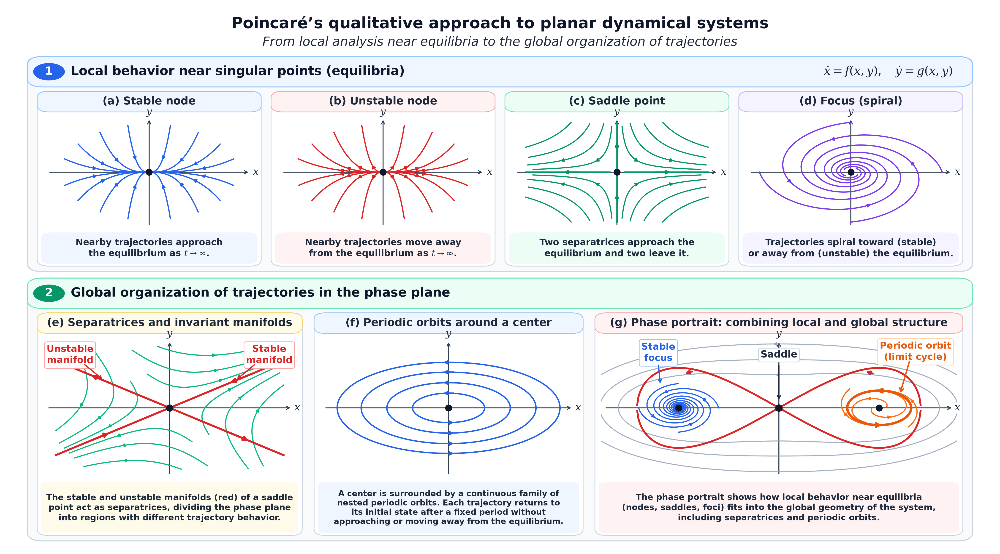
* **Part 1: Local Behavior Near Singular Points**:
  * **Nodes (Stable & Unstable)**: Real eigenvalues of identical sign ($\lambda_1, \lambda_2 < 0$ or $> 0$).
  * **Saddle Point**: Real eigenvalues of opposite sign ($\lambda_1 < 0 < \lambda_2$), defining local stable and unstable manifolds.
  * **Foci (Spirals)**: Complex conjugate eigenvalues ($\alpha \pm i\beta$), producing contracting or expanding logarithmic spirals.
* **Part 2: Global Organization of Trajectories in the Phase Plane**:
  * **Separatrices & Invariant Manifolds**: Boundary curves separating topologically distinct dynamical regimes (librational vs. rotational flow).
  * **Periodic Orbits Around a Center**: Continuous families of nested closed orbits with fixed periods.
  * **Attracting Limit Cycle**: Isolated closed orbit attracting nearby trajectories from both interior and exterior flow.
* **Script**: `code/generate_poincare_planar_dynamics_infographic.py`

---

### 2. [Historical Portraits: Henri Poincaré & Ivar Bendixson](code/generate_poincare_bendixson_portraits.py)
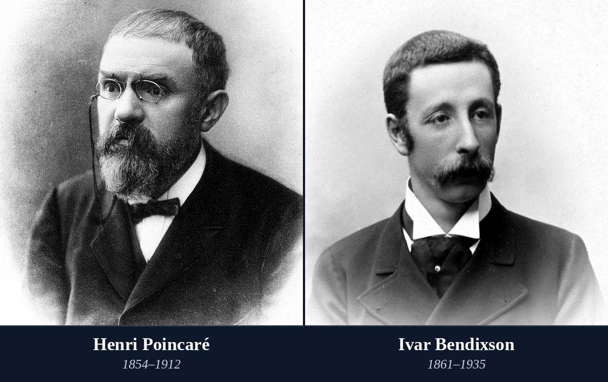
* **Historical Portrait Panel**:
  * **Henri Poincaré (1854–1912)**: Founder of qualitative dynamics, topology, and the modern geometric approach to celestial mechanics.
  * **Ivar Bendixson (1861–1935)**: Swedish mathematician who extended Poincaré's analysis into the rigorous modern formulation of the Poincaré–Bendixson theorem (1901).
* **Script**: `code/generate_poincare_bendixson_portraits.py`

---

### 3. [The Poincaré–Bendixson Theorem & Limit Cycles](code/generate_poincare_bendixson_figure.py)
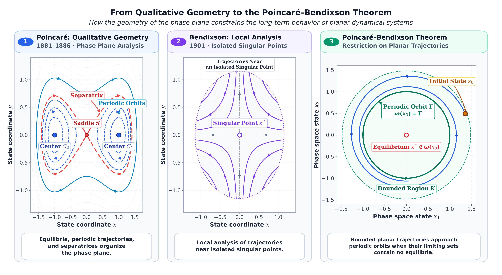
* **Three-Stage Progression**:
  * **Panel 1 (Poincaré 1881–1886)**: Qualitative classification of planar phase portraits and singular points.
  * **Panel 2 (Bendixson 1901)**: Rigorous topological criteria on the behavior of trajectories near singular points and non-existence criteria for periodic orbits.
  * **Panel 3 (Poincaré–Bendixson Theorem)**: In an autonomous planar system, a bounded trajectory in a compact region containing no equilibria must approach a periodic orbit.
* **Script**: `code/generate_poincare_bendixson_figure.py`

---

### 4. [Equilibrium Configurations & The Restricted 3-Body Problem](code/generate_three_body_solutions_crtbp.py)
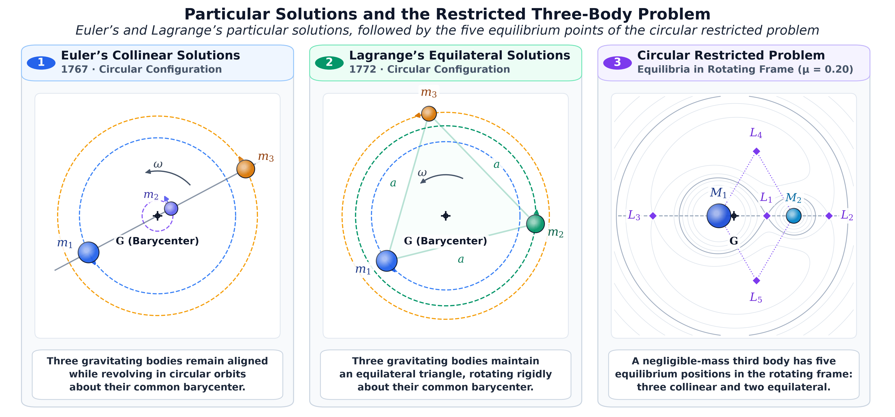
* **Exact Three-Body Configurations**:
  * **Euler's Collinear Solution (1767)**: Three masses revolving on a common rotating line.
  * **Lagrange's Equilateral Solution (1772)**: Three masses positioned at the vertices of an equilateral triangle.
  * **CRTBP Effective Potential & Five Lagrange Points**: Collinear saddles ($L_1, L_2, L_3$) and triangular equilibria ($L_4, L_5$) in the rotating frame with Jacobi constant zero-velocity curves.
* **Script**: `code/generate_three_body_solutions_crtbp.py`

---

### 5. [Poincaré Return Maps & Periodic Orbit Stability](code/generate_poincare_return_map_stability.py)
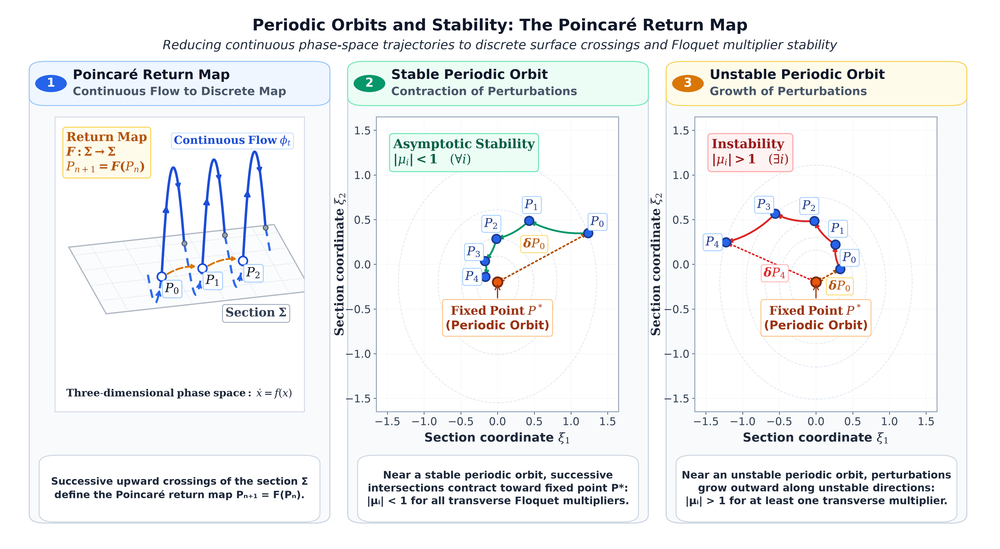
* **Discrete Map Reduction**:
  * Transverse section $\Sigma$ crossing continuous trajectories.
  * Fixed points $x^*$ representing closed periodic orbits $\gamma(t)$.
  * Stability classification via Floquet multipliers (eigenvalues $\lambda_i$ of the linearized return map $DP(x^*)$): asymptotic contraction ($|\lambda| < 1$) vs. perturbation expansion ($|\lambda| > 1$).
* **Script**: `code/generate_poincare_return_map_stability.py`

---

### 6. [Invariant Manifolds & The Homoclinic Tangle](images/poincare_homoclinic_tangle.png)
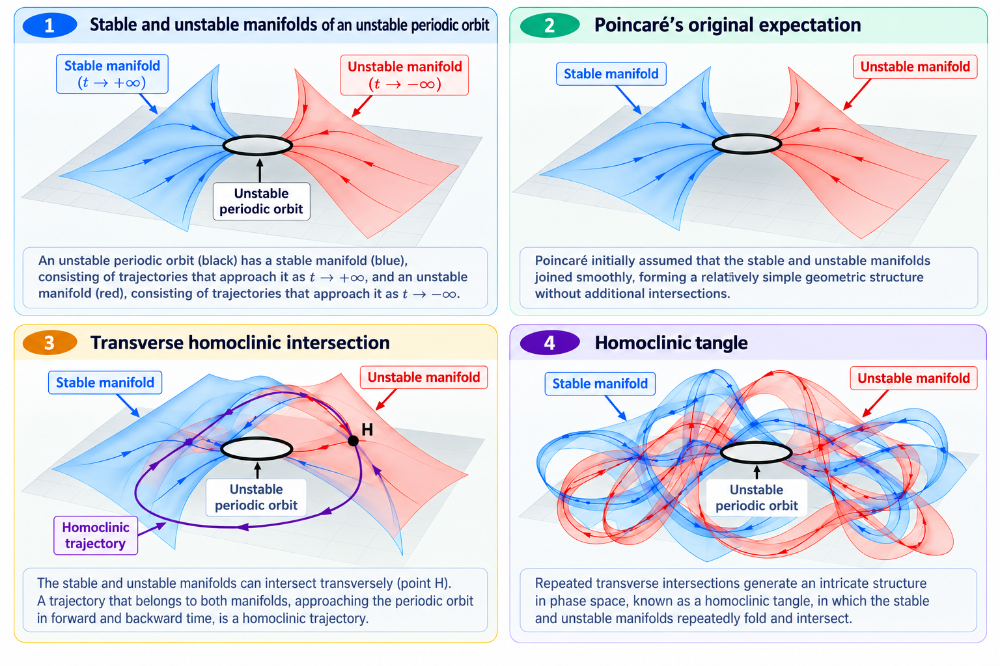
* **From Smooth Geometry to Infinite Complexity**:
  * Stable manifold $W^s(p)$ and unstable manifold $W^u(p)$ of a hyperbolic periodic point.
  * Poincaré's original smooth separatrix expectation vs. transverse homoclinic intersection ($x_0 \in W^s \cap W^u$).
  * Repeated area-preserving stretching, folding, and dense homoclinic tangle generating chaotic dynamics.

---

### 7. [Comparison: Simple Pendulum vs. Conservative Double Pendulum](code/generate_simple_vs_double_pendulum.py)
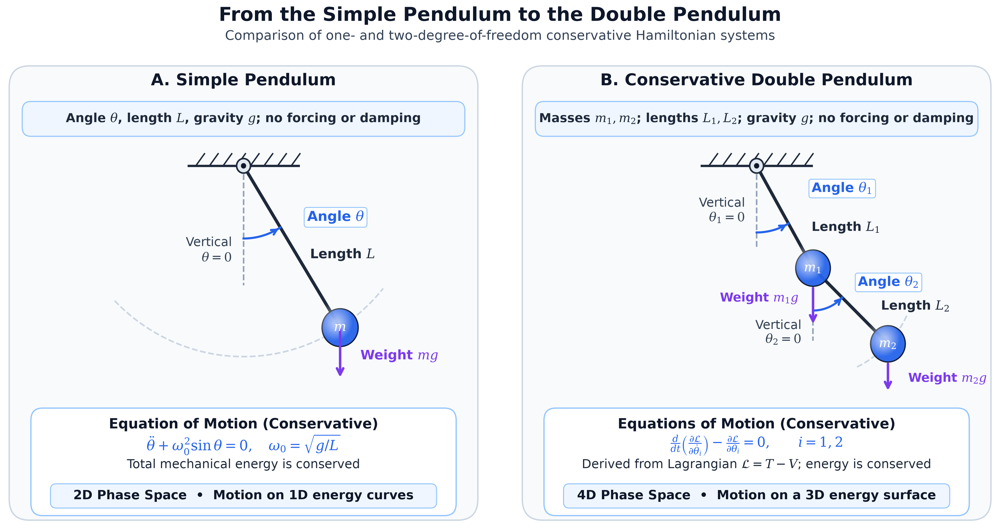
* **Degrees of Freedom & Phase Space Dimensionality**:
  * **Simple Pendulum**: 1 Degree of Freedom, 2D phase space $(\theta, \dot\theta)$, integrable motion governed by complete elliptic integrals.
  * **Conservative Double Pendulum**: 2 Degrees of Freedom, 4D phase space $(\theta_1, \theta_2, \dot\theta_1, \dot\theta_2)$, non-integrable coupled motion exhibiting coexisting regular tori and chaotic seas.
* **Script**: `code/generate_simple_vs_double_pendulum.py`

---

### 8. [Classical Conservative vs. Forced Dissipative Pendulum](code/generate_classical_vs_forced_pendulum.py)
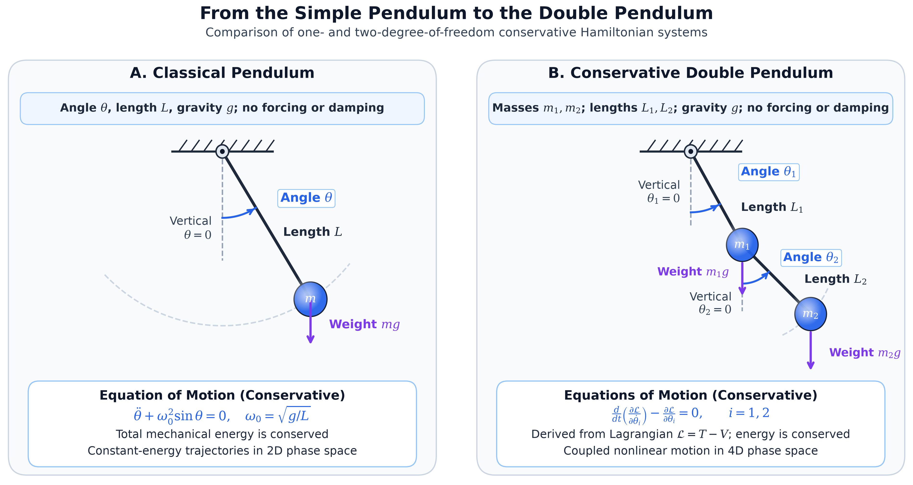
* **Autonomous vs. Nonautonomous Dynamics**:
  * **Conservative Pendulum**: Time-independent Hamiltonian, conserved total energy $E = \text{const}$, phase-space volume preserved by Liouville's theorem.
  * **Damped, Driven Pendulum**: External periodic forcing $A\cos(\Omega t)$, velocity damping $-\gamma\dot\theta$, nonautonomous 3D extended phase space with strange attractors.
* **Script**: `code/generate_classical_vs_forced_pendulum.py`

---

### 9. [Poincaré Sections of the Double Pendulum: Regularity, Resonance & Chaos](code/generate_poincare_sections_double_pendulum.py)
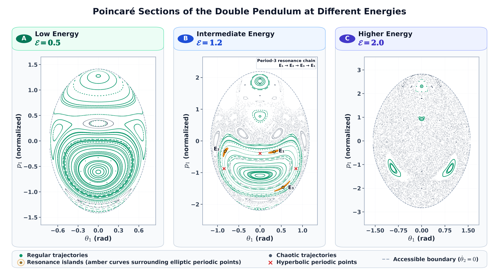
* **Energy-Dependent Phase Space Transitions**:
  * **Low Energy ($E = 3.0\text{ J}$)**: Nearly integrable motion; smooth, continuous Kolmogorov–Arnold–Moser (KAM) invariant curves.
  * **Intermediate Energy ($E = 8.5\text{ J}$)**: Resonance breakdown, period-3 island chain, and thin chaotic layers near separatrices.
  * **High Energy ($E = 15.0\text{ J}$)**: Vast connected chaotic sea with surviving island chains centered on stable periodic orbits.
* **Script**: `code/generate_poincare_sections_double_pendulum.py`

---

### 10. [Elliptic & Hyperbolic Periodic Points in an Area-Preserving Map](code/generate_elliptic_hyperbolic_periodic_points.py)
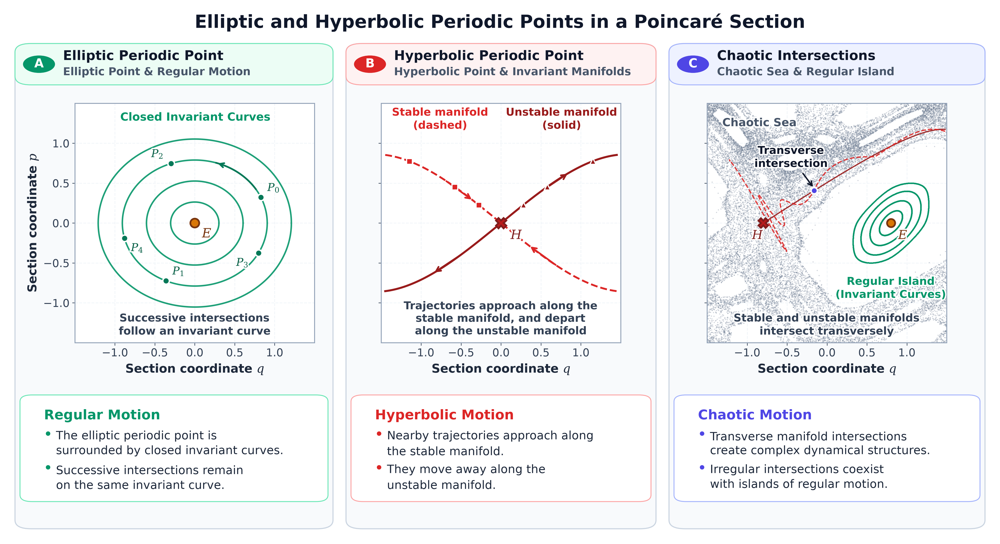
* **Local Geometry of Area-Preserving Maps**:
  * **Elliptic Point**: Complex conjugate eigenvalues on the unit circle ($\lambda_{1,2} = e^{\pm i\omega}$), surrounded by nested closed invariant curves (stable islands).
  * **Hyperbolic Point**: Real eigenvalues with reciprocal product ($\lambda_1\lambda_2 = 1, \lambda_1 > 1, \lambda_2 < 1$), forming stable and unstable invariant manifolds.
  * **Transverse Intersections**: Manifold intersections producing chaotic layers coexisting alongside regular islands.
* **Script**: `code/generate_elliptic_hyperbolic_periodic_points.py`

---

### 11. [Deterministic Chaos & Sensitivity to Initial Conditions](code/generate_double_pendulum_animation.py)
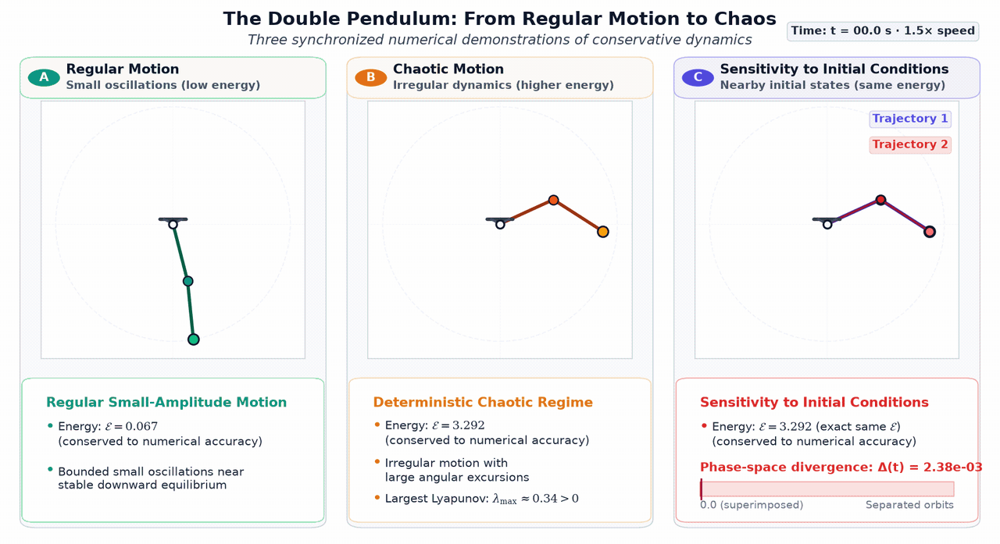
* **Numerical Demonstration of Chaos**:
  * **Panel 1 (Regular Low-Energy Motion)**: Predictable, periodic oscillations.
  * **Panel 2 (Nonlinear High-Energy Chaos)**: Complex, non-repeating trajectories exploring wide phase-space regions.
  * **Panel 3 (Sensitive Dependence)**: Two double pendulums initialized with a minute angular difference ($\Delta\theta_2 = 10^{-3}\text{ rad}$) stay synchronized initially before diverging exponentially.
* **Script**: `code/generate_double_pendulum_animation.py`

---

### 12. [Historical Portraits: Gaston Floquet & George David Birkhoff](code/generate_floquet_birkhoff_portraits.py)
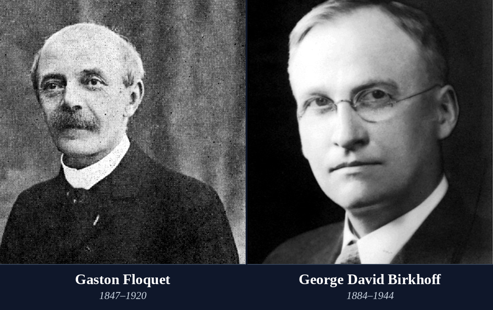
* **Historical Portrait Panel**:
  * **Gaston Floquet (1847–1920)**: Formulated Floquet theory (1883) for linear differential equations with periodic coefficients, establishing characteristic exponents and multipliers.
  * **George David Birkhoff (1884–1944)**: Proved Poincaré's Last Geometric Theorem (1913) and established the foundational ergodic theorem and modern topological dynamics (*Dynamical Systems*, 1927).
* **Script**: `code/generate_floquet_birkhoff_portraits.py`

---

### 13. [The Poincaré–Birkhoff Twist Theorem](code/generate_poincare_birkhoff_figure.py)
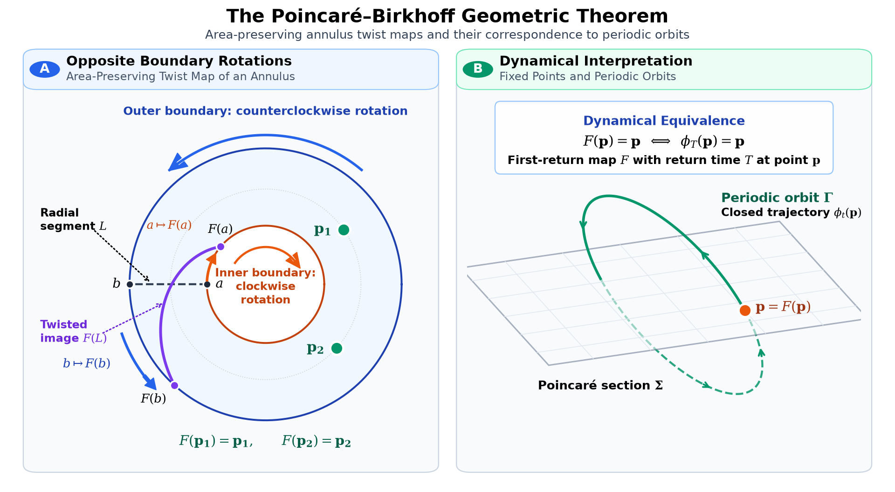
* **Two-Panel Geometric Exposition**:
  * **Panel 1 (Annulus Twist Map)**: An area-preserving map that twists concentric boundary circles in opposite directions must possess at least two fixed points.
  * **Panel 2 (Fixed Points to Periodic Orbits)**: Trajectory piercing a Poincaré section illustrates how fixed points of the return map correspond to closed periodic orbits in the continuous flow.
* **Script**: `code/generate_poincare_birkhoff_figure.py`

---

### 14. [Historical Timeline of Dynamical Systems (1881–1967)](code/generate_dynamical_systems_timeline.py)
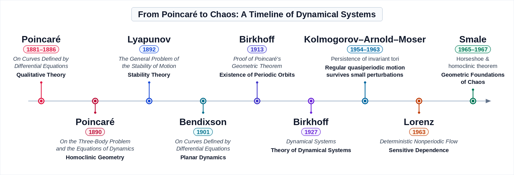
* **Milestones in the Evolution of Dynamics**:
  * **1881–1886**: Poincaré's qualitative theory of differential equations and phase-plane geometry.
  * **1890**: Poincaré's three-body memoir and discovery of homoclinic points.
  * **1892**: Lyapunov's stability theory and characteristic exponents.
  * **1901**: Bendixson's theorem on planar limit cycles.
  * **1913**: Birkhoff's proof of Poincaré's Geometric Theorem.
  * **1927**: Birkhoff publishes *Dynamical Systems*.
  * **1954–1963**: Kolmogorov–Arnold–Moser (KAM) theory and persistence of invariant tori under perturbation.
  * **1963**: Lorenz discovers sensitive dependence on initial conditions in deterministic nonperiodic flow.
  * **1965–1967**: Smale introduces the horseshoe map and geometric foundations of chaos.
* **Script**: `code/generate_dynamical_systems_timeline.py`

## 📁 Directory Structure

```
the_road_to_modern_dynamics_2/
├── README.md                                 # Comprehensive documentation & figure gallery
├── requirements.txt                          # Python dependencies
├── images/                                   # Pre-rendered high-res publication figures & animations
│   ├── the_road_to_modern_dynamics_2_cover.png
│   ├── poincare_planar_dynamics_infographic.png
│   ├── poincare_bendixson_portraits.png
│   ├── poincare_bendixson_theorem.png
│   ├── three_body_solutions_crtbp.png
│   ├── poincare_return_map_stability.png
│   ├── poincare_homoclinic_tangle.png
│   ├── simple_vs_double_pendulum.png
│   ├── classical_vs_forced_pendulum.png
│   ├── poincare_sections_double_pendulum.png
│   ├── elliptic_hyperbolic_periodic_points.png
│   ├── double_pendulum_regular_chaos_sensitivity.gif
│   ├── floquet_birkhoff_portraits.png
│   ├── poincare_birkhoff_theorem.png
│   ├── dynamical_systems_timeline.png
│   └── math/                                 # Mathematical equation renders (SVG & PNG)
├── code/                                     # Standalone, runnable generation scripts & simulation models
│   ├── generate_all_figures.py               # Master batch runner for all publication figures
│   ├── generate_classical_vs_forced_pendulum.py
│   ├── generate_double_pendulum_animation.py
│   ├── generate_dynamical_systems_timeline.py
│   ├── generate_elliptic_hyperbolic_periodic_points.py
│   ├── generate_floquet_birkhoff_portraits.py
│   ├── generate_poincare_bendixson_figure.py
│   ├── generate_poincare_bendixson_portraits.py
│   ├── generate_poincare_birkhoff_figure.py
│   ├── generate_poincare_planar_dynamics_infographic.py
│   ├── generate_poincare_return_map_stability.py
│   ├── generate_poincare_sections_double_pendulum.py
│   ├── generate_simple_vs_double_pendulum.py
│   ├── generate_three_body_solutions_crtbp.py
│   ├── poincare_sections_metadata.json
│   ├── poincare_sim_cache.pkl                # Precomputed Poincaré section orbits
│   └── sources/                              # High-resolution historical source portraits
└── tests/                                    # Automated validation suite
    ├── __init__.py
    └── test_figure_generation.py             # Numerical physics, conservation laws & rendering tests
```

---

## 🚀 Running the Code

### Dependencies
Install the required scientific Python packages:

```bash
pip install -r requirements.txt
```

### Generate All Figures
Execute the master runner to produce all publication figures into `images/`:

```bash
python3 code/generate_all_figures.py
```

### Generate Figures Individually
Each script is completely self-contained and accepts an optional output path:

```bash
python3 code/generate_poincare_planar_dynamics_infographic.py
python3 code/generate_poincare_bendixson_portraits.py
python3 code/generate_poincare_bendixson_figure.py
python3 code/generate_three_body_solutions_crtbp.py
python3 code/generate_poincare_return_map_stability.py
python3 code/generate_simple_vs_double_pendulum.py
python3 code/generate_classical_vs_forced_pendulum.py
python3 code/generate_poincare_sections_double_pendulum.py
python3 code/generate_elliptic_hyperbolic_periodic_points.py
python3 code/generate_floquet_birkhoff_portraits.py
python3 code/generate_poincare_birkhoff_figure.py
python3 code/generate_dynamical_systems_timeline.py
```

To render the 3-panel GIF animation:
```bash
python3 code/generate_double_pendulum_animation.py
```

---

## 🧪 Running the Test Suite

A comprehensive test suite validates both the physical/mathematical derivations and the rendering integrity:

```bash
# Run using standard library unittest
python3 -m unittest discover -s tests -t .

# Or run using pytest
pytest tests/ -v
```

The test suite validates:
1. **Double Pendulum Euler–Lagrange Matrix Equations**: Verified analytical consistency between the equations of motion $\mathbf{M}(\boldsymbol\theta)\ddot{\boldsymbol\theta} + \mathbf{C}(\boldsymbol\theta, \dot{\boldsymbol\theta}) = \mathbf{0}$ and variational Euler–Lagrange derivatives across arbitrary non-zero angles and velocities.
2. **Mechanical Energy Conservation**: Verified that total mechanical energy $E = T + V$ is conserved along numerical trajectories with relative error $\Delta E / E < 10^{-6}$.
3. **Linearized Normal Modes**: Verified that small-angle eigenfrequencies recover the analytical roots $\omega_{1,2}^2 = \frac{g}{L}(2 \mp \sqrt{2})$.
4. **Three-Body CRTBP Equilibria**: Verified that triangular Lagrange points $L_4, L_5$ form exact equilateral configurations ($r_1 = r_2 = 1$) with vanishing effective potential gradients $\nabla\Omega = (0, 0)$.
5. **Jacobi Integral Conservation**: Verified strict invariance of the Jacobi constant $C_J = 2\Omega - v^2$ ($dC_J/dt = 0$) along simulated orbits.
6. **Symplectic Area Preservation**: Verified that the Jacobian determinant of the return map satisfies $\det J = 1$ identically, with reciprocal eigenvalue product $\lambda_1 \lambda_2 = 1$.
7. **Rendering Integrity**: Isolated generation of 12 publication figures into temporary workspaces, confirming valid PNG magic headers, non-zero file sizes, and minimum resolution requirements.

---

## 📚 References & Historical Sources

1. **Euler, L. (1767).** *De motu rectilineo trium corporum se mutuo attrahentium.* Novi Commentarii Academiae Scientiarum Petropolitanae, 11, 144–151. [Digital copy: Euler Archive, University of the Pacific](https://scholarlycommons.pacific.edu/euler-works/327/)
2. **Lagrange, J.-L. (1772).** *Essai sur le problème des trois corps.* Prix de l'Académie Royale des Sciences de Paris, tome IX. Reprinted in *Œuvres de Lagrange*, vol. 6, pp. 229–331. [Digital text: Wikisource](https://fr.wikisource.org/wiki/M%C3%A9moires_extraits_des_recueils_de_l%E2%80%99Acad%C3%A9mie_des_sciences_de_Paris_et_de_l%E2%80%99Institut_de_France/Essai_sur_le_Probl%C3%A8me_des_trois_Corps)
3. **Poincaré, H. (1881–1886).** *Mémoire sur les courbes définies par une équation différentielle* (Parts I–II); *Sur les courbes définies par les équations différentielles* (Parts III–IV). Journal de Mathématiques Pures et Appliquées, 4 parts. Part I (1881), 3e série, 7, 375–422; Part II (1882), 3e série, 8, 251–296; Part III (1885), 4e série, 1, 167–244; Part IV (1886), 4e série, 2, 151–217. Digital copies: Numdam ([Part I](https://www.numdam.org/item/JMPA_1881_3_7__375_0/), [Part II](https://www.numdam.org/item/JMPA_1882_3_8__251_0/), [Part III](https://www.numdam.org/item/JMPA_1885_4_1__167_0/), [Part IV](https://www.numdam.org/item/JMPA_1886_4_2__151_0/)).
4. **Floquet, G. (1883).** *Sur les équations différentielles linéaires à coefficients périodiques.* Annales scientifiques de l'École Normale Supérieure, 2e série, 12, 47–88. [Digital copy: Numdam](https://doi.org/10.24033/asens.220)
5. **Poincaré, H. (1890).** *Sur le problème des trois corps et les équations de la dynamique.* Acta Mathematica, 13, 1–270. [Digital copy: Internet Archive](https://archive.org/details/actamathematica13upps)
6. **Lyapunov, A. M. (1892).** *The General Problem of the Stability of Motion* (Общая задача об устойчивости движения). Kharkov: Kharkov Mathematical Society. [Original Russian edition: Kharkiv University Digital Repository](https://escriptorium.karazin.ua/items/fe62d841-14f1-4248-b2bc-11ba9b314f17)
7. **Poincaré, H. (1892–1899).** *Les méthodes nouvelles de la mécanique céleste.* Paris: Gauthier-Villars, 3 vols. Vol. I, 1892; Vol. II, 1893; Vol. III, 1899. [Digital edition: ETH Zürich, e-rara](https://doi.org/10.3931/e-rara-421)
8. **Bendixson, I. (1901).** *Sur les courbes définies par des équations différentielles.* Acta Mathematica, 24, 1–88. [Digital edition: Springer / Acta Mathematica](https://doi.org/10.1007/BF02403068)
9. **Poincaré, H. (1912).** *Sur un théorème de géométrie.* Rendiconti del Circolo Matematico di Palermo, 33, 375–407. [Original journal article: Springer DOI](https://doi.org/10.1007/BF03015314)
10. **Birkhoff, G. D. (1912).** *Quelques théorèmes sur le mouvement des systèmes dynamiques.* Bulletin de la Société Mathématique de France, 40, 305–323. [Original paper: Numdam](https://www.numdam.org/item/BSMF_1912__40__305_0/)
11. **Birkhoff, G. D. (1913).** *Proof of Poincaré's Geometric Theorem.* Transactions of the American Mathematical Society, 14(1), 14–22. [Original paper: AMS PDF](https://www.ams.org/journals/tran/1913-014-01/S0002-9947-1913-1500933-9/S0002-9947-1913-1500933-9.pdf)
12. **Birkhoff, G. D. (1927).** *Dynamical Systems.* American Mathematical Society Colloquium Publications, Vol. IX. [Digitized edition: Internet Archive](https://archive.org/details/dynamicalsystems00birk) · [AMS DOI](https://doi.org/10.1090/COLL/009/01)
13. **Kolmogorov, A. N. (1954).** *On Conservation of Conditionally Periodic Motions for a Small Change in Hamilton's Function.* Doklady Akademii Nauk SSSR, 98(4), 527–530. [English translation: Harvard PDF](https://courses.seas.harvard.edu/climate/eli/Courses/APM203/2003fall/Kolmogorov-KAM-1954.pdf) · [CERN Document Server](https://cds.cern.ch/record/430016)
14. **Moser, J. (1962).** *On Invariant Curves of Area-Preserving Mappings of an Annulus.* Nachrichten der Akademie der Wissenschaften in Göttingen, Mathematisch-Physikalische Klasse, II, 1–20. [Digitized original: Google Books](https://books.google.com/books/about/On_Invariant_Curves_of_Area_preserving_M.html?id=DH11VIdcMPcC)
15. **Arnold, V. I. (1963).** *Proof of A. N. Kolmogorov's Theorem on the Preservation of Quasi-Periodic Motions under Small Perturbations of the Hamiltonian.* Russian Mathematical Surveys, 18(5), 9–36. [DOI: 10.1070/RM1963v018n05ABEH004130](https://doi.org/10.1070/RM1963v018n05ABEH004130)
16. **Lorenz, E. N. (1963).** *Deterministic Nonperiodic Flow.* Journal of the Atmospheric Sciences, 20(2), 130–141. [Original journal article](https://journals.ametsoc.org/view/journals/atsc/20/2/1520-0469_1963_020_0130_dnf_2_0_co_2.xml)
17. **Smale, S. (1965).** *Diffeomorphisms with Many Periodic Points.* In *Differential and Combinatorial Topology (A Symposium in Honor of Marston Morse)*, S. S. Cairns (Ed.), Princeton Mathematical Series, Vol. 27, Princeton University Press, pp. 63–80. [Bibliographic record: Math-Net.Ru](https://www.mathnet.ru/php/archive.phtml?jrnid=mat&option_lang=eng&paperid=439&wshow=paper)
18. **Adler, R. L., Konheim, A. G., & McAndrew, M. H. (1965).** *Topological Entropy.* Transactions of the American Mathematical Society, 114(2), 309–319. [AMS DOI](https://doi.org/10.1090/S0002-9947-1965-0175106-9)
19. **Smale, S. (1967).** *Differentiable Dynamical Systems.* Bulletin of the American Mathematical Society, 73(6), 747–817. [AMS DOI](https://doi.org/10.1090/S0002-9904-1967-11798-1)
20. **Oseledets, V. I. (1968).** *A Multiplicative Ergodic Theorem: Characteristic Lyapunov Exponents of Dynamical Systems.* Transactions of the Moscow Mathematical Society, 19, 197–231. [Bibliographic record and original Russian paper: Math-Net.Ru](https://www.mathnet.ru/php/archive.phtml?jrnid=mmo&option_lang=eng&paperid=214&wshow=paper)
21. **Devaney, R. L. (1989).** *An Introduction to Chaotic Dynamical Systems* (2nd ed.). Redwood City: Addison-Wesley. [Library bibliographic record: KIT](https://katalog.bibliothek.kit.edu/bib/61005)
22. **Barrow-Green, J. (1993).** *Poincaré and the Three Body Problem.* Ph.D. thesis, The Open University. [Open Research Online: ORO ID 57403](https://oro.open.ac.uk/57403/), [DOI: 10.21954/ou.ro.0000e03b](https://doi.org/10.21954/ou.ro.0000e03b)
23. **Barrow-Green, J. (1994).** *Oscar II's Prize Competition and the Error in Poincaré's Memoir on the Three Body Problem.* Archive for History of Exact Sciences, 48, 107–131. [DOI: 10.1007/BF00374436](https://doi.org/10.1007/BF00374436)
24. **Andersson, K. G. (1994).** *Poincaré's Discovery of Homoclinic Points.* Archive for History of Exact Sciences, 48, 133–147. [DOI: 10.1007/BF00374437](https://doi.org/10.1007/BF00374437)
25. **Dumas, H. S. (2014).** *The KAM Story: A Friendly Introduction to the Content, History, and Significance of Classical Kolmogorov–Arnold–Moser Theory.* World Scientific. [The KAM Story — World Scientific](https://doi.org/10.1142/8955)
26. **Rågstedt, M.** *From Order to Chaos: The Prize Competition in Honour of King Oscar II.* Institut Mittag-Leffler. [Historical account: Institut Mittag-Leffler](https://www.mittag-leffler.se/about-us/history/prize-competition/)

---

## 📄 License

This project is licensed under the MIT License - see the [LICENSE](../LICENSE) file for details.
