# Order and Chaos: The Road to Modern Dynamics III

This directory contains the standalone Python codebase, numerical simulation models, source orbital datasets, and scientific visualization suite supporting the technical article **Order and Chaos: The Road to Modern Dynamics III — From Smale’s horseshoe and KAM theory to planetary chaos**.

---

## 🌌 Overview & Mathematical Architecture

How can regular and chaotic motion coexist within the same deterministic system, and what does this imply for long-term predictability? Building on [Part I (*From Newton to Hamilton*)](../the_road_to_modern_dynamics/README.md) and [Part II (*From Poincaré to Chaos*)](../the_road_to_modern_dynamics_2/README.md), this project reconstructs the mathematical structures, numerical experiments, and celestial-mechanics datasets that explain the coexistence of order and chaos:

1. **Smale’s Horseshoe & Symbolic Dynamics (1960–1967)**:
   A transverse intersection between the stable and unstable manifolds of a hyperbolic fixed point produces a homoclinic tangle. Idealized by Smale’s horseshoe transformation $F$ acting on a square $R$, repeated stretching, compression, and folding produces a Cantor invariant set

   $$\Lambda = \bigcap_{n \in \mathbb{Z}} F^n(R), \qquad S_n = S_n^+ \cap S_n^-$$

   On $\Lambda$, every trajectory is topologically conjugate to a bi-infinite binary sequence

   $$(\ldots, s_{-2}, s_{-1}, s_0, s_1, s_2, \ldots), \qquad s_n \in \{0, 1\}$$

   governed by the shift map, yielding infinitely many periodic and nonperiodic trajectories, sensitive dependence on initial conditions, and topological entropy $\ln 2$ per iteration.

2. **Homoclinic Chaos in the Periodically Forced Pendulum**:
   While the unforced pendulum $\ddot{\theta} + \sin\theta = 0$ conserves mechanical energy and has coinciding stable and unstable manifolds along the separatrix passing through $(\theta, \dot{\theta}) = (\pi, 0)$, periodic external forcing

   $$\ddot{\theta} + \sin\theta = A\cos(\Omega t)$$

   breaks energy conservation while preserving phase-space area in the stroboscopic Poincaré map sampled at period $T = 2\pi/\Omega$, with $(\theta_n, \dot{\theta}_n)$ at $t_n = nT$. Separatrix splitting creates transverse homoclinic intersections and—by the Smale–Birkhoff homoclinic theorem—a horseshoe-type chaotic invariant set.

3. **Integrable Systems, Action–Angle Variables & KAM Theory (1954–1963)**:
   By the Liouville–Arnold theorem, compact connected regular level sets of an integrable two-degree-of-freedom Hamiltonian $H_0 = H_0(I_1, I_2)$ are invariant tori governed by

   $$\dot{I}_i = 0, \qquad \dot{\varphi}_i = \frac{\partial H_0}{\partial I_i} = \omega_i(I_1, I_2)$$

   Under a small perturbation $H(I, \varphi) = H_0(I) + \varepsilon H_1(I, \varphi)$, the actions vary as $\dot{I}_i = -\varepsilon \partial H_1/\partial \varphi_i$. Exact resonances

   $$m\omega_1 + n\omega_2 = 0, \qquad (m, n) \in \mathbb{Z}^2 \setminus \{(0, 0)\}$$

   produce the small-divisor problem and can break up into resonance islands and chaotic layers, whereas the Kolmogorov–Arnold–Moser (KAM) theorem guarantees that smoothly nondegenerate Diophantine tori persist as deformed quasiperiodic surfaces for sufficiently small $\varepsilon$.

4. **Dissipative Chaos & The Lorenz Attractor (1963)**:
   Reducing thermal convection in a fluid layer heated from below to three coupled modes (building on Barry Saltzman’s 1962 model), Edward Lorenz obtained

   $$\begin{aligned}
   \dot{x} &= \sigma(y - x) \\
   \dot{y} &= x(\rho - z) - y \\
   \dot{z} &= xy - \beta z
   \end{aligned}$$

   For the classical parameters $\sigma = 10$, $\rho = 28$, $\beta = 8/3$, the vector field has constant negative divergence $\nabla \cdot \mathbf{f} = -(\sigma + 1 + \beta) = -41/3 < 0$, contracting phase-space volumes exponentially according to

   $$V(t) = V(0)e^{-(\sigma + 1 + \beta)t}$$

   Trajectories converge toward the two-lobed strange attractor while exhibiting sensitive dependence measured by the maximal Lyapunov exponent and Lyapunov time:

   $$\lambda_{\max} = \lim_{t \to \infty} \frac{1}{t}\ln\!\left(\frac{\|\delta\mathbf{x}(t)\|}{\|\delta\mathbf{x}(0)\|}\right), \qquad t_L = \frac{1}{\lambda_{\max}}$$

5. **Planetary Chaos: From Lagrange–Laplace Secular Theory to Laskar (1781–2023)**:
   Separating planetary motion into an integrable Keplerian part and mutual perturbations,

   $$H = H_{\mathrm{Kep}} + \varepsilon H_{\mathrm{pert}}$$

   linear Lagrange–Laplace theory yields bounded secular oscillations of eccentricities and perihelia, whereas higher-order nonlinear couplings and secular resonances drive chaos in the Solar System with a Lyapunov time of

   $$t_L = \frac{1}{\lambda_{\max}} \simeq 5\ \mathrm{Myr}$$

   Using the four IMCCE *La2010a–d* orbital reconstructions (Laskar et al., 2011), this codebase reconstructs both the libration–circulation transitions of the Earth–Mars secular resonant angle $\theta = [\varphi(s_4) - \varphi(s_3)] - 2[\varphi(g_4) - \varphi(g_3)]$ near 48–50 Myr ago and the resulting divergence of Earth’s eccentricity beyond ~50 Myr.

---

## 📊 Scientific Figure & Animation Gallery

### 1. [From a Homoclinic Tangle to Smale’s Horseshoe](code/generate_homoclinic_tangle_to_horseshoe.py)
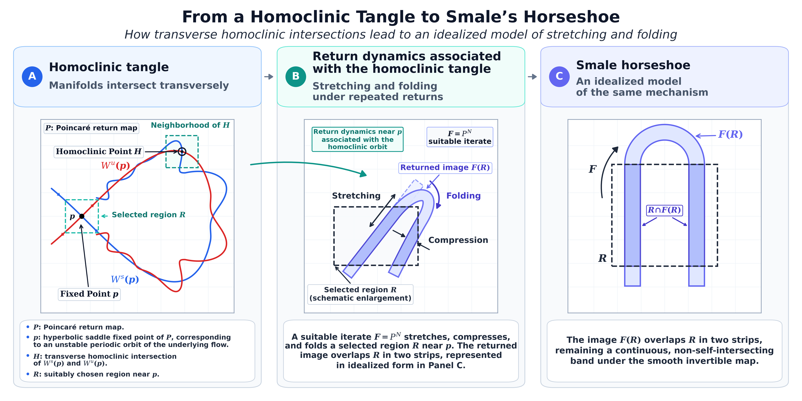
* **Three-Panel Conceptual Progression**:
  * **Panel A**: Transverse intersection of stable and unstable manifolds $W^s(p)$ and $W^u(p)$ at a homoclinic point $H$ in a Poincaré return map $P$.
  * **Panel B**: Stretching, compression, and folding of a region $R$ under a suitable iterate $F = P^N$.
  * **Panel C**: Idealized Smale horseshoe whose image $F(R)$ intersects $R$ in two vertical returning strips.
* **Script**: `code/generate_homoclinic_tangle_to_horseshoe.py`

---

### 2. [From Smale’s Horseshoe to the Invariant Set (Animation)](code/generate_horseshoe_iterations_animation.py)
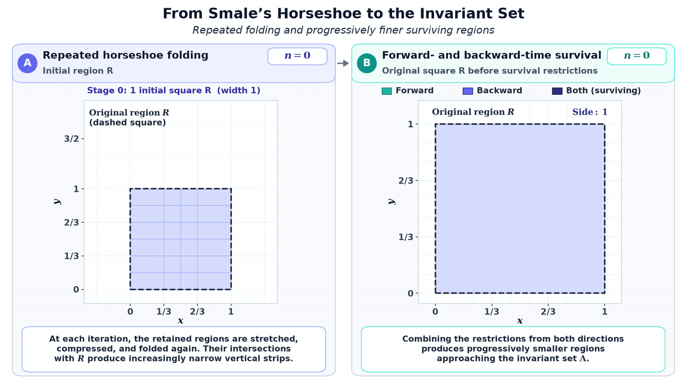
* **Iterative Cantor Construction**:
  * **Panel A**: Repeated stretching, compression, and folding of surviving regions produces thinner horseshoe bands and vertical backward-time strips $S_n^-$.
  * **Panel B**: Intersecting forward-time horizontal strips $S_n^+$ with vertical strips $S_n^-$ yields $S_n = S_n^+ \cap S_n^-$, converging toward the fractal invariant set $\Lambda$.
* **Outputs**: `images/horseshoe_stretching_folding_iterations.gif`, `.mp4`, `.png`
* **Script**: `code/generate_horseshoe_iterations_animation.py`

---

### 3. [Symbolic Dynamics: From Trajectories to Binary Sequences](code/generate_horseshoe_symbolic_dynamics.py)
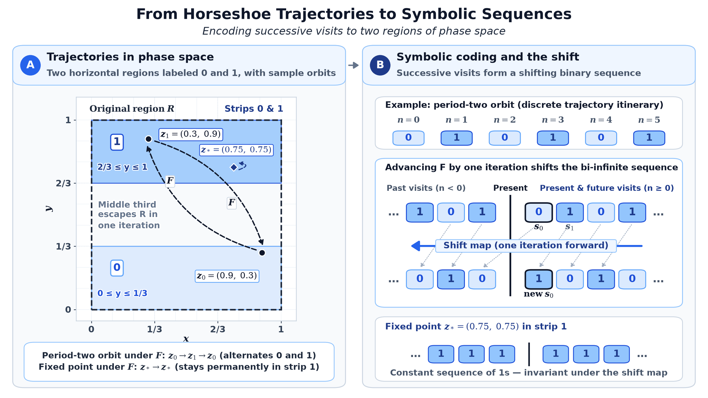
* **Topological Conjugacy to the Shift Map**:
  * **Panel A**: Horizontal returning strips labeled `0` and `1` with a period-two orbit alternating between $z_0$ and $z_1$ alongside the fixed point $z^* = (0.75, 0.75)$.
  * **Panel B**: Bi-infinite binary sequences showing past, present, and future visits; applying the map shifts the sequence by one position.
* **Script**: `code/generate_horseshoe_symbolic_dynamics.py`

---

### 4. [Unforced vs. Periodically Forced Pendulum (Animation)](code/generate_unforced_vs_forced_pendulum.py)
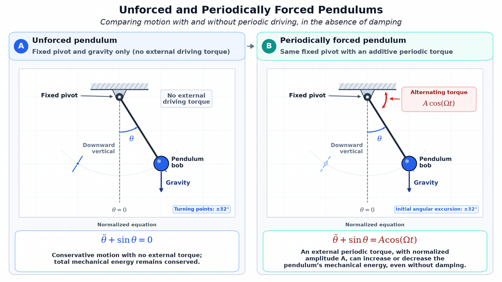
* **Direct Mechanical Comparison**:
  * **Panel A**: Unforced pendulum $\ddot{\theta} + \sin\theta = 0$ conserving mechanical energy.
  * **Panel B**: Periodically driven undamped pendulum $\ddot{\theta} + \sin\theta = A\cos(\Omega t)$ ($A = 0.20$, $\Omega = 0.80$) starting from identical initial conditions, showing energy exchange with the external torque.
* **Outputs**: `images/unforced_vs_forced_pendulum.gif`, `.mp4`, `.png`
* **Script**: `code/generate_unforced_vs_forced_pendulum.py`

---

### 5. [From the Pendulum Separatrix to Homoclinic Chaos (Animation)](code/generate_pendulum_homoclinic_chaos_animation.py)
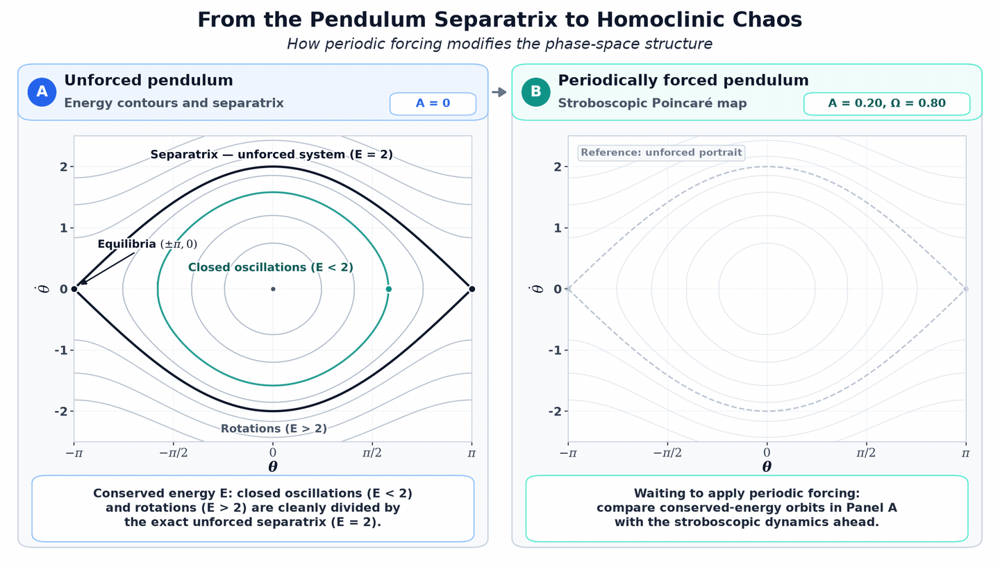
* **Separatrix Splitting & Stroboscopic Poincaré Map**:
  * **Panel A**: Unforced phase portrait with energy contours and coinciding stable/unstable separatrix manifolds.
  * **Panel B**: Numerically integrated stroboscopic Poincaré map at $T = 2\pi/\Omega$ ($A = 0.20$, $\Omega = 0.80$) revealing split manifolds, homoclinic tangle, chaotic sea, and surviving regular islands.
* **Outputs**: `images/pendulum_separatrix_to_homoclinic_chaos.gif`, `.mp4`, `.png`
* **Script**: `code/generate_pendulum_homoclinic_chaos_animation.py`

---

### 6. [Integrable Systems & Motion on Invariant Tori (Animation)](code/generate_integrable_torus_animation.py)
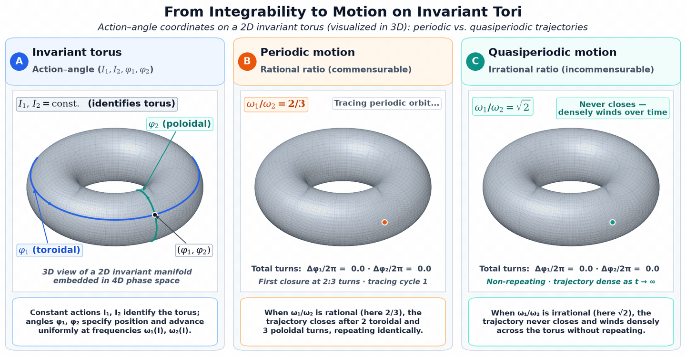
* **Liouville–Arnold Action–Angle Geometry**:
  * **Panel A**: Three-dimensional visualization of a two-dimensional invariant torus embedded in four-dimensional phase space, with constant actions $(I_1, I_2)$ identifying the torus and angles $(\varphi_1, \varphi_2)$ specifying position via $x = (R + r\cos\varphi_2)\cos\varphi_1$, $y = (R + r\cos\varphi_2)\sin\varphi_1$, $z = r\sin\varphi_2$.
  * **Panel B**: Periodic motion for rational frequency ratio $\omega_1/\omega_2 = 2/3$, closing after 2 toroidal and 3 poloidal turns and retracing identically.
  * **Panel C**: Quasiperiodic motion for irrational ratio $\omega_1/\omega_2 = \sqrt{2}$, never closing and winding densely over the torus as $t \to \infty$.
* **Outputs**: `images/integrable_torus_motion.gif`, `.mp4`, `.png`
* **Script**: `code/generate_integrable_torus_animation.py`

---

### 7. [Invariant Tori, Resonances, and the KAM Picture](code/generate_kam_invariant_tori_picture.py)
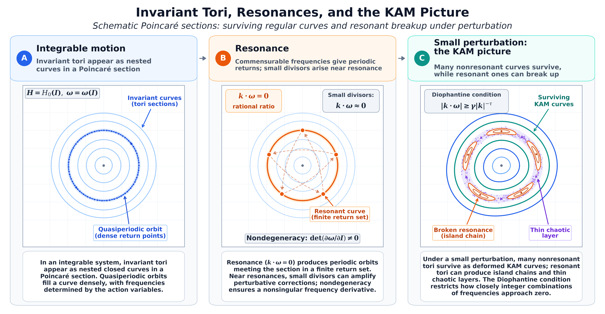
* **Schematic Poincaré Sections**:
  * **Panel A**: Integrable system with nested invariant curves densely filled by quasiperiodic orbits.
  * **Panel B**: Resonance $\mathbf{k} \cdot \boldsymbol{\omega} = 0$ producing finite periodic return points and the small-divisor problem.
  * **Panel C**: Small Hamiltonian perturbation showing surviving deformed KAM curves coexisting with resonance island chains and thin chaotic layers.
* **Script**: `code/generate_kam_invariant_tori_picture.py`

---

### 8. [Persistence and Disruption of Invariant Curves Under Periodic Forcing](code/generate_kam_poincare_sections.py)
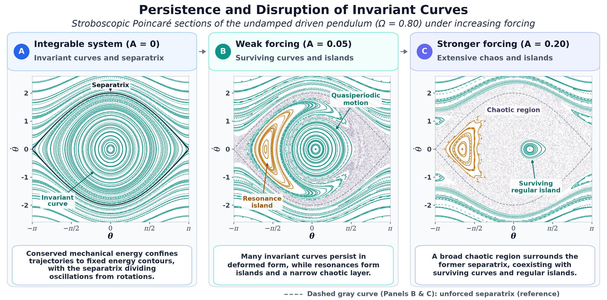
* **Numerical Stroboscopic Sections ($\Omega = 0.80$)**:
  * **Panel A ($A = 0$)**: Unforced energy contours and separatrix.
  * **Panel B ($A = 0.05$)**: Weak forcing with deformed surviving invariant curves, resonance islands, and narrow chaotic zones.
  * **Panel C ($A = 0.20$)**: Stronger forcing producing an extensive chaotic sea coexisting with regular islands and surviving invariant curves.
* **Script**: `code/generate_kam_poincare_sections.py`

---

### 9. [From Thermal Convection to the Lorenz Equations](code/generate_thermal_convection_to_lorenz.py)
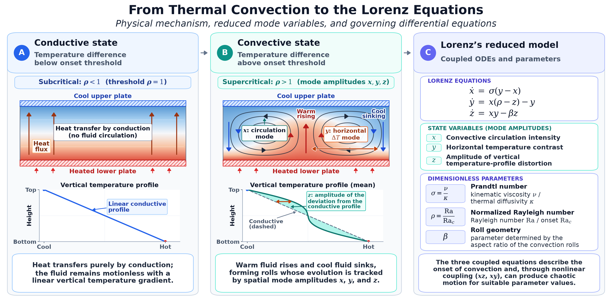
* **Physical Origin of the 3-Mode Model**:
  * **Panel A**: Pure heat conduction below the critical Rayleigh threshold ($\rho < 1$).
  * **Panel B**: Convection rolls above threshold ($\rho > 1$) parameterized by circulation intensity $x$ and temperature modes $y, z$.
  * **Panel C**: Coupled Lorenz equations with Prandtl number $\sigma = \nu/\kappa$, reduced Rayleigh number $\rho = \mathrm{Ra}/\mathrm{Ra}_c$, and geometric factor $\beta$.
* **Script**: `code/generate_thermal_convection_to_lorenz.py`

---

### 10. [The Lorenz Attractor in Three-Dimensional Phase Space](code/generate_lorenz_attractor.py)
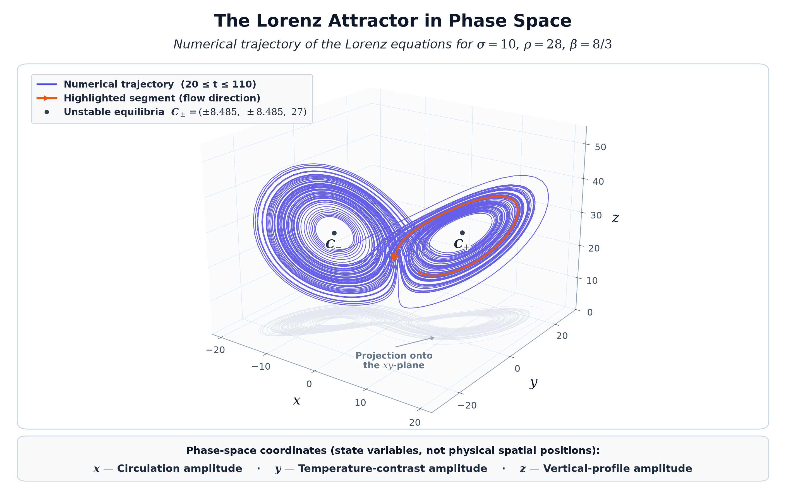
* **Strange Attractor Geometry ($\sigma = 10$, $\rho = 28$, $\beta = 8/3$)**:
  * Numerical trajectory circulating irregularly around the two unstable equilibria $C_+$ and $C_-$ after discarding the initial transient, with highlighted flow direction.
* **Script**: `code/generate_lorenz_attractor.py`

---

### 11. [Sensitive Dependence on Initial Conditions in the Lorenz System (Animation)](code/generate_lorenz_sensitive_dependence_animation.py)
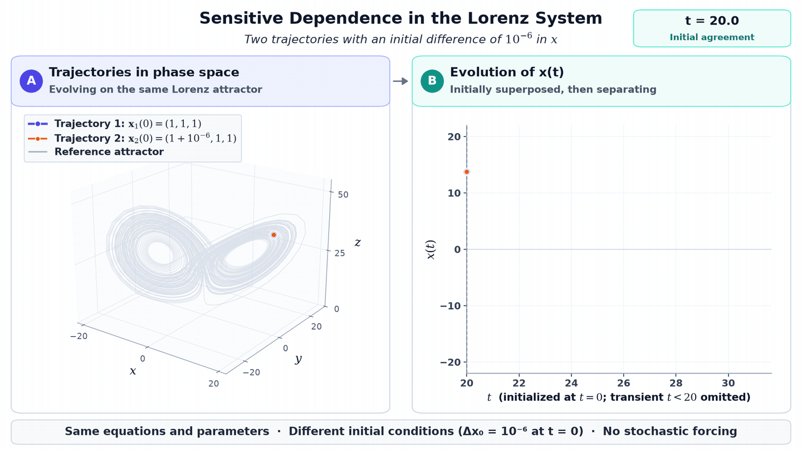
* **Synchronized Phase-Space & Time-Series Divergence**:
  * Compares $\mathbf{x}_1(0) = (1, 1, 1)$ and $\mathbf{x}_2(0) = (1 + 10^{-6}, 1, 1)$ on the attractor (Panel A) and in $x(t)$ (Panel B), illustrating exponential separation despite identical parameters and confinement to the same strange attractor.
* **Outputs**: `images/lorenz_sensitive_dependence.gif`, `.mp4`, `.png`
* **Script**: `code/generate_lorenz_sensitive_dependence_animation.py`

---

### 12. [Secular Evolution of a Planetary Orbit (Two-Mode Linear Model)](code/generate_secular_planetary_evolution.py)
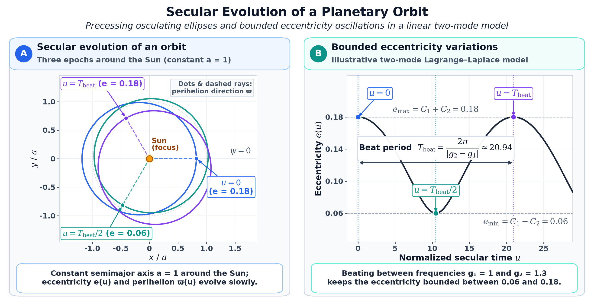
* **Linear Lagrange–Laplace Secular Dynamics**:
  * **Panel A**: Three osculating elliptical orbits ($a = 1$) at epochs $u = 0$, $T_{\mathrm{beat}}/2$, and $T_{\mathrm{beat}}$, showing slow evolution of eccentricity $e(u)$ and longitude of perihelion $\varpi(u)$.
  * **Panel B**: Bounded eccentricity oscillation $e(u) = |C_1 e^{i g_1 u} + C_2 e^{i g_2 u}| \in [0.06, 0.18]$ with beat period $T_{\mathrm{beat}} = 2\pi/|g_2 - g_1| \approx 20.94$ ($C_1 = 0.12$, $C_2 = 0.06$, $g_1 = 1$, $g_2 = 1.3$).
* **Script**: `code/generate_secular_planetary_evolution.py`

---

### 13. [Earth–Mars Secular Resonance and the Divergence of Planetary Orbital Reconstructions](code/generate_earth_mars_secular_resonance.py)
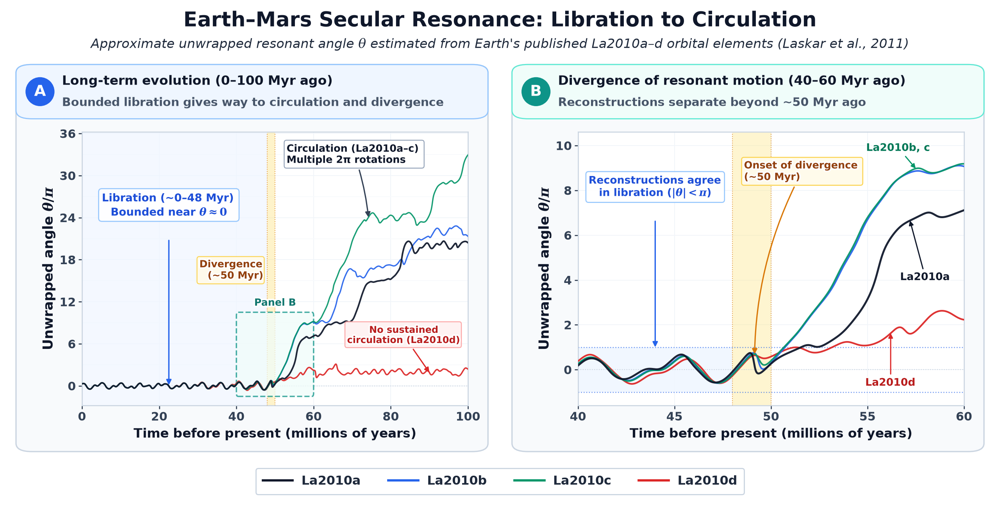
* **Approximate Reconstruction from Earth’s Published IMCCE *La2010a–d* Orbital Elements (Laskar et al., 2011)**:
  * **Panel A**: Approximate evolution of the unwrapped resonant angle $\theta = [\varphi(s_4) - \varphi(s_3)] - 2[\varphi(g_4) - \varphi(g_3)]$ over the past 100 Myr, showing bounded libration around $\theta \approx 0$ for ~48 Myr followed by divergence near 50 Myr ago (*La2010a–c* circulate through multiple $2\pi$ rotations whereas *La2010d* shows no sustained circulation).
  * **Panel B**: Enlarged view of the 40–60 Myr interval showing the separation of the four reconstructions near 50 Myr ago. (Estimated from Earth’s orbital elements rather than the full planetary proper variables of the original study.)
* **Source Data**: `data/La2010{a,b,c,d}_alkhqp3.dat`
* **Script**: `code/generate_earth_mars_secular_resonance.py`

---

### 14. [Divergence of Long-Term Orbital Solutions (*La2010a–d*)](code/generate_la2010_orbital_divergence.py)
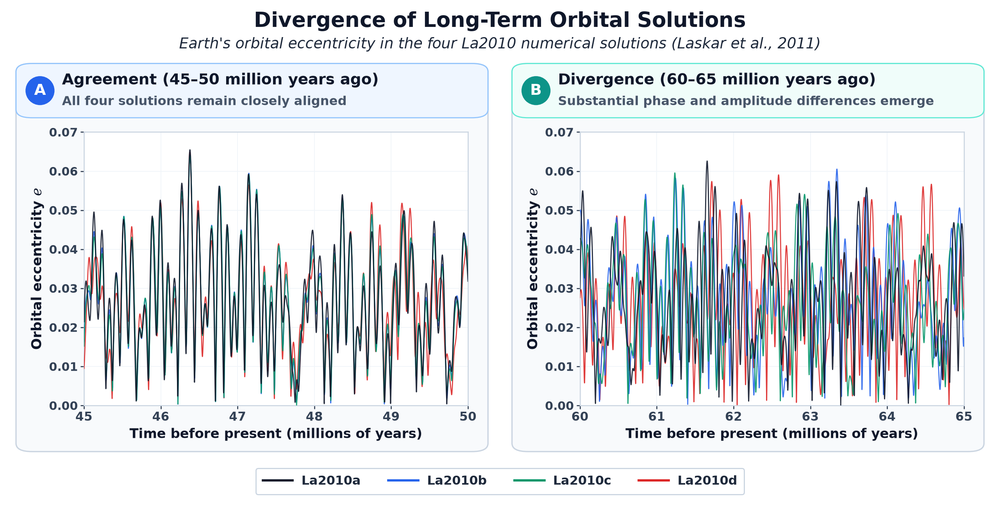
* **Predictability Horizon in the Solar System**:
  * **Panel A (45–50 Myr ago)**: Earth’s orbital eccentricity remains closely aligned across all four *La2010a–d* reconstructions.
  * **Panel B (60–65 Myr ago)**: Pronounced divergence appears between the four solutions as chaotic dynamics amplifies small ephemeris and modeling differences.
* **Source Data**: `data/La2010{a,b,c,d}_ecc3L.dat`
* **Script**: `code/generate_la2010_orbital_divergence.py`

---

### 15. [Historical Timeline: From Poincaré to Laskar (1890–2009)](code/generate_order_chaos_timeline.py)
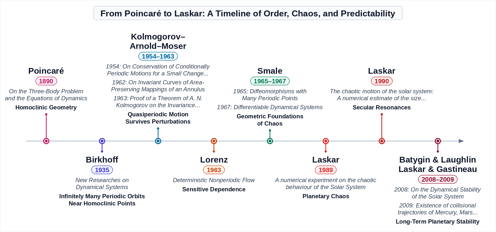
* **Conceptual Milestones**:
  * Traces key landmarks from Poincaré’s homoclinic geometry (1890) and Birkhoff’s periodic orbits (1935) through KAM theory (1954–1963), Lorenz’s sensitive dependence (1963), Smale’s geometric foundations of chaos (1965–1967), Laskar’s planetary chaos and secular resonances (1989–1990), and Batygin & Laughlin and Laskar & Gastineau’s studies of long-term planetary stability (2008–2009).
* **Script**: `code/generate_order_chaos_timeline.py`

---

## 📁 Directory Structure

```
the_road_to_modern_dynamics_3/
├── README.md                                                 # Project documentation, figure gallery & bibliography
├── requirements.txt                                          # Python dependencies
├── data/                                                     # Source IMCCE La2010 orbital datasets (Laskar et al., 2011)
│   ├── La2010a_alkhqp3.dat
│   ├── La2010b_alkhqp3.dat
│   ├── La2010c_alkhqp3.dat
│   ├── La2010d_alkhqp3.dat
│   ├── La2010a_ecc3L.dat
│   ├── La2010b_ecc3L.dat
│   ├── La2010c_ecc3L.dat
│   ├── La2010d_ecc3L.dat
│   └── README.TXT                                            # Original IMCCE La2010 format specification
├── images/                                                   # Pre-rendered scientific figures, animations & equations
│   ├── homoclinic_tangle_to_horseshoe.png
│   ├── horseshoe_stretching_folding_iterations.{gif,mp4,png}
│   ├── horseshoe_symbolic_dynamics.png
│   ├── unforced_vs_forced_pendulum.{gif,mp4,png}
│   ├── pendulum_separatrix_to_homoclinic_chaos.{gif,mp4,png}
│   ├── integrable_torus_motion.{gif,mp4,png}
│   ├── kam_invariant_tori_picture.png
│   ├── kam_poincare_sections.png
│   ├── thermal_convection_to_lorenz.png
│   ├── lorenz_attractor.png
│   ├── lorenz_sensitive_dependence.{gif,mp4,png}
│   ├── secular_planetary_evolution.png
│   ├── earth_mars_secular_resonance.png
│   ├── la2010_orbital_divergence.png
│   ├── order_chaos_predictability_timeline.png
│   └── math/                                                 # Compiled display-math equation PNGs
├── code/                                                     # Standalone, runnable scientific figure & animation scripts
│   ├── generate_all_figures.py                               # Master batch runner
│   ├── generate_homoclinic_tangle_to_horseshoe.py
│   ├── generate_horseshoe_iterations_animation.py
│   ├── generate_horseshoe_symbolic_dynamics.py
│   ├── generate_unforced_vs_forced_pendulum.py
│   ├── generate_pendulum_homoclinic_chaos_animation.py
│   ├── generate_integrable_torus_animation.py
│   ├── generate_kam_invariant_tori_picture.py
│   ├── generate_kam_poincare_sections.py
│   ├── generate_thermal_convection_to_lorenz.py
│   ├── generate_lorenz_attractor.py
│   ├── generate_lorenz_sensitive_dependence_animation.py
│   ├── generate_secular_planetary_evolution.py
│   ├── generate_earth_mars_secular_resonance.py
│   ├── generate_la2010_orbital_divergence.py
│   └── generate_order_chaos_timeline.py
└── tests/                                                    # Automated mathematical & rendering validation suite
    ├── __init__.py
    ├── test_physics_models.py                                # Horseshoe, pendulum, torus, KAM, Lorenz & La2010 unit tests
    └── test_figure_generation.py                             # Asset integrity, hygiene & isolated rendering tests
```

---

## 🚀 Running the Code

### Dependencies
Install the required scientific Python packages (`ffmpeg` on `PATH` is also required when regenerating `.mp4` and `.gif` animations):

```bash
cd the_road_to_modern_dynamics_3
python3 -m venv venv
source venv/bin/activate
pip install -r requirements.txt
```

### Generate All Static Scientific Figures
Execute the master runner to regenerate all 10 static scientific figures into `images/`:

```bash
python3 code/generate_all_figures.py
```

To also regenerate all 5 scientific animations (`.mp4`, `.gif`, and `.png` poster frames):

```bash
python3 code/generate_all_figures.py --include-animations
```

### Generate Figures & Animations Individually
Every script is self-contained and writes directly to `images/` (reading local IMCCE datasets from `data/`):

```bash
# Static scientific figures
python3 code/generate_homoclinic_tangle_to_horseshoe.py
python3 code/generate_horseshoe_symbolic_dynamics.py
python3 code/generate_kam_invariant_tori_picture.py
python3 code/generate_kam_poincare_sections.py
python3 code/generate_thermal_convection_to_lorenz.py
python3 code/generate_lorenz_attractor.py
python3 code/generate_secular_planetary_evolution.py
python3 code/generate_earth_mars_secular_resonance.py
python3 code/generate_la2010_orbital_divergence.py
python3 code/generate_order_chaos_timeline.py

# Scientific animations (MP4, GIF & poster PNG; requires ffmpeg)
python3 code/generate_horseshoe_iterations_animation.py
python3 code/generate_unforced_vs_forced_pendulum.py
python3 code/generate_pendulum_homoclinic_chaos_animation.py
python3 code/generate_integrable_torus_animation.py
python3 code/generate_lorenz_sensitive_dependence_animation.py
```

---

## 🧪 Running the Test Suite

Run the automated test suite to verify physical invariants, source datasets, and figure generation integrity:

```bash
# Using Python's standard library unittest
python3 -m unittest discover -s tests -t . -v

# Or using pytest
pytest tests/ -v
```

The test suite is organized into `tests/test_physics_models.py` and `tests/test_figure_generation.py` and validates:
1. **Smale’s Horseshoe & Symbolic Dynamics**: Period-two orbit ($z_0 \leftrightarrow z_1$), fixed point $z^* = (0.75, 0.75)$, uniform hyperbolicity (contraction $1/3$, expansion $3$, $|\det DF| = 1$), middle-strip escape, and topological entropy $\ln 2$.
2. **Unforced & Forced Pendulum Dynamics**: Energy conservation $H = \frac{1}{2}\dot{\theta}^2 - \cos\theta$ in the unforced case, saddle energy $E = +1$, energy exchange under periodic driving $A\cos(\Omega t)$, and zero Hamiltonian flow divergence (phase-space area preservation).
3. **Integrable Torus & KAM Properties**: Exact closure at $t = 2\pi$ for rational $\omega_1/\omega_2 = 2/3$, non-closure for $\omega_1/\omega_2 = \sqrt{2}$, torus implicit surface and unit normal verification, exact resonance, and Diophantine lower bound for $\sqrt{2}$.
4. **Lorenz Phase-Space Contraction & Sensitivity**: Constant divergence $\nabla \cdot \mathbf{f} = -41/3$, exact unstable equilibria $C_\pm$, and exponential divergence from a $10^{-6}$ perturbation in $x(0)$.
5. **Secular Two-Mode Model & *La2010* Orbital Reconstructions**: Analytical bounds $e \in [0.06, 0.18]$, beat period $T_{\mathrm{beat}} = 2\pi/0.3$, presence/integrity of all 8 IMCCE *La2010a–d* datasets, Earth–Mars libration/circulation regimes, and $>2.5\times$ RMS eccentricity divergence growth between 45–50 Myr and 60–65 Myr.
6. **Scientific Assets, Public Hygiene & Isolated Rendering**: Valid headers, dimensions, and non-zero sizes for all 25 pre-rendered scientific figures/animations and compiled equation images, absence of excluded cover/portrait files, and isolated static figure re-rendering into temporary directories.

---

## 📚 References & Further Reading

1. **Lagrange, J.-L. (1781/1783).** *Théorie des variations séculaires des éléments des Planètes. Première Partie.* Nouveaux Mémoires de l'Académie royale des Sciences et Belles-Lettres de Berlin, année 1781 (published 1783), 199–276. Reprinted in *Œuvres de Lagrange*, Tome V, 125–207. [Original text: Wikisource](https://fr.wikisource.org/wiki/M%C3%A9moires_extraits_des_recueils_de_l%E2%80%99Acad%C3%A9mie_royale_de_Berlin/Th%C3%A9orie_des_variations_s%C3%A9culaires_des_%C3%A9l%C3%A9ments_des_Plan%C3%A8tes/1)
2. **Laplace, P.-S. (1784/1787).** *Mémoire sur les inégalités séculaires des planètes et des satellites.* Mémoires de l'Académie royale des Sciences de Paris, année 1784 (published 1787), 1–50. Reprinted in *Œuvres complètes de Laplace*, Tome XI, 49–92. [Original text: Wikisource](https://fr.wikisource.org/wiki/%C5%92uvres_compl%C3%A8tes_de_Laplace/M%C3%A9moire_sur_les_in%C3%A9galit%C3%A9s_s%C3%A9culaires_des_plan%C3%A8tes_et_des_satellites) · [BnF](https://catalogue.bnf.fr/ark:/12148/cb30739053z)
3. **Poincaré, H. (1881).** *Mémoire sur les courbes définies par une équation différentielle.* Journal de Mathématiques Pures et Appliquées, 3e série, 7, 375–422. [Original text: Numdam](https://www.numdam.org/item/JMPA_1881_3_7__375_0/)
4. **Poincaré, H. (1890).** *Sur le problème des trois corps et les équations de la dynamique.* Acta Mathematica, 13, 1–270. [DOI: 10.1007/BF02392506](https://doi.org/10.1007/BF02392506) · [Digital copy: Internet Archive](https://archive.org/details/actamathematica13upps)
5. **Poincaré, H. (1892–1899).** *Les méthodes nouvelles de la mécanique céleste.* Paris: Gauthier-Villars, 3 vols. Vol. I, 1892; Vol. II, 1893; Vol. III, 1899. [Digital edition: ETH Zürich, e-rara](https://doi.org/10.3931/e-rara-421)
6. **Birkhoff, G. D. (1935).** *Nouvelles recherches sur les systèmes dynamiques.* Memoriae Pontificiae Academiae Scientiarum Novi Lyncaei, 1, 85–216. Reprinted in *Collected Mathematical Papers*, Vol. II, 530–659. [Collected Papers Vol. II: Internet Archive](https://archive.org/details/dli.ernet.242871) · [zbMATH](https://zbmath.org/16.23401)
7. **Cartwright, M. L., & Littlewood, J. E. (1945).** *On non-linear differential equations of the second order: I.* Journal of the London Mathematical Society, 20(3), 180–189. [DOI: 10.1112/jlms/s1-20.3.180](https://doi.org/10.1112/jlms/s1-20.3.180)
8. **Levinson, N. (1949).** *A second order differential equation with singular solutions.* Annals of Mathematics, 50(1), 127–153. [DOI: 10.2307/1969357](https://doi.org/10.2307/1969357)
9. **Kolmogorov, A. N. (1954).** *On Conservation of Conditionally Periodic Motions for a Small Change in Hamilton's Function.* Doklady Akademii Nauk SSSR, 98(4), 527–530. English translation in *Stochastic Behavior in Classical and Quantum Hamiltonian Systems*, Lecture Notes in Physics, Vol. 93, Springer (1979), pp. 51–56. [DOI: 10.1007/BFb0021737](https://doi.org/10.1007/BFb0021737)
10. **Moser, J. (1962).** *On Invariant Curves of Area-Preserving Mappings of an Annulus.* Nachrichten der Akademie der Wissenschaften in Göttingen, Mathematisch-Physikalische Klasse, II, 1–20. [Russian translation: Math-Net.Ru](https://www.mathnet.ru/eng/mat236)
11. **Saltzman, B. (1962).** *Finite Amplitude Free Convection as an Initial Value Problem—I.* Journal of the Atmospheric Sciences, 19(4), 329–341. [DOI: 10.1175/1520-0469(1962)019&lt;0329:FAFCAA&gt;2.0.CO;2](https://doi.org/10.1175/1520-0469%281962%29019%3C0329%3AFAFCAA%3E2.0.CO%3B2)
12. **Arnold, V. I. (1963).** *A Theorem of Liouville Concerning Integrable Problems of Dynamics.* Sibirskii Matematicheskii Zhurnal, 4(2), 471–474. [Original paper: Math-Net.Ru](https://www.mathnet.ru/eng/smj4603)
13. **Arnold, V. I. (1963).** *Proof of a Theorem of A. N. Kolmogorov on the Invariance of Quasi-Periodic Motions under Small Perturbations of the Hamiltonian.* Russian Mathematical Surveys, 18(5), 9–36. [DOI: 10.1070/RM1963v018n05ABEH004130](https://doi.org/10.1070/RM1963v018n05ABEH004130) · [Math-Net.Ru](https://www.mathnet.ru/eng/rm6404)
14. **Arnold, V. I. (1963).** *Small Denominators and Problems of Stability of Motion in Classical and Celestial Mechanics.* Russian Mathematical Surveys, 18(6), 85–191. [DOI: 10.1070/RM1963v018n06ABEH001143](https://doi.org/10.1070/RM1963v018n06ABEH001143)
15. **Lorenz, E. N. (1963).** *Deterministic Nonperiodic Flow.* Journal of the Atmospheric Sciences, 20(2), 130–141. [DOI: 10.1175/1520-0469(1963)020&lt;0130:DNF&gt;2.0.CO;2](https://doi.org/10.1175/1520-0469%281963%29020%3C0130%3ADNF%3E2.0.CO%3B2)
16. **Adler, R. L., Konheim, A. G., & McAndrew, M. H. (1965).** *Topological Entropy.* Transactions of the American Mathematical Society, 114(2), 309–319. [DOI: 10.1090/S0002-9947-1965-0175106-9](https://doi.org/10.1090/S0002-9947-1965-0175106-9)
17. **Smale, S. (1965).** *Diffeomorphisms with Many Periodic Points.* In *Differential and Combinatorial Topology (A Symposium in Honor of Marston Morse)*, S. S. Cairns (Ed.), Princeton Mathematical Series, Vol. 27, Princeton University Press, pp. 63–80. [DOI: 10.1515/9781400874842-006](https://doi.org/10.1515/9781400874842-006)
18. **Smale, S. (1967).** *Differentiable Dynamical Systems.* Bulletin of the American Mathematical Society, 73(6), 747–817. [DOI: 10.1090/S0002-9904-1967-11798-1](https://doi.org/10.1090/S0002-9904-1967-11798-1)
19. **Ruelle, D., & Takens, F. (1971).** *On the Nature of Turbulence.* Communications in Mathematical Physics, 20, 167–192. [DOI: 10.1007/BF01646553](https://doi.org/10.1007/BF01646553)
20. **Lorenz, E. N. (1972).** *Predictability: Does the Flap of a Butterfly's Wings in Brazil Set Off a Tornado in Texas?* Lecture delivered at the 139th meeting of the American Association for the Advancement of Science, December 29, 1972. [Original lecture text (PDF)](https://home.cs.colorado.edu/~lizb/chaos/lorenz_1972.pdf)
21. **Arnold, V. I. (1989).** *Mathematical Methods of Classical Mechanics* (2nd ed.). Springer, §§49–51. [DOI: 10.1007/978-1-4757-2063-1](https://doi.org/10.1007/978-1-4757-2063-1)
22. **Laskar, J. (1989).** *A numerical experiment on the chaotic behaviour of the Solar System.* Nature, 338, 237–238. [DOI: 10.1038/338237a0](https://doi.org/10.1038/338237a0) · [ADS](https://ui.adsabs.harvard.edu/abs/1989Natur.338..237L/abstract)
23. **Laskar, J. (1990).** *The chaotic motion of the solar system: A numerical estimate of the size of the chaotic zones.* Icarus, 88(2), 266–291. [DOI: 10.1016/0019-1035(90)90084-M](https://doi.org/10.1016/0019-1035(90)90084-M) · [ADS](https://ui.adsabs.harvard.edu/abs/1990Icar...88..266L/abstract)
24. **Laskar, J., Quinn, T., & Tremaine, S. (1992).** *Confirmation of resonant structure in the solar system.* Icarus, 95(1), 148–152. [DOI: 10.1016/0019-1035(92)90196-E](https://doi.org/10.1016/0019-1035(92)90196-E) · [ADS](https://ui.adsabs.harvard.edu/abs/1992Icar...95..148L/abstract)
25. **Sussman, G. J., & Wisdom, J. (1992).** *Chaotic Evolution of the Solar System.* Science, 257(5066), 56–62. [DOI: 10.1126/science.257.5066.56](https://doi.org/10.1126/science.257.5066.56) · [ADS](https://ui.adsabs.harvard.edu/abs/1992Sci...257...56S/abstract) · [MIT repository](https://dspace.mit.edu/entities/publication/73320f5f-2270-4118-bc98-fe3aa0c7411c)
26. **Lichtenberg, A. J., & Lieberman, M. A. (1992).** *Regular and Chaotic Dynamics* (2nd ed.). Springer. [DOI: 10.1007/978-1-4757-2184-3](https://doi.org/10.1007/978-1-4757-2184-3)
27. **Murray, C. D., & Dermott, S. F. (1999).** *Solar System Dynamics.* Cambridge University Press. [DOI: 10.1017/CBO9781139174817](https://doi.org/10.1017/CBO9781139174817) · [Companion website](https://ssdbook.maths.qmul.ac.uk/index.html)
28. **Ott, E. (2002).** *Chaos in Dynamical Systems* (2nd ed.). Cambridge University Press. [DOI: 10.1017/CBO9780511803260](https://doi.org/10.1017/CBO9780511803260)
29. **Hilborn, R. C. (2004).** *Sea Gulls, Butterflies, and Grasshoppers: A Brief History of the Butterfly Effect in Nonlinear Dynamics.* American Journal of Physics, 72(4), 425–427. [DOI: 10.1119/1.1636492](https://doi.org/10.1119/1.1636492)
30. **Batygin, K., & Laughlin, G. (2008).** *On the Dynamical Stability of the Solar System.* The Astrophysical Journal, 683(2), 1207–1216. [DOI: 10.1086/589232](https://doi.org/10.1086/589232)
31. **Laskar, J., & Gastineau, M. (2009).** *Existence of collisional trajectories of Mercury, Mars and Venus with the Earth.* Nature, 459(7248), 817–819. [DOI: 10.1038/nature08096](https://doi.org/10.1038/nature08096) · [ADS](https://ui.adsabs.harvard.edu/abs/2009Natur.459..817L/abstract)
32. **Laskar, J., Fienga, A., Gastineau, M., & Manche, H. (2011).** *La2010: A new orbital solution for the long-term motion of the Earth.* Astronomy & Astrophysics, 532, A89. [DOI: 10.1051/0004-6361/201116836](https://doi.org/10.1051/0004-6361/201116836) · [ADS](https://ui.adsabs.harvard.edu/abs/2011A%26A...532A..89L/abstract) · [Numerical data: IMCCE](https://ssp.imcce.fr/insola/earth/online/earth/La2010/index.html)
33. **Freiberger, M. (2017).** *Smale's chaotic horseshoe.* Plus Maths, University of Cambridge. [Original article](https://plus.maths.org/smales-horseshoe)
34. **Mogavero, F., Hoang, N. H., & Laskar, J. (2023).** *Timescales of Chaos in the Inner Solar System: Lyapunov Spectrum and Quasi-integrals of Motion.* Physical Review X, 13(2), 021018. [DOI: 10.1103/PhysRevX.13.021018](https://doi.org/10.1103/PhysRevX.13.021018) · [ADS](https://ui.adsabs.harvard.edu/abs/2023PhRvX..13b1018M/abstract)
35. **Lewis, J. M., & Lakshmivarahan, S. (2024).** *The Saltzman–Lorenz Exchange in 1961: Bridge to Chaos Theory.* Bulletin of the American Meteorological Society, 105(7), E1388–E1398. [DOI: 10.1175/BAMS-D-23-0157.1](https://doi.org/10.1175/BAMS-D-23-0157.1)
36. **Koiller, J., & Rajapakse, I. (2025).** *Apropos the Long-Lost Letter from Levinson to Smale, Now Found!* Notices of the American Mathematical Society, 72(7), 748–754. [DOI: 10.1090/noti3167](https://doi.org/10.1090/noti3167)

---

## 📄 License

This project is licensed under the MIT License - see the [LICENSE](../LICENSE) file for details.

